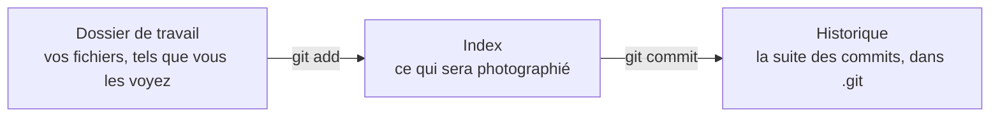
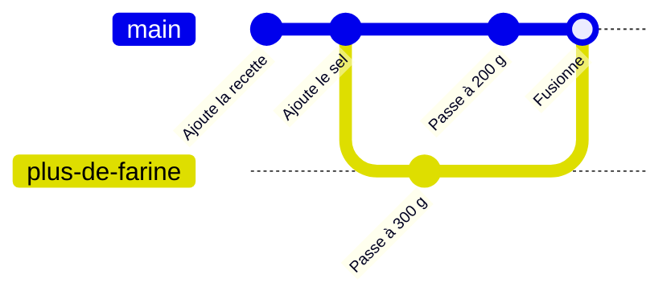
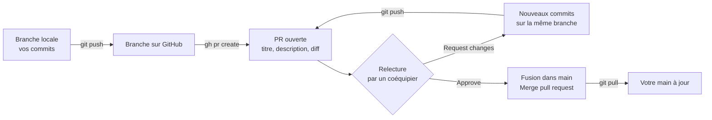
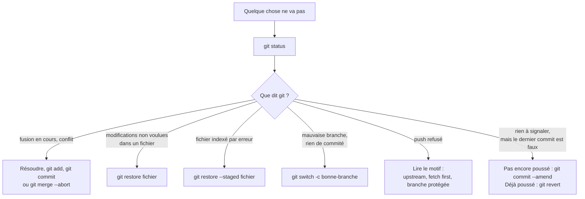

# Chapitre 1 · Git pas à pas pour non-développeurs

*Séance 2 « Git, configurer son agent, lancer le projet » · Master ITI, Nantes Université, 2026-2027. Chapitre à lire avant ou après la séance. État des outils vérifié le 19 novembre 2026 (git 2.53.0 et gh 2.100.0 sur le poste de rédaction ; documentation git 2.56.1).*

Ce chapitre accompagne le premier temps de la séance : git au clavier, en binômes, dans un dépôt d'essai. Il ne suppose aucune connaissance préalable. Chaque commande est donnée avec ce qu'elle affichait sur le poste de rédaction (les sections 4, 5 et 7 ont été jouées sans la section 6 : vos sorties comporteront quelques lignes de plus) et avec les erreurs que vous rencontrerez ; la fiche à suivre pendant l'atelier (les cinq étapes, sans les explications) est dans le chapitre 4.

## Ce que vous allez retenir

- Un **dépôt** est un dossier dont git garde l'histoire. Un **commit** est une photo de tout le projet à un instant, avec un message qui dit pourquoi.
- On ne photographie pas tout d'un coup : on choisit d'abord ce qui entre dans le cadre (`git add`, l'**index**), puis on déclenche (`git commit`).
- Une **branche** est une ligne de travail parallèle. On y essaie sans toucher à `main` ; quand c'est prêt, on **fusionne**.
- Le **dépôt distant** (`origin`, chez GitHub) est la copie commune : `git push` y envoie vos commits, `git pull` récupère ceux des autres.
- Une **pull request** (PR) est une demande de relecture et de fusion. Elle se passe sur GitHub, pas dans git. Personne n'approuve sa propre PR.
- Un **conflit** n'est pas une erreur : deux versions de la même ligne existent, git vous demande laquelle garder. Trois gestes : choisir, effacer les marqueurs, `git add` puis `git commit`.
- `git status` est votre boussole. Presque toutes les situations ont une sortie de secours, et les messages de git la donnent souvent eux-mêmes.
- Ce qui est poussé dans un dépôt public est publié : aucun secret, aucune donnée personnelle, jamais.

---

## 1. Pourquoi git, et pourquoi au clavier

### 1.1 Le problème que git résout

Vous avez tous connu le dossier qui contient `rapport_v2.docx`, `rapport_v2_final.docx` et `rapport_v2_final_corrigé_Paul.docx`. À plusieurs, c'est pire : qui a la bonne version, qu'est-ce qui a changé entre les deux, comment réunir les corrections de Paul et celles de Léa ?

**Git** est un **gestionnaire de versions** : un logiciel qui enregistre l'histoire d'un dossier, étape par étape, et qui sait réunir le travail de plusieurs personnes. Il répond à quatre questions : qu'est-ce qui a changé, quand, par qui, et pourquoi. Son origine (Linus Torvalds, 2005) est racontée dans le chapitre 1 des supports de la séance 1, jalon 9 : nous n'y revenons pas.

**GitHub** est autre chose : un site web qui héberge des dépôts git et ajoute autour d'eux des outils de collaboration (pull requests, relectures, automatisations). Git fonctionne sans GitHub ; GitHub ne fonctionne pas sans git.

### 1.2 Pourquoi vous tapez les commandes vous-mêmes

Votre agent sait utiliser git, et dans le projet il le fera souvent. Aujourd'hui, c'est vous qui tapez, pour trois raisons :

- vous serez **responsables** de ce que vous livrez (règle du cours : chacun peut expliquer toute PR qu'il a ouverte ou approuvée) : il faut pouvoir lire un historique ;
- quand l'agent se trompe de branche ou provoque un conflit, c'est vous qui devrez comprendre l'état du dépôt ;
- le vocabulaire (dépôt, branche, commit, PR, conflit) est celui de toute équipe de développement avec laquelle vous travaillerez.

Pendant l'atelier, l'agent a le droit d'**expliquer** une commande ou un message d'erreur. Il n'a pas le droit de faire à votre place.

### 1.3 Où taper les commandes

Dans le **terminal** : la fenêtre où l'on tape des commandes. Dans VS Code, ouvrez-le par le menu *Terminal > New Terminal* (ou *Terminal > Nouveau terminal*). Dans les exemples, le signe `$` au début d'une ligne marque ce que vous tapez (ne le recopiez pas) ; les lignes sans `$` sont ce que git répond.

Les réponses de git sont reproduites ici en anglais, telles qu'obtenues sur le poste de rédaction. Selon la langue de votre système, git peut les afficher en français : le sens est le même.

> **À retenir.** Git garde l'histoire, GitHub la partage. Aujourd'hui vous apprenez le geste ; ensuite l'agent le fera souvent, et vous saurez vérifier.

---

## 2. Le modèle mental

Six mots suffisent pour toute la formation. Lisez cette section une fois avant de toucher au clavier.

### 2.1 Dépôt, dossier de travail, index, commit

Un **dépôt** (*repository*, souvent abrégé *repo*) est un dossier ordinaire dans lequel git tient un journal. Ce journal vit dans un sous-dossier caché nommé `.git` : n'y touchez jamais à la main.

Un **commit** est une photo de l'ensemble du projet à un instant donné, accompagnée d'un auteur, d'une date et d'un message. Analogie : la sauvegarde d'un jeu vidéo, à ceci près qu'elle est commentée et qu'aucune sauvegarde n'écrase la précédente.

Entre vos fichiers et l'historique, il y a une étape intermédiaire, l'**index** (ou *staging area*, zone de préparation) : la liste de ce qui entrera dans la prochaine photo. Vous modifiez trois fichiers, mais deux seulement forment un tout cohérent ? Vous n'ajoutez que ces deux-là à l'index, puis vous commitez.



Chaque commit porte un **identifiant** : une longue suite de caractères dont on n'affiche en général que les sept premiers (`30fa585`). Chaque commit connaît aussi son **parent**, le commit précédent : l'historique est une chaîne, et l'on peut revenir à n'importe quelle photo.

### 2.2 Branche et fusion

Une **branche** est une ligne de travail parallèle. Techniquement, c'est une simple étiquette posée sur un commit, qui avance à chaque nouveau commit : créer une branche ne copie rien et ne coûte rien. La branche principale s'appelle par convention `main`.

Vous créez une branche, vous y faites vos commits : `main` ne bouge pas. Si l'essai est mauvais, vous abandonnez la branche. S'il est bon, vous **fusionnez** (*merge*) : le travail de la branche rejoint `main`.



Deux cas se présentent à la fusion :

- `main` **n'a pas bougé** depuis la création de la branche : git se contente d'avancer l'étiquette `main` jusqu'au bout de la branche. C'est une **avance rapide** (*fast-forward*) : aucun commit nouveau n'est créé, l'historique reste une ligne droite.
- `main` **a avancé** de son côté (c'est le schéma ci-dessus) : git crée un **commit de fusion**, qui a deux parents et réunit les deux lignes.

### 2.3 Dépôt distant, push et pull

Jusqu'ici tout se passe sur votre poste. Le **dépôt distant** (*remote*) est une copie du dépôt hébergée ailleurs, ici chez GitHub. Par convention, il s'appelle `origin`. Deux gestes :

- `git push` : **pousser**, envoyer vos commits vers le dépôt distant ;
- `git pull` : **tirer**, récupérer les commits que les autres y ont poussés et les intégrer à votre branche.

Tant que vous n'avez pas poussé, personne ne voit votre travail, et il n'existe que sur votre machine.

### 2.4 Pull request

Une **pull request** (PR) n'est pas une commande de git : c'est une page de GitHub sur laquelle vous dites « voici ma branche, voici ce qu'elle change et pourquoi ; relisez-la, puis fusionnons ». On y voit le **diff** (la différence ligne à ligne), on y discute, un relecteur approuve, puis la branche est fusionnée dans `main`.



### 2.5 Conflit

Un **conflit** survient à la fusion quand les deux branches ont modifié **la même ligne** du même fichier. Git sait réunir deux modifications faites à des endroits différents ; ici il ne peut pas deviner laquelle est la bonne. Il s'arrête, écrit les deux versions dans le fichier et attend votre décision (section 7).

> **À retenir.** Dépôt, commit, branche, fusion, dépôt distant, pull request : six mots. Le conflit est le septième, et ce n'est pas une panne.

---

## 3. Avant de commencer : l'identité

Chaque commit est signé d'un nom et d'une adresse. Vos dépôts sont **publics** : cette adresse sera visible de tous. En séance 1, vous avez donc configuré l'adresse anonyme que GitHub fournit, de la forme `ID+LOGIN@users.noreply.github.com` (elle se trouve sur GitHub, dans *Settings > Emails*). Vérifiez :

```bash
$ git config --global user.name
$ git config --global user.email
```

Si l'une des deux lignes ne répond rien, réglez-la (remplacez les valeurs par les vôtres) :

```bash
$ git config --global user.name "Camille Martin"
$ git config --global user.email "12345+camille@users.noreply.github.com"
```

Trois réglages de confort, à faire une fois pour toutes :

```bash
$ git config --global init.defaultBranch main
$ git config --global pull.rebase false
$ git config --global core.editor "code --wait"
```

Le premier nomme `main` la première branche de vos nouveaux dépôts (sans lui, git 2.x la nomme encore `master`, voir 9.3). Le deuxième dit à `git pull` de fusionner quand votre branche et celle du dépôt distant ont divergé (voir 9.6). Le troisième fait ouvrir VS Code, plutôt qu'un éditeur de terminal déroutant, quand git a besoin que vous écriviez un message (voir 9.2).

---

## 4. Premier dépôt, premiers commits

Fil d'exemple de tout le chapitre : un dépôt d'essai nommé `essai-git`, qui contient une recette de galettes. Rien de personnel dedans, pas même votre nom : il sera public.

### 4.1 Créer le dépôt

Créez un dossier `essai-git`, ouvrez-le dans VS Code (*File > Open Folder*), ouvrez le terminal, puis :

```bash
$ git init -b main
Initialized empty Git repository in .../essai-git/.git/
```

`git init` transforme le dossier en dépôt ; `-b main` nomme la première branche `main`.

### 4.2 Créer un fichier et regarder l'état

Créez dans VS Code un fichier `recette.md` avec ce contenu, et **enregistrez-le** (`Ctrl+S`, ou `Cmd+S` sous macOS) :

```markdown
# Galettes

- 250 g de farine de sarrasin
- 1 œuf
- 50 cl d'eau
```

Puis demandez à git où vous en êtes :

```bash
$ git status
On branch main

No commits yet

Untracked files:
  (use "git add <file>..." to include in what will be committed)
	recette.md

nothing added to commit but untracked files present (use "git add" to track)
```

Lisez cette réponse ligne à ligne : vous êtes sur la branche `main`, il n'y a encore aucun commit, et `recette.md` est **non suivi** (*untracked*) : git le voit mais ne s'en occupe pas encore. Entre parenthèses, git vous souffle la commande suivante. C'est presque toujours le cas : `git status` est la commande à taper chaque fois que vous hésitez.

### 4.3 Indexer et commiter

```bash
$ git add recette.md
$ git status --short
A  recette.md
$ git commit -m "Ajoute la recette des galettes"
[main (root-commit) 30fa585] Ajoute la recette des galettes
 1 file changed, 5 insertions(+)
 create mode 100644 recette.md
```

`git add` place le fichier dans l'index (`A` pour *added*). `git commit -m "…"` prend la photo, avec le message donné entre guillemets. Git répond par la branche, l'identifiant du commit (le vôtre sera différent : il dépend entre autres de l'auteur et de l'heure) et un résumé.

### 4.4 Modifier, comparer, commiter

Ajoutez une ligne à la recette (`- 1 pincée de sel`), enregistrez, puis regardez ce qui a changé **avant** de commiter :

```bash
$ git diff
diff --git a/recette.md b/recette.md
index 25efd8e..b9bf668 100644
--- a/recette.md
+++ b/recette.md
@@ -3,3 +3,4 @@
 - 250 g de farine de sarrasin
 - 1 œuf
 - 50 cl d'eau
+- 1 pincée de sel
```

Un **diff** se lit ainsi : une ligne précédée de `+` a été ajoutée, une ligne précédée de `-` a été supprimée, les autres sont là pour situer. C'est exactement ce que vous relirez dans une pull request.

`git diff` montre ce qui n'est pas encore indexé ; une fois le fichier ajouté, utilisez `git diff --staged` pour voir ce qui partira dans le commit.

```bash
$ git add recette.md
$ git commit -m "Ajoute le sel à la recette"
[main b10206a] Ajoute le sel à la recette
 1 file changed, 1 insertion(+)
$ git log --oneline
b10206a Ajoute le sel à la recette
30fa585 Ajoute la recette des galettes
```

`git log --oneline` affiche l'historique, un commit par ligne, le plus récent en haut. Sans `--oneline`, vous obtenez aussi l'auteur et la date (touche `q` pour quitter l'affichage s'il ne rend pas la main).

### 4.5 Écrire un bon message de commit

Le message est écrit pour la personne qui lira l'historique dans quelques semaines, c'est-à-dire vous, en janvier, la veille de la soutenance.

| Plutôt | Que |
|---|---|
| `Ajoute le sel à la recette` | `modifs` |
| `Corrige le temps de cuisson` | `fix` |
| `Supprime la garniture en double` | `wip`, `test`, `commit final 2` |

Règles simples : une première ligne courte (72 caractères au plus), qui commence par un verbe à l'impératif présent (« Ajoute », « Corrige ») et dit ce que le commit **apporte** ; un seul sujet par commit ; si une explication est utile, une ligne vide puis deux ou trois lignes de « pourquoi ». La discipline des petits commits (un commit par étape qui fonctionne) est présentée dans le chapitre 5 des supports de la séance 1, section 11.

> **À retenir.** Le cycle de base tient en quatre commandes : `git status`, `git add`, `git commit -m`, `git log --oneline`. Et un réflexe : enregistrer le fichier avant `git add`.

---

## 5. Les branches

### 5.1 Créer une branche et y travailler

```bash
$ git switch -c cuisson
Switched to a new branch 'cuisson'
```

`git switch -c` crée la branche (`-c` pour *create*) et vous y place. Ajoutez à la fin de `recette.md` :

```markdown

## Cuisson

2 minutes par face.
```

Enregistrez, puis :

```bash
$ git add recette.md
$ git commit -m "Décrit la cuisson"
[cuisson 97a74eb] Décrit la cuisson
 1 file changed, 4 insertions(+)
```

### 5.2 Revenir sur main et fusionner

```bash
$ git switch main
Switched to branch 'main'
```

Regardez le fichier dans VS Code : la section « Cuisson » a disparu. Rien n'est perdu : vous regardez `main`, qui n'a pas encore reçu ce commit. C'est tout l'intérêt d'une branche.

```bash
$ git merge cuisson
Updating b10206a..97a74eb
Fast-forward
 recette.md | 4 ++++
 1 file changed, 4 insertions(+)
```

Git annonce `Fast-forward` : `main` n'avait pas bougé, il a suffi d'avancer l'étiquette (section 2.2). L'historique reste une ligne droite :

```bash
$ git log --oneline --graph --all
* 97a74eb Décrit la cuisson
* b10206a Ajoute le sel à la recette
* 30fa585 Ajoute la recette des galettes
```

La branche a rempli son rôle, on peut la supprimer :

```bash
$ git branch -d cuisson
Deleted branch cuisson (was 97a74eb).
```

Supprimer une branche fusionnée ne supprime aucun commit : seule l'étiquette disparaît.

### 5.3 `git switch` ou `git checkout` ?

Vous verrez souvent, dans des tutoriels ou dans ce que propose l'agent, `git checkout cuisson` et `git checkout -b cuisson`. C'est l'ancienne commande, qui fait la même chose et fonctionne toujours. `git switch` (changer de branche) et `git restore` (rétablir un fichier) l'ont remplacée pour ces deux usages, avec des noms plus clairs. Les deux écritures sont correctes ; ce chapitre utilise les nouvelles.

> **À retenir.** `git switch -c nom` pour créer une branche, `git switch main` pour revenir, `git merge nom` pour fusionner **depuis la branche qui reçoit**. Dans le projet : un étudiant, un agent, une branche.

---

## 6. GitHub : pousser, ouvrir une pull request, relire, fusionner

### 6.1 Créer le dépôt distant et pousser

Vérifiez d'abord que l'outil `gh` (la ligne de commande de GitHub, installée en séance 1) est connecté à votre compte :

```bash
$ gh auth status
```

S'il répond que vous n'êtes pas connecté, lancez `gh auth login` et suivez les questions (connexion par le navigateur).

Créez ensuite le dépôt sur GitHub à partir de votre dossier, et poussez-y vos commits, en une commande :

```bash
$ gh repo create essai-git --public --source=. --remote=origin --push
```

Lecture de la commande : créer un dépôt nommé `essai-git`, **public** (votre binôme doit pouvoir le lire), à partir du dossier courant (`--source=.`), l'enregistrer comme dépôt distant sous le nom `origin`, et pousser la branche courante. L'option `--push` exige qu'il existe au moins un commit. Vérifiez :

```bash
$ git remote -v
origin	https://github.com/VOTRE-LOGIN/essai-git.git (fetch)
origin	https://github.com/VOTRE-LOGIN/essai-git.git (push)
$ gh browse
```

`gh browse` ouvre la page du dépôt dans le navigateur.

### 6.2 Une branche, un commit, un push

On ne travaille jamais directement sur `main` quand on veut une relecture. Créez une branche, ajoutez une section à la recette, commitez :

```bash
$ git switch -c garniture
```

```markdown

## Garniture

Jambon, œuf, fromage.
```

```bash
$ git add recette.md
$ git commit -m "Ajoute la garniture complète"
$ git push -u origin garniture
To https://github.com/VOTRE-LOGIN/essai-git.git
 * [new branch]      garniture -> garniture
branch 'garniture' set up to track 'origin/garniture'.
```

`-u origin garniture` signifie : pousse cette branche vers `origin` et retiens le lien (la branche locale **suit** désormais la branche distante). Ce lien posé, un simple `git push` suffira les fois suivantes.

### 6.3 Ouvrir la pull request

```bash
$ gh pr create --web
```

Le navigateur s'ouvre sur le formulaire de GitHub. Donnez un **titre** (ce que la PR apporte) et une **description** (pourquoi, et ce que le relecteur doit regarder), puis cliquez sur *Create pull request*.

Deux variantes existent : `gh pr create` sans option pose les mêmes questions dans le terminal ; `gh pr create --fill` remplit titre et description à partir de vos messages de commit, sans rien demander. Dans le projet d'équipe, évitez `--fill` : cette option n'utilise pas le **modèle de PR** du dépôt, dont les rubriques sont obligatoires (chapitre 3).

Vous pouvez aussi tout faire depuis le site : après un push, la page du dépôt affiche un bandeau *Compare & pull request*.

### 6.4 Relire la PR de son binôme

Envoyez l'adresse de votre PR à votre binôme (`gh pr view --web` l'ouvre). Le relecteur, sur la page de la PR :

1. lit le titre et la description : ce que la PR annonce ;
2. ouvre l'onglet **Files changed** et vérifie que la **liste** des fichiers touchés correspond à cette annonce (ici, `recette.md` seul) ;
3. peut commenter une ligne précise (bouton `+` qui apparaît au survol de la ligne) ;
4. clique sur **Review changes**, écrit un commentaire d'ensemble, choisit **Comment** (simple remarque), **Approve** (j'approuve) ou **Request changes** (je demande des modifications), puis **Submit review**.

Si des modifications sont demandées, l'auteur fait de nouveaux commits **sur la même branche** et pousse : la PR se met à jour toute seule.

GitHub interdit à l'auteur d'approuver sa propre PR. Sur un dépôt public, tout compte GitHub peut laisser une relecture ; dans les dépôts d'équipe, la branche `main` sera protégée et exigera l'approbation d'un collaborateur du dépôt avant toute fusion (chapitre 3).

### 6.5 Fusionner et se remettre à jour

Une fois la PR approuvée, l'auteur la fusionne. Depuis le site : bouton **Merge pull request**, puis **Confirm merge**, puis **Delete branch**. Ou depuis le terminal :

```bash
$ gh pr merge --merge --delete-branch
```

`--merge` demande un **commit de fusion** (*Create a merge commit* sur le site). GitHub propose deux autres méthodes, *Squash and merge* et *Rebase and merge*, qui réécrivent l'historique de la branche ; le projet du cours n'utilise que le commit de fusion, pour que l'ordre de vos commits reste lisible (le commit de test avant le code).

La fusion a eu lieu **sur GitHub**. Si vous avez fusionné par le site, votre `main` local n'a pas bougé et la branche `garniture` existe encore sur votre poste : mettez-vous à jour avec les commandes ci-dessous, puis supprimez-la (`git branch -d garniture`). Si vous avez utilisé `gh pr merge --delete-branch`, `gh` a en principe déjà supprimé la branche locale et mis `main` à jour : les mêmes commandes répondent alors qu'il n'y a rien à faire, ce qui est normal.

```bash
$ git switch main
$ git pull
$ git log --oneline --graph
```

Le dernier commit affiché est le commit de fusion de la PR (`Merge pull request #1 from …`).

> **À retenir.** Le circuit d'une modification : branche, commits, `git push -u origin branche`, PR, relecture par un autre, fusion, `git switch main` puis `git pull`. Vous le referez des dizaines de fois.

---

## 7. Le conflit, pas à pas

Vous allez provoquer un conflit exprès, pour ne pas le découvrir la veille d'un rendu. Tout se passe en local, sans réseau.

### 7.1 Fabriquer le conflit

Sur une nouvelle branche, changez la quantité de farine :

```bash
$ git switch -c plus-de-farine
```

Dans `recette.md`, remplacez `250 g` par `300 g`, enregistrez, puis :

```bash
$ git add recette.md
$ git commit -m "Passe à 300 g de farine"
$ git switch main
```

De retour sur `main`, la ligne indique de nouveau `250 g`. Remplacez-la cette fois par `200 g`, enregistrez, puis :

```bash
$ git add recette.md
$ git commit -m "Passe à 200 g de farine"
```

Les deux branches ont maintenant modifié la même ligne, chacune à sa façon. Fusionnez :

```bash
$ git merge plus-de-farine
Auto-merging recette.md
CONFLICT (content): Merge conflict in recette.md
Automatic merge failed; fix conflicts and then commit the result.
```

### 7.2 Lire l'état du dépôt

```bash
$ git status
On branch main
You have unmerged paths.
  (fix conflicts and run "git commit")
  (use "git merge --abort" to abort the merge)

Unmerged paths:
  (use "git add <file>..." to mark resolution)
	both modified:   recette.md
```

Git dit tout : la fusion est en cours, le fichier `recette.md` a été modifié des deux côtés, et il existe une **sortie de secours**, `git merge --abort`, qui annule la fusion et remet le dépôt dans l'état précédent. Retenez-la : elle rend l'exercice sans danger.

Dans le fichier, git a écrit les deux versions entre trois lignes de **marqueurs** :

```text
# Galettes

<<<<<<< HEAD
- 200 g de farine de sarrasin
=======
- 300 g de farine de sarrasin
>>>>>>> plus-de-farine
- 1 œuf
- 50 cl d'eau
```

- entre `<<<<<<< HEAD` et `=======` : la version de la branche où vous êtes (`HEAD` désigne votre position actuelle, ici `main`) ;
- entre `=======` et `>>>>>>> plus-de-farine` : la version de la branche que vous fusionnez.

### 7.3 Résoudre dans VS Code

VS Code colore le conflit et affiche au-dessus une ligne d'actions cliquables :

| Libellé anglais | Libellé du pack de langue français | Effet |
|---|---|---|
| Accept Current Change | Accepter la modification actuelle | garde la version de votre branche (200 g) |
| Accept Incoming Change | Accepter la modification entrante | garde la version fusionnée (300 g) |
| Accept Both Changes | Accepter les deux modifications | garde les deux lignes, l'une sous l'autre |
| Compare Changes | Comparer les modifications | affiche les deux versions côte à côte |

Les libellés anglais sont ceux de la documentation de VS Code ; les libellés français proviennent des fichiers de traduction du pack de langue officiel (voir « Points non vérifiés »).

Cliquez par exemple sur **Accept Incoming Change** : la ligne `300 g` reste, les marqueurs disparaissent. Vous pouvez aussi résoudre **à la main** : effacez ce que vous ne gardez pas et les trois lignes de marqueurs, ou écrivez une troisième version (`275 g`) si c'est la bonne réponse. Résoudre un conflit est une décision, pas une opération mécanique. Enregistrez le fichier.

VS Code propose aussi un bouton **Resolve in Merge Editor** (*Résoudre dans l'éditeur de fusion*) : un écran à trois volets (la version entrante, la version actuelle, le résultat) avec un bouton **Complete Merge** (*Terminer la fusion*). Il est utile pour les conflits longs ; pour une ligne, les actions ci-dessus suffisent.

### 7.4 Terminer la fusion

```bash
$ git add recette.md
$ git status
On branch main
All conflicts fixed but you are still merging.
  (use "git commit" to conclude merge)
$ git commit -m "Fusionne plus-de-farine : on retient 300 g"
[main ee909f8] Fusionne plus-de-farine : on retient 300 g
$ git log --oneline --graph --all
*   ee909f8 Fusionne plus-de-farine : on retient 300 g
|\
| * 9c94ac7 Passe à 300 g de farine
* | 3f29890 Passe à 200 g de farine
|/
* 97a74eb Décrit la cuisson
* b10206a Ajoute le sel à la recette
* 30fa585 Ajoute la recette des galettes
```

`git add` dit à git « ce fichier est résolu » ; `git commit` conclut. Le graphe montre les deux lignes qui se séparent puis se rejoignent dans un commit de fusion à deux parents. C'est ce dessin que l'encadrant vous demandera de montrer à la fin de l'atelier.

### 7.5 Conflit dans une pull request

Le même conflit peut apparaître sur GitHub : la page de la PR affiche alors *This branch has conflicts that must be resolved*. Pour un cas simple, le bouton **Resolve conflicts** ouvre un éditeur dans le navigateur (on y supprime les marqueurs, puis *Mark as resolved* et *Commit merge*). La méthode générale, que vous pratiquerez en séance 3, consiste à ramener `main` dans votre branche sur votre poste (`git switch ma-branche`, `git pull origin main`), à résoudre comme ci-dessus, puis à pousser.

> **À retenir.** Un conflit est une question que git vous pose. Choisir, effacer les marqueurs, `git add`, `git commit`. Et si vous êtes perdu : `git merge --abort`.

---

## 8. Ce qu'on ne commite jamais, et `.gitignore`

### 8.1 La règle d'or appliquée à git

Vos dépôts sont publics : tout ce qui y entre est **publié**, et l'historique garde tout. Supprimer un fichier dans un commit ultérieur ne l'efface pas des commits précédents. On ne commite donc jamais :

- un **secret** : mot de passe, clé d'API, jeton, fichier `.env` ;
- une **donnée personnelle** réelle : nom, courriel, numéro de téléphone, liste d'étudiants ou de salariés ;
- une donnée d'un employeur ou d'un stage, même « pour tester » ;
- par simple hygiène : les fichiers que l'on peut régénérer (dossiers de compilation, fichiers produits par un outil).

Si un secret a été poussé par erreur : prévenez l'enseignant tout de suite. Le secret doit être **révoqué** (remplacé par un nouveau) : le retirer de l'historique ne suffit pas, il a pu être copié.

### 8.2 Le fichier `.gitignore`

Le fichier `.gitignore`, placé à la racine du dépôt, liste ce que git doit **ignorer** : ces fichiers n'apparaissent plus dans `git status` et ne peuvent pas être ajoutés par mégarde. Une ligne par motif :

```text
# secrets locaux
.env

# fichiers produits par les outils
build/
```

`.gitignore` se commite comme un autre fichier : toute l'équipe en bénéficie. Deux limites : il n'agit que sur les fichiers **pas encore suivis** (ignorer un fichier déjà commité ne le retire pas), et il ne protège pas d'un secret écrit dans un fichier suivi. Le dépôt-modèle du projet fournit un `.gitignore` adapté à Flutter, qui ignore déjà `.env`.

### 8.3 Regarder avant d'ajouter

`git add .` ajoute d'un coup **tout** ce qui a changé dans le dossier. C'est pratique et c'est ainsi que les fichiers indésirables entrent dans un dépôt. Prenez l'habitude inverse : `git status` d'abord, puis `git add` fichier par fichier, puis `git diff --staged` pour relire ce qui part. Vous demanderez la même discipline à votre agent.

> **À retenir.** Un dépôt public n'oublie rien. On regarde avant d'ajouter, et les secrets vivent dans un `.env` ignoré, jamais dans le dépôt.

---

## 9. Erreurs fréquentes et comment s'en sortir

Premier réflexe dans tous les cas : `git status`, et lire ce que git propose.



### 9.1 « Please tell me who you are »

```text
Author identity unknown

*** Please tell me who you are.
```

L'identité n'est pas configurée. Reprenez la section 3, puis relancez le commit.

### 9.2 Un éditeur étrange s'est ouvert

Vous avez tapé `git commit` sans `-m`, ou git a besoin d'un message de fusion : un éditeur s'ouvre. Si c'est **vim** (écran presque vide, le clavier ne répond pas comme prévu) : appuyez sur `Échap`, tapez `:wq` puis `Entrée` pour enregistrer et quitter, ou `:q!` puis `Entrée` pour quitter sans rien garder (le commit est alors abandonné). Le réglage `core.editor` de la section 3 évite la situation : c'est VS Code qui s'ouvre, vous écrivez le message, enregistrez et fermez l'onglet.

### 9.3 La branche s'appelle `master`

Vous avez tapé `git init` sans `-b main` et sans le réglage `init.defaultBranch`. Git 2.x nomme alors la branche `master` et prévient que le défaut deviendra `main` avec Git 3.0. Renommez-la :

```bash
$ git branch -m main
```

### 9.4 « has no upstream branch »

```text
fatal: The current branch main has no upstream branch.
To push the current branch and set the remote as upstream, use

    git push --set-upstream origin main
```

Votre branche n'a pas encore de lien avec une branche distante. Git donne la commande ; `-u` est l'abréviation de `--set-upstream` : `git push -u origin nom-de-la-branche`.

Variante, si aucun dépôt distant n'existe : `fatal: No configured push destination.` Créez-le d'abord (section 6.1).

### 9.5 Push rejeté : « fetch first » ou « non-fast-forward »

```text
 ! [rejected]        main -> main (fetch first)
error: failed to push some refs to '...'
hint: Updates were rejected because the remote contains work that you do not
hint: have locally.
```

Quelqu'un a poussé sur la même branche avant vous : le dépôt distant contient des commits que vous n'avez pas. Git refuse pour ne rien écraser. Récupérez d'abord (`git pull`), puis poussez de nouveau. Le motif `(non-fast-forward)` désigne la même situation.

**Ne répondez jamais à ce message par `git push --force`** : cette option écrase l'historique commun et efface le travail des autres. Vous la ferez refuser par configuration à votre agent dans la deuxième partie de la séance (chapitre 2).

### 9.6 `git pull` : « Need to specify how to reconcile divergent branches »

```text
fatal: Need to specify how to reconcile divergent branches.
```

Votre branche et la branche distante ont chacune des commits que l'autre n'a pas, et git ne sait pas quelle méthode employer pour les réunir. Le réglage de la section 3 (`git config --global pull.rebase false`) répond une fois pour toutes : fusionner. Relancez ensuite `git pull` ; un conflit peut alors apparaître, il se traite comme en section 7.

### 9.7 Push refusé sur `main` dans le dépôt d'équipe

Dans les dépôts du projet, `main` est **protégée** : un push direct y est refusé, avec un message qui commence par `remote: error: GH006: Protected branch update failed`. Ce n'est pas une panne, c'est la règle : toute modification passe par une branche et une PR relue. Si vous avez commité sur `main` par erreur, voyez 9.9.

### 9.8 « nothing to commit » alors que j'ai modifié le fichier

Deux causes, dans cet ordre de fréquence : le fichier n'est **pas enregistré** dans VS Code (un point rond à côté du nom de l'onglet le signale) ; ou vous avez oublié `git add`. C'est le blocage le plus courant de l'atelier.

### 9.9 J'ai travaillé sur la mauvaise branche

- **Rien n'est encore commité** : créez la bonne branche, vos modifications vous suivent.

  ```bash
  $ git switch -c ma-branche
  ```

- **C'est déjà commité sur `main`, pas encore poussé** : créez la branche à cet endroit (elle contient le commit), puis demandez de l'aide pour remettre `main` à sa place. La manœuvre existe (`git reset`), elle est sans danger quand on la comprend, et c'est une mauvaise idée de la découvrir seul.

### 9.10 Annuler

| Situation | Commande | Attention |
|---|---|---|
| Abandonner les modifications non commitées d'un fichier | `git restore recette.md` | **irréversible** : ces modifications sont perdues |
| Retirer un fichier de l'index sans toucher à son contenu | `git restore --staged recette.md` | sans danger |
| Corriger le message du dernier commit | `git commit --amend -m "Nouveau message"` | seulement si le commit **n'a pas été poussé** |
| Annuler un commit déjà poussé | `git revert <identifiant>` | crée un nouveau commit qui défait l'ancien ; l'historique reste intact |
| Annuler une fusion en cours | `git merge --abort` | sans danger |
| Mettre de côté des modifications le temps de changer de branche | `git stash`, puis `git stash pop` | à utiliser avec parcimonie |

La distinction entre `--amend` et `revert` tient à une règle : **on ne réécrit pas un historique déjà partagé**. `--amend` remplace le dernier commit par un nouveau ; si l'ancien est déjà chez les autres, les deux versions entrent en conflit. `git revert` ajoute, il ne réécrit rien : c'est la seule annulation propre une fois que c'est poussé.

### 9.11 Supprimer une branche

`git branch -d nom` refuse de supprimer une branche dont les commits ne sont nulle part ailleurs :

```text
error: the branch 'feature' is not fully merged
hint: If you are sure you want to delete it, run 'git branch -D feature'
```

C'est une protection : vérifiez d'abord que vous n'avez pas oublié de fusionner. `-D` (majuscule) force la suppression, et ces commits deviennent difficiles à retrouver.

### 9.12 Push bloqué à cause de l'adresse

Si vous avez activé sur GitHub le réglage *Block command line pushes that expose my email* et qu'un commit porte votre adresse personnelle, GitHub refuse le push. Corrigez l'adresse (section 3), puis refaites le dernier commit avec la bonne identité :

```bash
$ git commit --amend --reset-author --no-edit
```

Ce cas est fréquent le premier jour, et il rend service : l'adresse refusée n'a pas été publiée.

> **À retenir.** `git status` d'abord. Presque tout se rattrape tant que ce n'est pas poussé ; après, on ajoute un commit qui corrige, on ne réécrit pas. Et jamais `git push --force`.

---

## 10. Git, l'agent et la suite du projet

### 10.1 Ce que l'agent fera avec git

Claude Code sait lancer toutes les commandes de ce chapitre, et il le fera sur demande : créer une branche, commiter, ouvrir une PR. Trois habitudes vous gardent aux commandes :

- **Lire avant d'accepter.** Quand l'agent propose une commande git, vous savez maintenant la lire. `git add .` suivi d'un commit sans que vous ayez vu quels fichiers changent (`git status`) mérite un refus.
- **Vérifier la branche.** Avant de lui confier une tâche : `git status`. Un agent lancé sur `main` travaille sur `main`.
- **Vérifier par les preuves, pas par le résumé.** L'agent décrit ce qu'il a fait ; la liste des fichiers modifiés et les tests montrent ce qui a réellement changé. Ce sont ces preuves qui font foi, et ce sont elles que votre relecteur regardera.

Les commandes dangereuses (`git push --force`, `rm -rf`) seront refusées par configuration, et non par simple consigne : c'est l'objet du chapitre 2.

### 10.2 Les règles de git dans le projet d'équipe

| Règle | Ce que cela veut dire en pratique |
|---|---|
| Un étudiant, un agent, une branche | chacun crée sa branche pour chaque tâche ; personne ne travaille sur `main` |
| `main` est protégée | push direct refusé ; PR obligatoire avec une approbation |
| Pas de code non relu | toute PR est relue par un autre que son auteur, avant la fusion |
| Merge commit seul | bouton *Create a merge commit* ; l'ordre des commits est conservé |
| Commits petits et lisibles | un sujet par commit, un message qui dit ce qu'il apporte |
| Rien de secret, rien de personnel | le dépôt est public, l'historique n'oublie rien |

Les protections de branche et leur rôle face à un agent sont détaillés dans le chapitre 8 des supports de la séance 1, section 7. La mise en place dans votre dépôt d'équipe (clonage, première PR avec le modèle, vérification de la protection, tag `s2-fin`) est décrite au chapitre 3.

### 10.3 Poser un repère : le tag

Un **tag** est une étiquette fixe posée sur un commit, pour retrouver un état précis du projet. À la fin de la séance, chaque équipe pose le tag `s2-fin` sur `main` :

```bash
$ git switch main
$ git pull
$ git tag s2-fin
$ git push origin s2-fin
 * [new tag]         s2-fin -> s2-fin
```

Contrairement à une branche, un tag ne bouge plus. Les tags ne partent pas avec un `git push` ordinaire : il faut les pousser explicitement.

> **À retenir.** L'agent tape vite ; vous lisez ce qu'il tape. La branche, la PR relue et la protection de `main` sont les trois garde-fous de votre équipe.

---

## 11. Aide-mémoire

| Je veux… | Commande |
|---|---|
| savoir où j'en suis | `git status` |
| créer un dépôt | `git init -b main` |
| voir ce qui a changé | `git diff` (non indexé), `git diff --staged` (indexé) |
| préparer un fichier pour le commit | `git add recette.md` |
| commiter | `git commit -m "Message"` |
| voir l'historique | `git log --oneline --graph --all` |
| créer une branche et y aller | `git switch -c ma-branche` |
| changer de branche | `git switch main` |
| fusionner une branche dans celle où je suis | `git merge ma-branche` |
| annuler une fusion en cours | `git merge --abort` |
| créer le dépôt GitHub depuis mon dossier | `gh repo create nom --public --source=. --remote=origin --push` |
| récupérer un dépôt existant | `gh repo clone PROPRIÉTAIRE/DÉPÔT` |
| pousser une branche la première fois | `git push -u origin ma-branche` |
| pousser ensuite | `git push` |
| récupérer le travail des autres | `git pull` |
| ouvrir une PR | `gh pr create --web` |
| voir la PR de ma branche | `gh pr view --web` |
| fusionner la PR | `gh pr merge --merge --delete-branch` |
| supprimer une branche fusionnée | `git branch -d ma-branche` |
| poser et pousser un tag | `git tag s2-fin` puis `git push origin s2-fin` |

---

## Glossaire

- **Branche** : ligne de travail parallèle ; étiquette mobile posée sur un commit.
- **Cloner** : copier sur son poste un dépôt distant, avec tout son historique.
- **Commit** : photo du projet à un instant, avec auteur, date et message.
- **Commit de fusion** (*merge commit*) : commit à deux parents, créé quand on réunit deux lignes qui ont toutes deux avancé.
- **Conflit** : situation où deux branches ont modifié la même ligne ; git demande de choisir.
- **Dépôt** (*repository*) : dossier dont git garde l'histoire.
- **Dépôt distant** (*remote*) : copie du dépôt hébergée ailleurs ; par convention `origin`.
- **Diff** : différence ligne à ligne entre deux états (`+` ajouté, `-` supprimé).
- **Fast-forward** (avance rapide) : fusion sans nouveau commit, quand la branche qui reçoit n'a pas bougé.
- **Fusion** (*merge*) : réunion du travail d'une branche dans une autre.
- **HEAD** : votre position actuelle dans l'historique, en général le dernier commit de la branche courante.
- **Index** (*staging area*) : zone de préparation ; ce qui entrera dans le prochain commit.
- **`.gitignore`** : fichier qui liste ce que git doit ignorer.
- **Pull request (PR)** : demande de relecture et de fusion, sur GitHub.
- **Pousser, tirer** (*push*, *pull*) : envoyer ses commits vers le dépôt distant, récupérer ceux des autres.
- **Relecture** (*review*) : vérification d'une PR par un autre que son auteur, par les preuves (ce qu'elle annonce, son fonctionnement, la liste des fichiers touchés), conclue par un commentaire, une approbation ou une demande de modifications.
- **Tag** : étiquette fixe posée sur un commit (`s2-fin`, `v1.0`).
- **Upstream** : branche distante que suit une branche locale.

---

## Pour aller plus loin

- *Pro Git* (Scott Chacon et Ben Straub), gratuit en ligne et traduit en français : chapitres 2 (« Les bases de Git ») et 3 (« Les branches avec Git »).
- La documentation de GitHub sur les pull requests et la relecture (liens dans les sources).
- Dans les supports de la séance 1 : chapitre 1, jalon 9 (l'histoire de git) ; chapitre 5, section 11 (un commit par étape verte) ; chapitre 8, section 7 (branches, pull requests et protections).
- Chapitre 3 de ce support : le même circuit, dans le dépôt de votre équipe, avec le modèle de PR et la protection de `main`.
- Chapitre 4 : la fiche git de l'atelier et l'aide-mémoire de dépannage, à garder ouverts pendant la séance.

---

## Points non vérifiés (à signaler honnêtement)

- **Tout ce qui se passe sur GitHub en ligne n'a pas été exécuté** pour ce chapitre : `gh repo create`, `gh pr create`, `gh pr merge`, les écrans de relecture et de fusion. Les options de `gh` ont été relues dans l'aide de gh 2.100.0 et les libellés d'interface dans la documentation de GitHub. Les sorties de `git push` et `git pull` ont été obtenues avec un dépôt distant local (un dossier), puis leurs adresses réécrites à la main sous la forme GitHub.
- **Fait que `--fill` n'utilise pas le modèle de PR** : déduit de la lecture du code source de `gh`, non confirmé par le manuel ni par un essai.
- **Message exact du push refusé sur une branche protégée** : la première ligne (`GH006: Protected branch update failed`) figure dans la documentation de GitHub pour un cas voisin ; la suite du message pour un push direct n'est attestée que par des sources communautaires.
- **Libellés français de VS Code** : relevés dans les fichiers de traduction du pack de langue officiel (dépôt `microsoft/vscode-loc`), non observés dans une interface en fonctionnement ; ils peuvent différer selon la version. Les titres français des trois volets de l'éditeur de fusion n'ont pas été trouvés.
- **Sortie de vim** (`Échap`, `:wq`, `:q!`) : usage courant, non relu sur une source officielle. L'éditeur ouvert par défaut dépend du système et de l'installation de git (sous Windows, l'installateur de Git for Windows propose un choix : non vérifié).
- **Message du push bloqué pour adresse exposée** (code GH007) et commande de correction `git commit --amend --reset-author --no-edit` : le réglage est confirmé par la documentation de GitHub, le texte du message ne l'est pas, et la commande n'a pas été essayée contre GitHub.
- **Relecture d'une PR par un compte non collaborateur sur un dépôt public** : pratique courante, non revérifiée dans la documentation pour ce chapitre.
- **`git stash`** : cité dans le tableau des annulations, non exécuté pour ce chapitre.
- **Identifiants de commit** : ceux du poste de rédaction ; les vôtres seront différents. Les fichiers d'essai étaient écrits sans accents : les accents des exemples ont été rétablis à la main.
- **Messages de git en français** : les sorties ont été capturées en anglais (`LC_ALL=C`) ; la traduction affichée sur votre poste n'a pas été relevée.
- **Git 3.0 et la branche `main` par défaut** : annoncé par git 2.53 et par la documentation ; Git 3.0 n'était pas publié à la date de rédaction.

---

## Sources

Documentation de git (version 2.56.1, consultée le 19 novembre 2026) :

- git init : https://git-scm.com/docs/git-init
- git switch : https://git-scm.com/docs/git-switch
- git restore : https://git-scm.com/docs/git-restore
- git merge : https://git-scm.com/docs/git-merge
- git push : https://git-scm.com/docs/git-push
- git var (choix de l'éditeur) : https://git-scm.com/docs/git-var
- *Pro Git*, « First-Time Git Setup » : https://git-scm.com/book/en/v2/Getting-Started-First-Time-Git-Setup

GitHub CLI (gh 2.100.0, aide locale et manuel) :

- gh repo create : https://cli.github.com/manual/gh_repo_create
- gh pr create : https://cli.github.com/manual/gh_pr_create

Documentation de GitHub :

- Branches protégées : https://docs.github.com/en/repositories/configuring-branches-and-merges-in-your-repository/managing-protected-branches/about-protected-branches
- Approuver une PR avec relectures requises : https://docs.github.com/en/pull-requests/collaborating-with-pull-requests/reviewing-changes-in-pull-requests/approving-a-pull-request-with-required-reviews
- Relire les modifications proposées : https://docs.github.com/en/pull-requests/collaborating-with-pull-requests/reviewing-changes-in-pull-requests/reviewing-proposed-changes-in-a-pull-request
- Fusionner une pull request : https://docs.github.com/en/pull-requests/collaborating-with-pull-requests/incorporating-changes-from-a-pull-request/merging-a-pull-request
- Méthodes de fusion : https://docs.github.com/en/repositories/configuring-branches-and-merges-in-your-repository/configuring-pull-request-merges/about-merge-methods-on-github
- Résoudre un conflit sur GitHub : https://docs.github.com/en/pull-requests/collaborating-with-pull-requests/addressing-merge-conflicts/resolving-a-merge-conflict-on-github
- Adresses de courriel et adresse noreply : https://docs.github.com/en/account-and-profile/reference/email-addresses-reference
- Bloquer les push qui exposent l'adresse : https://docs.github.com/en/account-and-profile/how-tos/email-preferences/blocking-command-line-pushes-that-expose-your-personal-email-address
- Associer un éditeur de texte à git : https://docs.github.com/en/get-started/git-basics/associating-text-editors-with-git

Documentation de VS Code :

- Conflits de fusion : https://code.visualstudio.com/docs/sourcecontrol/merge-conflicts
- Contrôle de code source, vue d'ensemble : https://code.visualstudio.com/docs/sourcecontrol/overview
- Indexation et commits : https://code.visualstudio.com/docs/sourcecontrol/staging-commits
- Pack de langue français (fichiers de traduction) : dépôt `microsoft/vscode-loc`, dossier `i18n/vscode-language-pack-fr/translations/`

Sources locales : `cours/programme-detaille.md` (séance 2, blocs 4 et 5 ; section 8, règles du jeu), `cours/presentations/day-2/` (slides « Git, pour de bon »), supports de la séance 1 (chapitres 1, 5 et 8). Exécution : les commandes git des sections 4, 5, 7, 9 et 10.3 (hors `git stash`) ont été jouées avec git 2.53.0 dans des dépôts jetables (dont un dépôt distant local pour `push`, `pull`, le rejet « fetch first », la divergence et le tag) ; les sorties reproduites sont celles obtenues.
