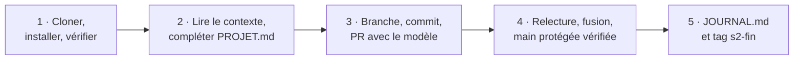
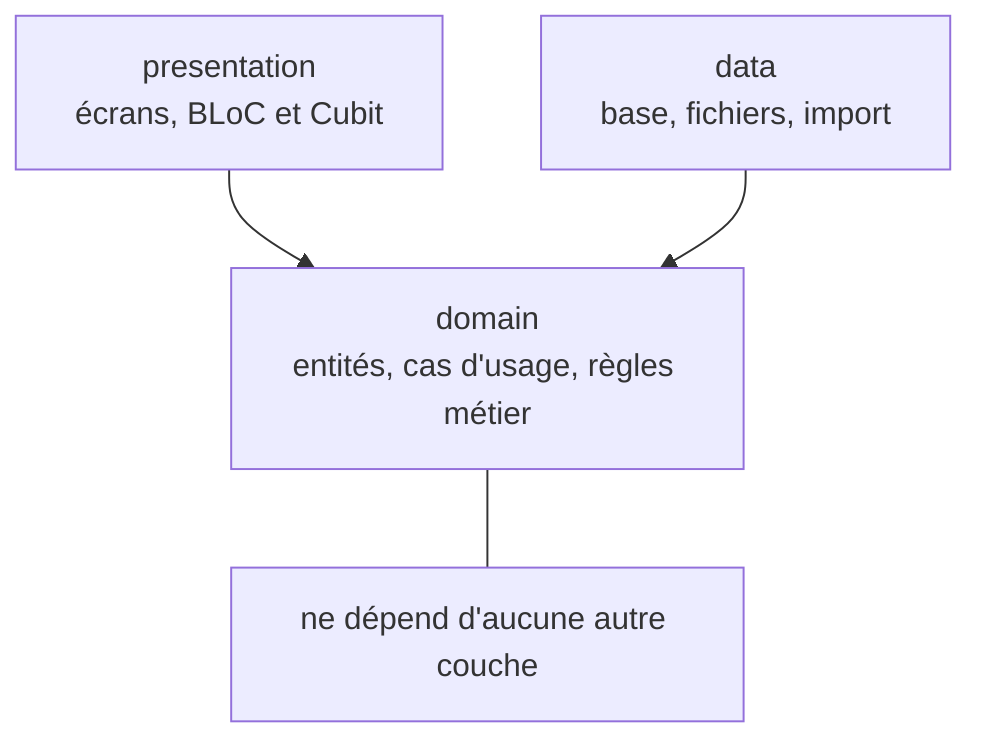
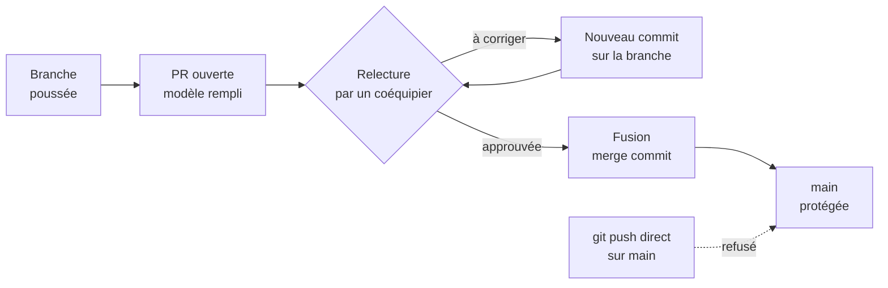
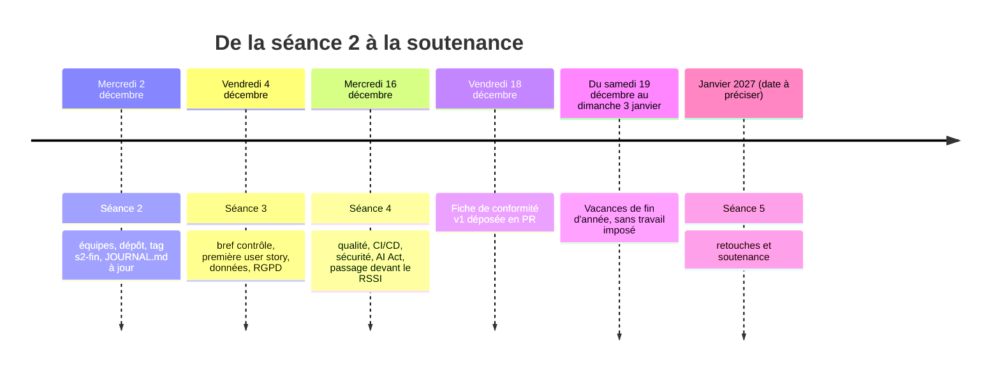

# Chapitre 3 · Démarrer le projet d'équipe : dépôt, `PROJET.md`, première PR, `main` protégée

*Séance 2 « Git, configurer son agent, lancer le projet » · Master ITI, Nantes Université, 2026-2027. Chapitre à lire avant ou après la séance. État des outils vérifié le 19 novembre 2026 (git 2.53.0, gh 2.100.0, Flutter 3.50.0 sur le poste de rédaction).*

Ce chapitre accompagne le troisième temps de la séance : vous quittez le dépôt d'essai et vous entrez dans le **vrai dépôt de votre équipe**. Il commence par ce qui se décide en ouverture de séance (constituer l'équipe, choisir un thème), puis suit l'ordre de l'atelier : comprendre où ranger quoi, faire démarrer le projet sur chaque poste, décider du périmètre dans `PROJET.md`, faire passer une première modification par une pull request relue, vérifier que `main` est protégée, puis laisser au dépôt de quoi vous retrouver à la séance suivante, deux jours plus tard, et tout au long du projet.

## Ce que vous allez retenir

- Votre équipe se constitue **en début de séance**, après la présentation des trois thèmes ; elle a un **thème**, un **numéro** et des **gardiens** : un gardien n'est pas celui qui fait tout, c'est celui qui vérifie que c'est fait.
- Le projet est rangé en **trois couches** (`presentation`, `domain`, `data`) et en **fonctionnalités** (une fonctionnalité, un dossier). Vous n'avez pas à savoir écrire ce code ; vous devez savoir **où il va**, parce que c'est ce que vous contrôlerez quand l'agent vous proposera quelque chose.
- Deux fichiers fournis servent de premier contexte à l'agent et à vous : `CLAUDE.md` (commandes, règles, interdits) et `docs/ARCHITECTURE.md` (les couches et les conventions).
- Un dépôt « tient debout » quand cinq commandes passent sur **chaque** poste : cloner, `flutter pub get`, `build_runner`, `flutter test`, `flutter run -d chrome`.
- `PROJET.md` est un **document de décision** : l'agent aide à rédiger, l'équipe décide. Vous y retenez trois à cinq user stories.
- Toute modification passe par une **branche**, une **PR** rédigée avec le modèle du dépôt, une **relecture** par un coéquipier, puis une fusion. `main` refuse le reste, et vous le constaterez vous-mêmes.
- Avant de partir : cinq lignes d'**état courant** en tête de `JOURNAL.md` et le tag `s2-fin`. C'est le repère de fin de séance : le dépôt devient la mémoire du projet.

---

## 1. Pourquoi ce chapitre

Jusqu'ici, vous vous êtes entraînés : git dans un dépôt d'essai (chapitre 1, `01-git-pas-a-pas.md`), la configuration de Claude Code dans ce même dépôt (chapitre 2, `02-configurer-claude-code.md`). Rien de ce que vous y avez fait ne pouvait gêner quelqu'un d'autre. À partir de maintenant, vous travaillez à plusieurs dans un dépôt **public**, qui sera lu par vos coéquipiers, par une autre équipe en séances 3 et 4, par l'enseignant et par un jury.

Le chapitre ne redit pas ce que les autres expliquent. Les gestes git sont dans le chapitre 1, la configuration de l'agent dans le chapitre 2, les fiches à suivre pendant l'atelier dans le chapitre 4 (`04-fiches-de-seance.md`). Flutter, le TDD et les patrons d'architecture ont leurs chapitres dans les supports de la séance 1 (chapitres 4, 5 et 9) : vous trouverez ici les renvois précis.



> **À retenir.** L'objectif de la matinée n'est pas d'écrire du code : c'est d'obtenir un dépôt qui démarre sur tous les postes, un périmètre décidé ensemble et un circuit de relecture qui fonctionne.

---

## 2. Équipes, thèmes, numéros et rôles

### 2.1 Ce qui se décide au début de la séance

Aucun formulaire n'a été lancé après la séance 1 : il n'y a, en arrivant, ni équipes, ni thèmes attribués, ni dépôts. Tout se décide en ouverture de séance, juste après la remise en route des postes (chapitre 4, fiche 0) et la présentation des trois thèmes.

1. **Vous formez une équipe** de 3 à 5 personnes.
2. **L'équipe remplit le formulaire, sur place** : sa composition, les identifiants GitHub de ses membres, son classement des trois thèmes. Vérifiez l'orthographe de chaque identifiant : c'est avec lui que vous serez invité dans le dépôt.
3. **Trois équipes au plus par thème.** L'enseignant attribue les premiers choix ; si un thème a plus de trois candidates, on tire au sort tout de suite, et l'équipe qui perd passe à son choix suivant.
4. **Chaque équipe reçoit un numéro**, attribué par thème. Notez-le : il détermine quelle équipe relira vos PR en séance 3 et laquelle auditera votre dépôt en séance 4.
5. **Les rôles sont attribués** (2.3).

### 2.2 Ce qui se passe pendant les ateliers git et configuration

Pendant que vous travaillez dans votre dépôt d'essai (chapitres 1 et 2), l'enseignant ou une aide lance un script avec la liste obtenue : il crée **un dépôt par équipe** à partir d'un **dépôt-modèle** (section 4), y place le `PROJET.md` du thème attribué et ajoute chaque membre comme **collaborateur**. Comme les dépôts sont créés après l'attribution des thèmes, rien n'est à renommer ni à remplacer.

Vous recevez alors une invitation par courriel : **acceptez-la à la pause** (courriel de GitHub, ou `github.com/notifications`). Un dépôt public se lit sans invitation, il ne s'écrit pas sans elle. Au début de l'atelier d'initialisation, chacun vérifie qu'il voit le dépôt de son équipe sur GitHub et qu'il y a un accès en écriture.

Avant de classer les thèmes, sachez que le thème C demande plus de travail de conformité que les deux autres (il prend une décision qui concerne des personnes). Les trois énoncés sont dans `cours/projets/themes.md` et sont présentés en début de séance avec leur propre diaporama ; ce chapitre n'y revient pas, et ses exemples s'appuient sur le thème B (le calcul du TRS d'un atelier).

### 2.3 Les gardiens

| Taille de l'équipe | Rôles |
|---|---|
| 3 membres | **Gardien produit et conformité** (`PROJET.md`, cas d'acceptation, fiche de conformité) ; **gardien des données** (modèle, migrations, jeu de données de départ) ; **gardien du harnais et de la CI** (`CLAUDE.md`, permissions, GitHub Actions) |
| 4 membres | Les trois rôles ci-dessus, avec un **gardien conformité** distinct (fiche, pseudonymisation, contact avec le RSSI) |
| 5 membres | Les quatre rôles, plus un **gardien de la démonstration** (README testé à froid, jeu de données de soutenance) |

Trois précisions. Un gardien **veille** : il ne fait pas tout le travail de son domaine, il s'assure que ce travail existe et qu'il est cohérent. La charge du projet ne dépend pas de la taille de l'équipe : à trois on cumule, à cinq on complète. Et quel que soit son rôle, **chacun relit au moins une PR d'un autre**.

> **À retenir.** Équipe, thème, numéro et rôles sont fixés aujourd'hui une fois pour toutes : les appariements des séances 3 et 4 en dépendent.

---

## 3. La pile du projet : où ranger quoi

### 3.1 Trois couches

Votre dépôt contient déjà une application Flutter qui démarre. Elle suit une organisation appelée **Clean Architecture** (architecture propre) : le code est séparé en trois **couches**, c'est-à-dire trois familles de fichiers qui n'ont pas le même travail.

| Couche | Sa question | Ce qu'on y trouve | Exemple (thème B) |
|---|---|---|---|
| `presentation` | Que voit l'utilisateur ? | Les écrans (widgets) et leur état (BLoC, Cubit) | L'écran qui affiche le TRS d'un quart |
| `domain` | Quelle est la règle ? | Les entités, les cas d'usage, les règles métier | Le calcul de la disponibilité d'un quart |
| `data` | D'où viennent les données ? | La base, les fichiers, l'import | La lecture des arrêts enregistrés |

La règle qui donne son intérêt à ce rangement tient en une phrase : **`domain` ne dépend de personne**. La règle métier s'écrit sans rien savoir de l'écran ni de la base. Les deux autres couches la connaissent ; elle ne les connaît pas.



Pourquoi cela vous concerne, vous qui n'écrirez presque pas ce code à la main :

- **pour relire** : une règle de calcul trouvée dans un écran, ou une requête de base de données dans `domain`, est un signal d'alerte que vous pouvez repérer sans lire le détail du code ;
- **pour tester** : une règle sans écran ni base se vérifie en une seconde, ce qui rend le TDD praticable ;
- **pour cadrer l'agent** : « la règle de calcul va dans `domain`, avec son test » est une consigne vérifiable. « Fais du code propre » ne l'est pas.

### 3.2 Une fonctionnalité, un dossier

Le code n'est pas rangé d'abord par couche, mais par **fonctionnalité** (en anglais *feature*) : chaque fonctionnalité a son dossier, et les trois couches se retrouvent à l'intérieur. L'arborescence ci-dessous est un **exemple rédigé pour ce chapitre** ; les noms réels sont ceux de votre dépôt.

```text
lib/
├── core/                    ce qui sert à toutes les fonctionnalités
└── features/
    └── disponibilite/       une fonctionnalité = un dossier
        ├── domain/          la règle
        ├── data/            les données
        └── presentation/    l'écran et son état
test/
└── features/
    └── disponibilite/       les tests suivent la même arborescence
```

Conséquence pratique pour le travail d'équipe : deux personnes qui travaillent sur deux fonctionnalités touchent deux dossiers différents, donc provoquent peu de conflits (chapitre 1, section sur les conflits).

### 3.3 Les bibliothèques, en une ligne chacune

| Nom | Rôle | Où en lire plus (supports de la séance 1) |
|---|---|---|
| `get_it` | **Injection de dépendances** : un annuaire où l'on enregistre les pièces (par exemple « la source des arrêts ») pour pouvoir les remplacer par une fausse dans les tests | Chapitre 9, patrons de création et patrons d'architecture de Flutter |
| `flutter_bloc` | **État de l'écran** : un BLoC ou un Cubit reçoit ce que fait l'utilisateur et produit l'état à afficher | Chapitre 4, section 7 (« L'état et sa gestion ») |
| `flutter_test`, `bloc_test`, `mocktail` | **TDD** : écrire le test avant le code ; tester un BLoC ; fabriquer de fausses pièces | Chapitre 4, section 9 ; chapitre 5 (le dojo) |
| `bdd_widget_test` | **BDD** : des scénarios rédigés en français dans des fichiers `.feature`, transformés en tests | Chapitre 5, section 10 |
| drift | **Base de données** SQLite, avec migrations versionnées | Utilisé à partir de la séance 3 |

Vous n'avez rien à installer : ces bibliothèques sont déjà déclarées dans le dépôt, et leurs versions sont **verrouillées** par le fichier `pubspec.lock`, qui est versionné. C'est ce verrou qui permet au projet de démarrer à l'identique sur tous les postes, aujourd'hui comme en janvier.

> **À retenir.** Retenez la question à poser devant toute proposition de l'agent : « dans quelle couche et dans quel dossier ce fichier va-t-il, et pourquoi ? ». Si la réponse est floue, la proposition n'est pas prête.

---

## 4. Lire le dépôt-modèle

Le dépôt de votre équipe est une copie du dépôt-modèle de l'enseignant. D'après le programme, il contient les éléments suivants. Le tableau vous dit ce que vous en faites **aujourd'hui**.

| Fichier ou dossier | Rôle | Aujourd'hui |
|---|---|---|
| `README.md` | Comment installer et lancer le projet ; version de Flutter | À lire en premier |
| `CLAUDE.md` et `.claude/settings.json` | Instructions de l'agent et permissions (dont le refus de lecture de `.env`) | À lire (section 5) |
| `docs/ARCHITECTURE.md` | Les couches, l'injection, les conventions BLoC, la discipline TDD et BDD | À lire (section 5) |
| `PROJET.md` | Vision et user stories, pré-remplies pour votre thème | **À compléter** (section 8) |
| `JOURNAL.md` | État courant du projet et mémoire des décisions | **À compléter** (section 11) |
| `.github/pull_request_template.md` | Le modèle de description d'une PR | Utilisé à la première PR (section 9) |
| `.github/workflows/` | La CI minimale : `flutter analyze` et `flutter test` à chaque modification | À regarder tourner |
| `lib/` et `test/` | Le squelette en couches, avec un BLoC d'exemple, un test unitaire, un fichier `.feature` d'exemple, une base d'exemple, une garde d'accès d'exemple | À visiter (section 6) |
| `test/acceptance/` | Dossier vide, réservé aux cas d'acceptation de la séance 4 | À laisser vide |
| `pubspec.yaml`, `pubspec.lock` | Dépendances déclarées et versions verrouillées | À ne pas modifier |
| `docs/fiche_conformite.md` | Gabarit de la fiche de conformité (13 rubriques) | Pour les séances 3 et 4 |
| `.gitignore`, `.env.example` | Ce que git ignore (dont `.env`) ; modèle de fichier d'environnement sans secret | À connaître |

La CI (intégration continue, chapitre 8 des supports de la séance 1) est active dès aujourd'hui : chaque PR affiche une pastille verte ou rouge. Elle ne **bloque** pas encore la fusion (elle deviendra obligatoire en séance 4), mais une pastille rouge se regarde.

---

## 5. Le contexte fourni : `CLAUDE.md` et `docs/ARCHITECTURE.md`

Ces deux fichiers sont le **premier contexte** de votre agent. Le chapitre 2 explique comment Claude Code lit `CLAUDE.md` et pourquoi il doit rester court ; on regarde ici ce que **celui du projet** vous dit. Ils sont pensés pour être réutilisables : vous pourrez les reprendre dans un autre projet Flutter.

**Avertissement.** Au moment où ce chapitre est écrit, ces deux fichiers sont encore à produire par l'enseignant : ils n'ont pas pu être lus. Les extraits qui suivent sont des **exemples rédigés pour ce chapitre, à partir de ce que le programme annonce ; le fichier réel de votre dépôt fait foi.**

### 5.1 `CLAUDE.md`, lu ligne à ligne

```markdown
# Projet d'équipe (Flutter, Clean Architecture)

## Commandes
- Installer : `flutter pub get`
- Générer le code : `dart run build_runner build --delete-conflicting-outputs`
- Tests : `flutter test` · Analyse : `flutter analyze` · Format : `dart format .`
- Lancer : `flutter run -d chrome`

## Règles
- Une fonctionnalité = un dossier, avec `domain/`, `data/`, `presentation/`.
- `domain/` n'importe jamais `data/` ni `presentation/`, ni Flutter.
- Test d'abord : un test qui échoue, puis le code minimal qui le fait passer.
- Voir `docs/ARCHITECTURE.md` avant de créer un fichier.

## Interdits
- Ne jamais modifier, désactiver ni supprimer un test pour le faire passer.
- Ne jamais modifier `test/acceptance/`.
- Aucune donnée réelle, aucun secret, aucun nom de personne dans le dépôt.

## Avant de dire « c'est terminé »
Lancer `flutter analyze` et `flutter test`, et coller le résultat.
```

Comment le lire :

- **Commandes** : ce sont les vôtres aussi. Si vous ne deviez retenir qu'une section, ce serait celle-ci.
- **Règles** : chacune se **vérifie**. Vous pouvez ouvrir un fichier de `domain/` et regarder ses premières lignes (les `import`) : si l'une mentionne `data` ou `presentation`, la règle est enfreinte.
- **Interdits** : ce sont des **demandes** faites au modèle. Les plus graves sont doublées par une **contrainte** dans `.claude/settings.json` (chapitre 2 : une consigne est une demande, une permission est une contrainte). Ouvrez ce fichier et repérez la règle qui refuse la lecture de `.env`.
- **Avant de dire « c'est terminé »** : l'agent doit fournir une preuve, pas une affirmation.

Ce fichier vit : c'est la règle du jeu n° 9 (section 13). Quand l'équipe apprend quelque chose (« l'agent mélange les minutes et les secondes »), elle l'écrit dans `CLAUDE.md`, par une PR, sous la responsabilité du gardien du harnais.

### 5.2 `docs/ARCHITECTURE.md`, ce que vous devez y trouver

Le programme annonce quatre contenus : la structure en couches, l'injection avec `get_it`, les conventions des BLoC, la discipline TDD et BDD. Lisez-le en cherchant la réponse à quatre questions :

1. Où crée-t-on le dossier d'une nouvelle fonctionnalité, et quels sous-dossiers contient-il ?
2. Où enregistre-t-on une nouvelle pièce dans `get_it` ?
3. Comment nomme-t-on un BLoC, ses événements et ses états ?
4. Dans quel ordre écrit-on le scénario, le test et le code ?

Si l'une de ces réponses manque ou vous paraît obscure, notez-le dans `JOURNAL.md` : c'est une amélioration à proposer.

> **À retenir.** Lisez ces deux fichiers **avant** de lancer l'agent. Vous ne pouvez pas contrôler qu'il respecte des règles que vous n'avez pas lues.

---

## 6. Visite guidée : un scénario et un test de BLoC

Le programme classe cette visite parmi ce qui ne se sacrifie jamais : deux minutes à l'écran suffisent, et elles montrent à quoi ressemblera votre première user story en séance 3. Les deux extraits ci-dessous sont **illustratifs** : ils n'ont pas été exécutés et ne sont pas ceux du squelette, qui n'existe pas encore à la date de rédaction. Ouvrez les vrais fichiers dans votre dépôt.

### 6.1 Un fichier `.feature`

Un fichier `.feature` décrit un comportement en phrases, selon la forme **Soit / Quand / Alors** (le langage s'appelle Gherkin ; chapitre 5 des supports de la séance 1, section 10). Celui-ci reprend la sous-règle que l'énoncé du thème B propose comme première user story, avec ses valeurs :

```gherkin
Fonctionnalité: Calcul de la disponibilité d'un quart
  Scénario: disponibilité avec un arrêt planifié et deux arrêts non planifiés
    Soit un quart de 480 minutes
    Et un arrêt planifié "pause" de 30 minutes
    Et un arrêt non planifié "panne" de 45 minutes
    Et un arrêt non planifié "changement_serie" de 15 minutes
    Quand je calcule la disponibilité
    Alors le temps requis est de 450 minutes
    Et le temps de marche est de 390 minutes
    Et la disponibilité affichée est 86,7 %
```

Ce qu'il faut voir : aucun mot de programmation. Un responsable d'atelier peut le lire et dire « oui, c'est bien la règle » ou « non, la pause ne se compte pas ainsi ». C'est pourtant un **test** : la commande `build_runner` (section 7) en tire du code exécutable, et `flutter test` dit s'il passe.

### 6.2 Un test de BLoC

Un test de BLoC vérifie l'**état de l'écran** sans afficher d'écran : « quand il se passe ceci, l'écran doit passer par ces états ».

```dart
blocTest<DisponibiliteCubit, DisponibiliteState>(
  'affiche 86,7 % pour le quart de démonstration',
  build: () => DisponibiliteCubit(calculer: calculerDisponibilite),
  act: (cubit) => cubit.charger(quartDeDemonstration),
  expect: () => [
    const DisponibiliteState.chargement(),
    const DisponibiliteState.pret(affichage: '86,7 %'),
  ],
);
```

Lisez-le comme une phrase en quatre temps : le **titre** dit ce qui est vérifié ; `build` fabrique la pièce à tester ; `act` joue l'action de l'utilisateur ; `expect` liste les états attendus, dans l'ordre. Vous n'avez pas à savoir l'écrire. Vous devez savoir le lire assez pour répondre à la question : « ce test vérifie-t-il bien ce que nous avons demandé ? ».

> **À retenir.** Quand on ne sait pas lire le code, on peut lire les tests. Le scénario dit la règle dans vos mots ; le test de BLoC dit ce que l'écran doit montrer.

---

## 7. Faire démarrer le projet sur chaque poste

### 7.1 Les cinq commandes

Chaque membre de l'équipe les tape **sur son propre poste**. Attention au point de départ : fermez d'abord le dossier `essai-git` et ouvrez un terminal dans votre dossier de travail habituel. Si vous clonez depuis `essai-git`, vous obtenez un dépôt dans un dépôt (la commande `pwd` affiche le dossier où vous êtes : il ne doit pas se terminer par `essai-git`). Remplacez `<organisation>` par le nom de l'organisation GitHub de la formation et `<numéro>` par le numéro de votre équipe, chevrons compris.

```bash
gh repo clone <organisation>/equipe_<numéro>
cd equipe_<numéro>
flutter pub get
dart run build_runner build --delete-conflicting-outputs
flutter test
flutter run -d chrome
```

| Commande | Ce qu'elle fait | Ce que vous devez voir |
|---|---|---|
| `gh repo clone` | Copie le dépôt de l'équipe sur votre poste, avec tout son historique | Un nouveau dossier `equipe_NN` |
| `flutter pub get` | Télécharge les bibliothèques, aux versions de `pubspec.lock` | `Got dependencies!` |
| `dart run build_runner build --delete-conflicting-outputs` | **Génère** du code à partir d'autres fichiers (les `.feature`, la base) | Un message de succès, après une attente qui peut dépasser une minute la première fois |
| `flutter test` | Lance tous les tests | `All tests passed!` |
| `flutter run -d chrome` | Compile l'application et l'ouvre dans Chrome | Une fenêtre Chrome avec l'application |

Pourquoi `build_runner` : les fichiers générés **ne sont pas versionnés** (git les ignore). Ils n'existent donc pas juste après un clone, et il faut relancer cette commande après chaque nouveau clone et chaque fois qu'un fichier `.feature` ou la base changent. L'option `--delete-conflicting-outputs` l'autorise à remplacer d'anciens fichiers générés.

Ouvrez ensuite le dossier dans VS Code (`code .`), puis lancez Claude Code **dans ce dossier** : c'est à cette condition qu'il lit le `CLAUDE.md` et les permissions du projet (chapitre 2).

### 7.2 Quand ça échoue

| Symptôme | Cause probable | Que faire |
|---|---|---|
| `gh repo clone` répond que le dépôt est introuvable | Faute de frappe, ou numéro d'équipe erroné | Vérifier le nom sur GitHub ; `gh auth status` pour voir le compte connecté |
| Le clone marche, mais le premier `git push` est refusé (erreur 403) | Invitation de collaborateur non acceptée | Accepter l'invitation (courriel de GitHub ou `github.com/notifications`) |
| `flutter pub get` échoue sur une version | Version de Flutter différente de celle du README | Comparer avec `flutter --version` ; **ne pas** modifier `pubspec.yaml` ni lancer `flutter upgrade` : appeler un encadrant |
| `flutter test` signale des fichiers manquants (noms en `.g.dart` ou `_test.dart` générés) | `build_runner` n'a pas été lancé | Lancer la commande `build_runner`, puis relancer les tests |
| `build_runner` s'arrête sur un conflit de fichiers | Anciens fichiers générés | Vérifier que l'option `--delete-conflicting-outputs` est bien présente |
| `flutter run -d chrome` ne trouve pas Chrome | Chrome absent ou non détecté | `flutter doctor` : seule la ligne Chrome compte, la chaîne Android peut rester en rouge |
| Les tests passent chez l'un et pas chez l'autre | Postes différents, ou modification locale non commitée | `git status` sur les deux postes ; comparer `flutter --version` |

Deux réflexes : lire le message d'erreur en entier, en commençant par la **première** ligne rouge (chapitre 4 des supports de la séance 1, section 11) ; et demander à l'agent d'**expliquer** l'erreur avant de lui demander de la corriger. La fiche F du chapitre 4 reprend les pannes git les plus fréquentes.

> **À retenir.** Le dépôt n'est « fonctionnel » que si les tests sont verts et l'application ouverte dans Chrome sur le poste de **chaque** membre. Un seul poste qui marche ne suffit pas.

---

## 8. `PROJET.md` : décider avant de produire

### 8.1 Ce que contient le fichier

`PROJET.md` vous est fourni **pré-rempli pour votre thème** : une vision en cinq lignes et une liste de user stories proposées. Votre travail d'équipe est de le relire, de **retenir trois à cinq user stories**, d'ajuster le texte et de décider.

- La **vision** répond en cinq lignes à : pour qui, quel problème, quel outil, pour combien de temps, et ce que l'outil ne fera pas.
- Une **user story** (récit utilisateur) décrit un besoin du point de vue de celui qui l'a, sous la forme « **En tant que** … **je veux** … **afin de** … ».
- Ses **critères d'acceptation** disent à quoi l'on reconnaîtra que c'est fait. Un bon critère est vérifiable : il deviendra un scénario `.feature`.

Exemple pour le thème B, **rédigé pour ce chapitre** à partir de l'énoncé (le `PROJET.md` de votre dépôt fait foi) :

```markdown
## Vision
Pendant une campagne de mesure d'un trimestre, la responsable amélioration
continue de la ligne 4 veut un TRS par poste et par quart, calculé avec la
même formule pour tout le monde. L'outil remplace le tableur le temps de la
campagne ; il ne devient pas un système de pilotage d'atelier. Il ne sert
jamais à évaluer une personne. Toutes les données sont fictives.

## User stories retenues
1. En tant que responsable, je veux créer les postes et les quarts,
   afin de préparer la campagne de mesure.
2. En tant qu'opérateur, je veux déclarer les arrêts de mon quart,
   afin que le temps perdu soit compté de la même façon par tous.
3. En tant que responsable, je veux consulter la disponibilité d'un poste
   pour un quart, afin de savoir où le temps se perd.

### Critères d'acceptation de la story 3
- Pour un quart de 480 minutes avec une pause de 30 minutes, une panne de
  45 minutes et un changement de série de 15 minutes, la disponibilité
  affichée est 86,7 %.
- Un arrêt qui déborde du quart n'est compté que pour sa partie dans le quart.
```

### 8.2 Choisir trois à cinq user stories

Trois critères pour trancher : la story est-elle **nécessaire** au livrable minimum de votre thème ? Est-elle **petite** (une story que l'on ne sait pas découper en un ou deux scénarios est trop grosse) ? Sait-on dire **quand elle est finie** ? Désignez aussi celle qui sera la **première** : vous l'annoncerez en une phrase à la fin de la séance, et vous la livrerez en séance 3.

### 8.3 Le rôle de l'agent

`PROJET.md` est un document, pas du code : l'agent peut vous aider à le rédiger. Il est utile pour reformuler une story au bon format, proposer des critères d'acceptation, signaler une ambiguïté (« que se passe-t-il si un arrêt commence avant le quart ? »). Il n'est pas légitime pour **choisir** : le périmètre engage l'équipe, pas l'outil.

Une façon de faire qui marche : passez en mode plan (chapitre 2), et demandez « relis `PROJET.md` ; pour chaque user story, propose deux critères d'acceptation vérifiables et signale ce qui est ambigu ; ne modifie rien ». Vous discutez ses propositions à voix haute, vous en gardez certaines, vous en écartez d'autres, et **vous notez lesquelles** : vous en aurez besoin dans la description de la PR.

> **À retenir.** L'agent aide à rédiger, l'équipe décide. Ce que vous refusez à l'agent est une information aussi utile que ce que vous acceptez.

---

## 9. La première pull request

### 9.1 Branche, commit, envoi

Vous ne travaillez jamais directement sur `main` : vous créez une branche, vous y commitez, vous la poussez. Les gestes sont expliqués au chapitre 1 ; en voici l'enchaînement pour `PROJET.md`.

```bash
git switch -c projet-perimetre
git status
git add PROJET.md
git commit -m "Retient les user stories de l'équipe"
git push -u origin projet-perimetre
```

Une seule personne de l'équipe porte cette première PR ; les autres préparent la relecture. L'option `-u` relie votre branche locale à celle de GitHub : les `git push` suivants n'auront plus besoin de préciser la destination.

### 9.2 Ouvrir la PR avec le modèle

```bash
gh pr create --web
```

Cette commande ouvre dans le navigateur le formulaire de création de PR, **déjà rempli avec le modèle du dépôt**. Sans `--web`, `gh pr create` pose ses questions dans le terminal et part lui aussi du modèle. N'utilisez pas l'option `--fill` : elle remplit la PR avec le message du commit et **saute le modèle**.

Le modèle (`.github/pull_request_template.md`) vous demande cinq choses. Exemple rempli, **rédigé pour ce chapitre** ; la fiche E du chapitre 4 donne le modèle vierge.

```markdown
## Résumé
Retient quatre user stories pour le thème B et précise la vision : l'outil
ne sert jamais à évaluer une personne.

## Ce que l'agent a proposé, ce que j'ai refusé
- Proposé et gardé : deux critères d'acceptation chiffrés pour la story 3.
- Proposé et refusé : une story « classement des opérateurs », contraire à
  la finalité du thème.

## Suivi
- Temps estimé : 30 min
- Temps réel : 45 min
- Retouches : 2 (reformulation de la vision, un critère corrigé)
```

### 9.3 Pourquoi ce suivi

Ces lignes ne servent pas à vous surveiller. Elles répondent à trois règles d'usage de l'IA du programme :

- **Transparence** : chaque PR dit ce que l'agent a proposé et ce que vous avez refusé.
- **Esprit critique** : l'équipe devra documenter au moins deux cas où elle a repéré une erreur de l'agent. La section « refusé » est l'endroit où ces cas apparaissent ; l'étiquette `erreur-agent` permet de les retrouver.
- **Mesurer plutôt que croire** : dans l'essai contrôlé de METR (juillet 2025) vu en séance 1, des développeurs expérimentés pensaient avoir gagné 20 % de temps avec l'IA et en avaient perdu 19 %. Noter le temps estimé, le temps réel et les retouches est la seule façon de ne pas se fier à son impression (chapitre 3 des supports de la séance 1).



> **À retenir.** Une PR raconte une décision : ce qui change, pourquoi, ce que l'agent a proposé, ce que vous avez écarté et combien de temps cela a pris.

---

## 10. Relire, fusionner, vérifier la protection

### 10.1 Relire avec la checklist en cinq lignes

Le relecteur est un **coéquipier autre que l'auteur**. Il ouvre la PR sur GitHub, onglet « Files changed », et se pose cinq questions dans l'ordre :

1. Je comprends ce que fait cette PR, et je saurais l'expliquer.
2. Elle fait une seule chose, et le diff se lit en entier.
3. Les vérifications passent : `flutter analyze`, `flutter test`.
4. Aucun secret, aucune donnée réelle ou personnelle.
5. Aucun test supprimé ni affaibli, et les règles de `CLAUDE.md` sont respectées.

Le programme fixe le nombre de lignes de cette checklist, pas leur texte : celui-ci est une **proposition des supports**, reprise sur la fiche D du chapitre 4. Pour cette première PR, qui ne touche qu'un fichier Markdown, la ligne 3 se réduit à « la pastille de CI est verte » et la ligne 5 à « rien d'autre que `PROJET.md` n'a changé ».

Pour donner son avis : bouton « Review changes », un commentaire, puis l'un des trois choix **Comment** (une remarque), **Approve** (j'approuve) ou **Request changes** (à corriger), et « Submit review ». Si quelque chose est à corriger, l'auteur ajoute un commit sur la même branche et le pousse : la PR se met à jour toute seule.

Approuver n'est pas une politesse. Règle du jeu n° 2 : chacun doit pouvoir expliquer n'importe quelle PR qu'il a ouverte **ou approuvée**. « C'est l'agent qui l'a écrit » n'est pas une réponse recevable, pour l'auteur comme pour le relecteur.

### 10.2 Fusionner

Une fois la PR approuvée, le bouton « Merge pull request » devient actif. Dans vos dépôts, une seule méthode est autorisée : le **merge commit** (« Create a merge commit »), qui conserve tous les commits de la branche et ajoute un commit de fusion. Les deux autres méthodes de GitHub sont désactivées, parce qu'elles réécrivent l'historique : or votre historique est une preuve (en séance 3, on doit y voir le commit du test **avant** celui du code). Après « Confirm merge », la branche est supprimée sur GitHub.

Chacun met ensuite son poste à jour :

```bash
git switch main
git pull
```

### 10.3 Ce que la protection de `main` impose

| Réglage | Conséquence pour vous |
|---|---|
| PR obligatoire | Aucun commit n'arrive sur `main` autrement que par une PR |
| 1 approbation requise | Quelqu'un d'autre doit avoir approuvé |
| L'auteur ne peut pas approuver sa propre PR (règle générale de GitHub) | On ne peut pas s'auto-valider, même avec l'aide de l'agent |
| Pas de contournement par les administrateurs | La règle vaut pour tout le monde, enseignant compris |

À partir de la séance 4 s'ajoutera une cinquième exigence : une CI verte.

### 10.4 Vérifier que la protection est active

Un garde-fou que l'on n'a pas vu refuser n'est pas un garde-fou (c'est la leçon du chapitre 2 sur les permissions, appliquée à git). Un membre de l'équipe tente donc un envoi direct sur `main` :

```bash
git switch main
git pull
git commit --allow-empty -m "Test : push direct sur main"
git push
```

L'option `--allow-empty` crée un commit qui ne modifie aucun fichier : il ne sert qu'au test. Le refus attendu commence ainsi :

```text
remote: error: GH006: Protected branch update failed for refs/heads/main.
```

Les lignes suivantes précisent la raison (les modifications doivent passer par une pull request) et la commande se termine par un rejet. **Si le push passe**, la protection n'est pas active : prévenez l'enseignant tout de suite.

Il reste à effacer le commit de test, qui existe encore sur votre poste :

```bash
git reset --hard origin/main
```

Cette commande remet votre branche `main` locale **exactement** dans l'état de celle de GitHub. Elle est justifiée ici, et dangereuse ailleurs : elle **supprime sans retour** les commits locaux qui n'ont pas été poussés et toutes les modifications non commitées du dossier. Avant de la taper, lancez `git status` et vérifiez que vous n'avez rien d'autre en cours que le commit de test. C'est une commande que vous ne laissez pas un agent lancer à votre place.

> **À retenir.** La protection de `main` est à git ce que la permission `deny` est à l'agent : une contrainte appliquée par l'outil, pas une consigne. Dans les deux cas, on la teste.

---

## 11. `JOURNAL.md` et le tag `s2-fin`

### 11.1 L'état courant en cinq lignes

`JOURNAL.md` commence par une rubrique « État courant ». Avant de partir, le gardien du harnais y écrit cinq lignes, pour quelqu'un qui aurait tout oublié : c'est-à-dire vous, à la rentrée de janvier, ou un coéquipier absent aujourd'hui. Exemple **rédigé pour ce chapitre** :

```markdown
## État courant (2 décembre 2026, fin de la séance 2)
- Où on en est : équipe 05, thème B ; dépôt cloné et vert sur les 4 postes ;
  PROJET.md fusionné (PR n° 1), 4 user stories retenues.
- Prochaine étape : story 3 (disponibilité d'un quart) en TDD et BDD, séance 3
  (vendredi 4 décembre).
- Commandes clés : flutter pub get · dart run build_runner build
  --delete-conflicting-outputs · flutter test · flutter run -d chrome.
- Décisions : l'outil ne calcule rien par personne ; cible Chrome uniquement.
- Reste à faire : un poste n'ouvre pas encore Chrome (flutter doctor à revoir).
```

Aucun nom complet, aucune adresse : le dépôt est public. Ce qui n'a pas été terminé aujourd'hui s'écrit ici ; ce sera repris au contrôle d'ouverture de la séance 3, deux jours plus tard.

Le journal passe par une PR, comme tout le reste : `main` est protégée, vous venez de le vérifier. C'est l'occasion d'une deuxième PR, relue par un autre relecteur que celui de la première.

### 11.2 Poser le tag

Un **tag** est une étiquette durable posée sur un commit : « voici l'état du projet à la fin de la séance 2 ». Une fois le journal fusionné :

```bash
git switch main
git pull
git tag s2-fin
git push origin s2-fin
```

`git pull` d'abord, pour que l'étiquette soit posée sur le `main` à jour et non sur un état ancien de votre poste. Le tag part ensuite sur GitHub par un push à part : la protection de branche vise la branche `main`, pas les tags, donc cet envoi n'est pas refusé. Vous retrouvez le tag sur la page du dépôt, dans la liste des branches et tags.

> **À retenir.** Le tag dit **quel** état retrouver, le journal dit **quoi en faire**. L'un sans l'autre ne suffit pas.

---

## 12. Et ensuite : la séance 3 dans deux jours, puis la fin du calendrier

L'interruption de huit semaines est derrière vous : elle séparait la séance 1 de celle-ci, et c'est pour elle que la fiche 0 du chapitre 4 vous a fait revérifier votre poste. La suite est plus serrée.



### 12.1 D'ici vendredi

Rien n'est demandé entre la séance 2 et la séance 3. La séance 3 s'ouvre sur un **bref contrôle**, pas sur une remise en route :

1. `git pull` ;
2. `flutter pub get` ;
3. `flutter test`.

Si votre équipe n'a pas terminé l'initialisation aujourd'hui (première PR relue, protection de `main` vérifiée), elle la termine à ce moment-là : notez-le dans `JOURNAL.md`.

### 12.2 Plus tard dans le calendrier

- **Entre la séance 3 et la séance 4, douze jours** : une tâche facultative, de 2 h au plus par étudiant, pour terminer ce qui aura glissé de la séance 3 (jeu de données complet, rôles). Elle sera précisée en séance 3.
- **Le sprint final** se place entre la séance 4 (16 décembre) et la soutenance, en janvier 2027 (date à préciser) : 15 à 20 heures par équipe. Il englobe les vacances de fin d'année (du samedi 19 décembre 2026 au dimanche 3 janvier 2027 inclus) : aucun travail n'est imposé pendant les vacances au-delà de ce que votre équipe choisit.
- **Jalons** : fiche de conformité v1 en PR le vendredi 18 décembre 2026 ; réponse du RSSI au plus tard une semaine avant la soutenance ; gel et tag `v1.0-rc` l'avant-veille de la soutenance à 18 h ; lecture des dépôts par les évaluateurs la veille.

### 12.3 Ce qu'il ne faut pas faire d'ici là

- **Pas de `flutter upgrade` sans raison.** Les versions sont verrouillées pour que le projet démarre à l'identique sur tous les postes.
- **Rien de personnel dans le dépôt, même pour tester** : ni liste de noms, ni export d'un stage, ni capture d'écran d'une messagerie. C'est la règle d'or.
- **Pas de secret** dans le dépôt ni dans un prompt.
- Claude Code et les modèles changent vite : **notez la version** que vous utilisez (`claude --version`) et relisez vos permissions après chaque mise à jour (chapitre 2).

> **À retenir.** Le tag `s2-fin` et l'état courant de `JOURNAL.md` sont votre repère de fin de séance : vendredi, vous repartez de là.

---

## 13. Les dix règles du jeu

Elles valent pour toute la durée du projet. Vous avez déjà pratiqué les quatre premières aujourd'hui.

1. **Pas de code non relu.** Toute PR est relue par quelqu'un d'autre que l'auteur, avant fusion.
2. **On comprend ce qu'on livre.** Chacun peut expliquer n'importe quelle PR qu'il a ouverte ou approuvée.
3. **Commits petits et lisibles**, merge commit uniquement : le commit de test précède le code dans l'historique.
4. **`main` est protégée.** Pas de push direct, PR obligatoire avec une approbation ; à partir de la séance 4, CI verte obligatoire.
5. **Jamais de secrets dans le dépôt** (clés d'API, mots de passe, jetons). Le dépôt est public : nom, PR et commits y sont visibles, d'où l'adresse noreply de GitHub.
6. **Données fictives uniquement.** Aucune donnée personnelle réelle, ni dans le dépôt, ni dans un prompt.
7. **On ne triche pas avec les tests.** Pas de test supprimé, désactivé ou assoupli. `test/acceptance/` n'est modifié que par un humain, dans une PR relue.
8. **Agent sous contrôle.** Mode manuel (le programme écrit « permissions par défaut », ce qui ne désigne plus le mode manuel depuis que le mode auto est le mode de démarrage ; voir le chapitre 2, section 3.2) ; pas de mode « sans confirmation » sur sa machine personnelle ; actions destructrices refusées par configuration ; un agent par étudiant, sur sa propre branche.
9. **`CLAUDE.md` est maintenu.** Toute règle apprise y est ajoutée.
10. **Aucune mise en usage réelle sans validation du RSSI.** La règle s'applique dès qu'un outil sort de la formation, même s'il est temporaire.

---

## 14. Avez-vous fini ? La definition of done côté équipe

- [ ] L'équipe s'est constituée en séance, a rempli le formulaire, et a un thème attribué, un numéro et des rôles.
- [ ] Chaque membre a un accès en écriture au dépôt (invitation acceptée).
- [ ] `flutter test` passe et `flutter run -d chrome` démarre l'application **sur le poste de chaque membre**.
- [ ] `PROJET.md` est complété : trois à cinq user stories retenues, la première désignée.
- [ ] `main` contient une première PR, rédigée avec le modèle, **relue et approuvée par un autre que son auteur**, fusionnée en merge commit.
- [ ] La protection de `main` a été **vérifiée** : un push direct a été refusé.
- [ ] L'état courant est écrit en tête de `JOURNAL.md` et le tag `s2-fin` est visible sur GitHub.
- [ ] L'équipe sait dire en une phrase son thème et sa première user story.

---

## Glossaire

- **Approbation (*approve*)** : avis favorable donné par un relecteur sur une PR ; engage sa responsabilité.
- **BLoC, Cubit** : composants qui portent l'état d'un écran, séparés de l'affichage.
- **`build_runner`** : outil Dart qui génère du code à partir d'autres fichiers (scénarios, base).
- **Clean Architecture** : organisation du code en couches, la règle métier ne dépendant ni de l'écran ni de la base.
- **Collaborateur** : compte GitHub autorisé à écrire dans un dépôt.
- **Couche** : famille de fichiers ayant le même rôle (`presentation`, `domain`, `data`).
- **Critère d'acceptation** : condition vérifiable qui dit qu'une user story est terminée.
- **Dépôt-modèle** : dépôt de départ fourni par l'enseignant, copié pour chaque équipe.
- **Fichier `.feature`** : scénarios de comportement rédigés en phrases (Soit, Quand, Alors).
- **Fonctionnalité (*feature*)** : un service rendu à l'utilisateur ; dans le projet, un dossier.
- **Gardien** : membre de l'équipe qui veille sur un domaine (produit, données, harnais, conformité, démonstration).
- **Injection de dépendances** : fournir à une pièce de code ce dont elle a besoin au lieu de la laisser le fabriquer, pour pouvoir le remplacer en test.
- **Merge commit** : commit de fusion qui conserve tous les commits de la branche fusionnée.
- **Modèle de PR** : texte de départ proposé par GitHub à l'ouverture d'une PR.
- **Protection de branche** : réglages de GitHub qui imposent des conditions avant toute modification d'une branche.
- **Pull request (PR)** : demande de relecture et de fusion d'une branche.
- **Tag** : étiquette durable posée sur un commit.
- **TRS** : taux de rendement synthétique d'un équipement (disponibilité × performance × qualité) ; sujet du thème B.
- **User story** : besoin exprimé du point de vue de l'utilisateur, « En tant que… je veux… afin de… ».

---

## Pour aller plus loin

- Supports de la séance 1 : chapitre 4 (Flutter, sections 7, 9 et 10), chapitre 5 (le dojo : TDD, BDD, petits commits, rôle de l'agent), chapitre 8 (CI et protections de branche, section 7), chapitre 9 (patrons d'architecture de Flutter).
- Supports de la séance 2 : chapitre 1 pour chaque geste git de ce chapitre, chapitre 2 pour la configuration de l'agent, chapitre 4 pour les fiches C (initialisation), D (checklist), E (modèle de PR) et F (dépannage).
- L'énoncé de votre thème dans `cours/projets/themes.md` : relisez la « première user story » qu'il propose et son scénario.
- Simon Willison, « Don't file pull requests with code you haven't reviewed yourself » : une page, à lire avant la séance 3.
- Documentation de GitHub : « About pull request reviews » et « About protected branches ».

---

## Points non vérifiés (à signaler honnêtement)

- **Le dépôt-modèle n'existe pas encore** à la date de rédaction (le programme le classe « à produire »). Son contenu (section 4) est repris de la section 8 du programme ; `CLAUDE.md`, `docs/ARCHITECTURE.md`, `PROJET.md`, `JOURNAL.md` et le modèle de PR n'ont pas été lus. **Aucune des cinq commandes de mise en route n'a pu être exécutée sur le squelette**, et les messages attendus (`Got dependencies!`, `All tests passed!`) sont ceux de Flutter en général.
- **Exemples illustratifs** : l'arborescence (3.2), le `CLAUDE.md` (5.1), le test de BLoC (6.2), le `PROJET.md` (8.1), la description de PR (9.2) et le journal (11.1) sont rédigés pour ce chapitre ; le code Dart n'a pas été exécuté. Le scénario `.feature` (6.1) est recopié de l'énoncé du thème B.
- **Gherkin en français** : `cours/projets/themes.md` signale que la prise en charge des mots-clés français (`Soit`, `Quand`, `Alors`) par `bdd_widget_test` n'est pas confirmée. Le scénario de votre squelette peut utiliser les mots-clés anglais avec des phrases en français.
- **Message de refus du push direct** : la première ligne (`GH006: Protected branch update failed`) figure dans la documentation de GitHub pour un cas voisin ; la suite du message pour un push direct n'est attestée que par des sources communautaires. Le test n'a pas été fait sur un dépôt réel.
- **Tout ce qui passe par GitHub en ligne** (clone d'un dépôt d'équipe, `gh pr create --web`, relecture, boutons de fusion, envoi du tag vers GitHub) n'a pas été exécuté : commandes relues dans l'aide de `gh` 2.100.0 et dans la documentation de GitHub. Le fait que `--fill` saute le modèle de PR est déduit du code source de `gh`, pas de son manuel.
- **Séquence git locale** (branche, commit, `git push -u`, `git commit --allow-empty`, `git reset --hard origin/main`, `git tag`, `git push origin s2-fin`) : jouée avec git 2.53.0 dans un dépôt jetable relié à un dépôt distant local, sans GitHub.
- **Pannes de la section 7.2** : causes probables tirées de l'expérience courante, non reproduites ; le code d'erreur 403 pour une invitation non acceptée est donné à titre indicatif.
- **Checklist de PR** : texte proposé par les supports, à valider par l'enseignant.
- **Dates et calendrier** : les dates des 4, 16 et 18 décembre, des vacances et de la soutenance, en janvier 2027 (date à préciser), sont reprises du programme et susceptibles d'ajustement par l'enseignant.
- **Création des dépôts pendant la séance** : le script du programme (section 13) n'a pas été exécuté pour ce chapitre ; le délai entre le formulaire et la réception de l'invitation n'est pas mesuré.

---

## Sources

Documents du cours :

- `cours/programme-detaille.md` : séance 2 (blocs 3 et 8 à 10, definition of done), section 4 (rôles d'équipe), section 5 (travail entre les séances), section 7 (règles d'usage de l'IA), section 8 (pile, dépôt-modèle, règles du jeu), section 13 (script de création des dépôts).
- `cours/projets/themes.md` : pile technique du projet, organisation des équipes, thème B (user stories, scénario de la disponibilité, cas d'acceptation n° 2).
- Supports de la séance 1 : chapitres 3, 4, 5, 8 et 9 (`cours/supports/day-1/`).

Documentation officielle (consultée le 19 novembre 2026) :

- GitHub CLI, `gh repo clone` et `gh pr create` : https://cli.github.com/manual/gh_repo_clone et https://cli.github.com/manual/gh_pr_create
- GitHub, modèle de pull request : https://docs.github.com/en/communities/using-templates-to-encourage-useful-issues-and-pull-requests/creating-a-pull-request-template-for-your-repository
- GitHub, relire une pull request : https://docs.github.com/en/pull-requests/collaborating-with-pull-requests/reviewing-changes-in-pull-requests/reviewing-proposed-changes-in-a-pull-request
- GitHub, approbation et revues requises (l'auteur ne peut pas approuver sa propre PR) : https://docs.github.com/en/pull-requests/collaborating-with-pull-requests/reviewing-changes-in-pull-requests/approving-a-pull-request-with-required-reviews
- GitHub, fusionner une pull request et méthodes de fusion : https://docs.github.com/en/pull-requests/collaborating-with-pull-requests/incorporating-changes-from-a-pull-request/merging-a-pull-request
- GitHub, branches protégées : https://docs.github.com/en/repositories/configuring-branches-and-merges-in-your-repository/managing-protected-branches/about-protected-branches
- git, `git-push`, `git-tag`, `git-reset`, `git-switch` : https://git-scm.com/docs

Autres sources :

- METR, essai contrôlé de juillet 2025 (arXiv 2507.09089), cité d'après le programme et le chapitre 3 des supports de la séance 1.
- Simon Willison, « Don't file pull requests with code you haven't reviewed yourself », cité d'après le programme (page non relue pour ce chapitre).

Vérifications locales : `gh --help` (gh 2.100.0), séquence git jouée dans un dépôt jetable (git 2.53.0), `flutter --version` (Flutter 3.50.0).
