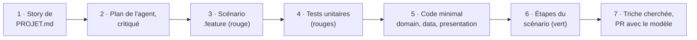

# Chapitre 2 · La première user story, en TDD et en BDD avec l'agent

*Séance 3 « Première user story, données et RGPD » · Master ITI, Nantes Université, 2026-2027. Chapitre à lire avant ou après la séance. Tous les extraits de code, de scénario et de sortie ont été écrits et exécutés le 26 novembre 2026 sous Linux avec Flutter 3.50.1 (Dart 3.14.0), sur une copie du dépôt-modèle, en suivant pas à pas la démarche décrite ici.*

Ce chapitre accompagne le bloc 3 de la séance, le premier atelier où votre équipe livre une vraie fonctionnalité. Il suit l'exemple du thème B, la **disponibilité d'un quart** (règles 2 et 3 de l'énoncé), du texte de `PROJET.md` jusqu'à la pull request : un plan demandé à l'agent et critiqué, un scénario en français, des tests unitaires écrits avant le code, un rangement en couches respecté, des étapes de scénario qui n'ouvrent aucun écran, et, à chaque pas, ce qu'il faut regarder pour savoir si l'agent a triché. Les équipes des thèmes A et C trouveront en section 10 où sont leur propre story et leur propre sous-règle.

## Ce que vous allez retenir

- La première user story se livre dans l'ordre du programme : **plan** demandé à l'agent et critiqué, puis **scénario `.feature`** (généré par `build_runner`, il est rouge), **tests unitaires** (rouges), **code minimal** couche par couche, **étapes** du scénario, commandes de vérification. Après le plan, c'est l'ordre de `docs/ARCHITECTURE.md`, section 5.
- Pour chaque pièce, **un commit du test (rouge), puis un commit du code (vert)** : l'historique montre que le test est venu avant le code.
- Le scénario s'écrit en français, avec `# language: fr` en première ligne, et **les valeurs entre accolades** (`{480}`, `{'pause'}`, `{'86,7 %'}`) : sans accolades, `bdd_widget_test` fond les nombres dans le nom de l'étape, et l'étape ne resservira jamais.
- Avant que quiconque écrive, on demande à l'agent un **plan** et on le **critique** : quels fichiers, dans quelle couche, dans quel ordre, quels tests, et ce qu'il ne doit pas toucher.
- En séance 3, pas de base de données pour la story : un **repository en mémoire** (un faux stockage) implémente l'interface déclarée dans `domain`, et il est enregistré dans `get_it` comme les autres pièces. Le Cubit est testé avec `bloc_test` ; l'écran est facultatif.
- Une sous-règle de domaine se vérifie avec des **étapes qui appellent le cas d'usage sans monter d'écran**. C'est vérifié : avec `bdd_widget_test` 3.1.0, le scénario passe sans qu'aucun widget soit affiché.
- Un test désactivé par `skip: true` laisse `flutter test` afficher `All tests passed!`. La triche ne se voit pas dans la couleur du résultat : elle se voit dans la **liste des fichiers touchés** (un test ou un scénario modifié alors que la PR annonçait du code) et dans le `~` de la sortie de `flutter test`.
- Les fichiers générés ne sont pas versionnés : sur un clone frais, `dart run build_runner build --delete-conflicting-outputs` vient **avant** `flutter test`.

---

## 1. Pourquoi ce chapitre

En séance 2, vous avez préparé le terrain : un dépôt qui démarre, un `PROJET.md` décidé, une première PR relue (chapitre 3 de la séance 2). Aujourd'hui, vous demandez à l'agent d'écrire du code qui calcule quelque chose de vrai. C'est le moment où il devient tentant de le laisser faire seul, et c'est précisément ce que ce chapitre veut éviter : vous gardez la main sur **ce qui est vérifié** (le scénario et les tests), l'agent s'occupe de **ce qui vérifie** (le code).

Le chapitre ne redit pas ce qui existe déjà. Le cycle rouge, vert, nettoyage, la forme Soit / Quand / Alors, les petits commits et les cinq règles du « TDD sans triche » sont expliqués dans le dojo de la séance 1 (chapitre 5 de la séance 1, sections 3.3 et 10 à 12). Le mode plan et les permissions sont au chapitre 2 de la séance 2 (sections 5 et 6). La lecture d'un `.feature` et d'un test de BLoC a été faite au chapitre 3 de la séance 2 (section 6). Ici, on applique le tout au projet d'équipe.



Le plan vient en premier : il se demande et se critique avant le scénario, et rien n'est écrit tant qu'il n'est pas approuvé. Ensuite, à chaque pièce, le test est commité rouge avant que le code le fasse passer.

> **À retenir.** Vous écrivez ou validez ce qui juge (scénario, tests) ; l'agent écrit ce qui est jugé (le code). Si l'agent modifie le juge, ce n'est plus du TDD.

---

## 2. La démonstration : ce que fait l'exemple du squelette

L'atelier commence par une démonstration de dix minutes sur la fonctionnalité d'exemple `jets` du dépôt-modèle. Vous avez déjà lu son scénario et son test de Cubit en séance 2 ; on regarde aujourd'hui **ce qui se passe entre les deux**.

### 2.1 Du `.feature` au test généré

Le scénario `test/scenarios/jets/lancer_un_de.feature` est un texte. La commande

```bash
dart run build_runner build --delete-conflicting-outputs
```

le traduit en un fichier de test Dart placé à côté de lui, `test/scenarios/jets/lancer_un_de_test.dart`. Voici le début de ce qui a été généré :

```dart
// GENERATED CODE - DO NOT MODIFY BY HAND
// ignore_for_file: type=lint, type=warning

// @dart=3.6
import 'package:flutter_test/flutter_test.dart';

import './../../steps/le_de_va_donner.dart';
import './../../steps/lecran_des_jets_est_ouvert.dart';
import './../../steps/je_lance_le_de.dart';
import './../../steps/je_vois_le_texte.dart';

void main() {
  group('''Lancer un dé contre un degré de difficulté''', () {
    testWidgets('''un jet égal au degré de difficulté est une réussite''',
        (tester) async {
      await leDeVaDonner(tester, 10);
      await lecranDesJetsEstOuvert(tester);
      await jeLanceLeDe(tester);
      await jeVoisLeTexte(tester, 'Dernier jet : 10 · Réussite');
    });
```

Trois choses à voir :

- **Chaque phrase du scénario est devenue un appel de fonction**, dans l'ordre : « le dé va donner {10} » appelle `leDeVaDonner(tester, 10)`. La valeur entre accolades est passée en **paramètre**.
- Ces fonctions, les **étapes** (*steps*), sont dans `test/steps/`, un fichier par phrase. Ce sont elles qui font le travail : `lecranDesJetsEstOuvert` affiche l'application, `jeLanceLeDe` appuie sur le bouton.
- La première ligne avertit : **ne pas modifier à la main**. Ce fichier est régénéré à chaque `build_runner`, et il n'est pas versionné (section 9).

### 2.2 Le test du Cubit d'exemple

Le second fichier montré est `test/features/jets/presentation/jets_cubit_test.dart` (lecture guidée au chapitre 3 de la séance 2, section 6.2). Il ne passe par aucun scénario : il fabrique un `JetsCubit` avec de fausses pièces, joue une action et compare la suite d'états. Vous écrirez le même genre de test pour votre Cubit (section 5.3).

> **À retenir.** Un `.feature` ne s'exécute pas tout seul : `build_runner` en tire un test, et ce test appelle vos étapes. Le scénario dit **quoi**, les étapes disent **comment le vérifier**.

---

## 3. Demander un plan à l'agent, et le critiquer

### 3.1 La demande

C'est le premier geste de l'atelier, comme le prévoit le programme : **avant** d'écrire le scénario et avant toute ligne de code, on demande un plan et on le critique. Passez en mode plan (chapitre 2 de la séance 2, section 6) : l'agent lit, propose, et ne modifie rien tant que vous n'avez pas approuvé. Une demande qui marche contient le **contexte**, la **tâche**, les **limites** et ce que vous attendez en retour. Exemple, **rédigé pour ce chapitre** :

```text
/plan Lis CLAUDE.md, docs/ARCHITECTURE.md et PROJET.md (première user story
conseillée et ses critères). Propose un plan pour livrer cette story en TDD,
dans l'ordre de la section 5 d'ARCHITECTURE.md : d'abord le scénario .feature
(je l'écris ou je le relis avant toute autre chose), puis les tests unitaires,
puis le code.
Limites : règles 2 et 3 seulement (pas de performance, pas de qualité) ;
pas de table drift : un repository en mémoire derrière une interface du
domain ; l'écran n'est pas demandé ; tu ne modifies ni le .feature ni un test
existant ; aucun double dans le calcul.
Pour chaque étape du plan : les fichiers créés ou modifiés (chemin complet),
le test écrit avant, et la commande qui prouve le rouge puis le vert.
```

### 3.2 Quoi regarder dans le plan

Lisez le plan en entier avant de l'approuver, à voix haute si vous êtes deux. Les questions qui suivent se vérifient sans savoir écrire de Dart.

| Question | Ce que vous attendez | Signal d'alerte |
|---|---|---|
| **Où vont les fichiers ?** | `lib/features/disponibilite/` avec `domain/`, `data/`, `presentation/` ; les tests sous `test/features/disponibilite/` | Une règle de calcul dans `presentation/` ou dans un Cubit ; un fichier dans `lib/` sans dossier de fonctionnalité |
| **Dans quel ordre ?** | Le scénario d'abord, puis, pour chaque pièce, le test (commité rouge) avant le code ; règle et cas d'usage avant le Cubit | « J'écris le code puis j'ajoute les tests » |
| **Quelles pièces ?** | Une règle pure, une interface de repository dans `domain/repositories/`, une implémentation en mémoire dans `data/`, un cas d'usage, un Cubit qui ne reçoit que le cas d'usage | Un Cubit qui reçoit le repository ; une table drift ou une migration (hors sujet pour cette story, voir le chapitre 4) |
| **Quelle injection ?** | Les nouvelles pièces enregistrées dans `lib/core/di/injection.dart`, sous le type de leur contrat | `sl<…>()` appelé dans `domain/` ; une pièce construite à la main dans un écran |
| **Quels tests ?** | Les trois critères de `PROJET.md` avec **les valeurs de l'énoncé** ; au moins un cas de troncature | Des valeurs « arrondies pour simplifier », ou des cas inventés à la place de ceux de l'énoncé |
| **Que ne touche-t-il pas ?** | Ni le `.feature` une fois relu, ni `test/acceptance/`, ni `pubspec.yaml` | « J'ajoute le paquet X pour les calculs » sans PR dédiée |
| **Comment prouve-t-il ?** | `flutter test` rouge puis vert à chaque étape ; à la fin, les commandes de « Vérifier avant une PR » du `README.md` | « Les tests devraient passer » sans sortie collée |

Un plan acceptable ressemble, dans ses grandes lignes, à la démarche des sections 4 à 7. Un plan qui en diffère n'est pas forcément faux : demandez-lui **pourquoi**. Si l'agent propose une meilleure idée, gardez-la et notez-la ; si vous refusez une partie, notez-la aussi : c'est la rubrique « Proposé et refusé » de votre PR (section 9).

> **À retenir.** On n'approuve pas un plan qu'on ne sait pas expliquer. Les deux questions clés : « dans quelle couche va ce fichier ? » et « quel test l'aura fait échouer avant ? ». Le plan approuvé, on passe au scénario.

---

## 4. De la story de `PROJET.md` au scénario

### 4.1 La story et ses critères

Le `PROJET.md` du thème B conseille comme première user story la story 4 de la liste « À choisir pour commencer », **limitée à la disponibilité** (règles 2 et 3 de l'énoncé), sans déclaration de production ni performance :

> En tant que responsable, je veux consulter la disponibilité d'un poste pour un quart, afin de savoir où le temps se perd (règles 2 et 3).

Son premier critère d'acceptation est le cas n° 2 de l'énoncé : un quart de 480 minutes avec une pause de 30 minutes, une panne de 45 minutes et un changement de série de 15 minutes donne un **temps requis** de 450 minutes, un **temps de marche** de 390 minutes et une **disponibilité affichée** de 86,7 %. Deux règles de l'énoncé sont en jeu :

- **règle 2** : chaque arrêt est **tronqué** aux bornes du quart avant tout calcul (un arrêt qui déborde ne compte que pour sa partie dans le quart ; un arrêt hors du quart compte 0) ;
- **règle 3** : temps requis = durée du quart moins les arrêts **planifiés** (pause, maintenance préventive, étalonnage) ; temps de marche = temps requis moins les arrêts **non planifiés** (panne, changement de série, attente matière, micro-arrêt) ; disponibilité = temps de marche / temps requis.

L'énoncé ajoute une contrainte qui compte pour la suite : le calcul se fait sur des **valeurs exactes** (entiers et fractions, pas de nombre à virgule flottante, le type `double` de Dart), et **seul l'affichage arrondit**, à 0,1 point, demi vers le haut.

### 4.2 Le scénario, et pourquoi des accolades

`cours/projets/themes.md` donne le scénario de cette story, avec ses valeurs **entre accolades**. Pour comprendre pourquoi, il a d'abord été écrit sans accolades dans la copie de vérification (`Soit un quart de 480 minutes`, `Et un arrêt planifié "pause" de 30 minutes`), puis passé à `build_runner`. Résultat : la génération réussit, mais **les valeurs ne sont pas reconnues comme des paramètres**. `bdd_widget_test` a créé une étape par phrase, valeurs comprises, avec ces noms de fichiers :

```text
test/steps/un_quart_de480_minutes.dart
test/steps/un_arret_planifie_pause_de30_minutes.dart
test/steps/un_arret_non_planifie_panne_de45_minutes.dart
test/steps/la_disponibilite_affichee_est867.dart
...
```

Autrement dit, « un quart de 480 minutes » et « un quart de 540 minutes » seraient deux étapes différentes, à écrire deux fois, et la virgule de « 86,7 » a disparu du nom. Les guillemets droits (`"pause"`) ne marquent pas non plus un paramètre. D'où la convention du dépôt-modèle (`docs/ARCHITECTURE.md`, section 5, « Écrire un scénario »), que suit l'énoncé : **les valeurs entre accolades**, `{480}` pour un nombre, `{'pause'}` pour un texte. Voici le fichier retenu, `test/scenarios/disponibilite/calculer_la_disponibilite.feature` :

```gherkin
# language: fr
Fonctionnalité: Calcul de la disponibilité d'un quart

  Scénario: disponibilité avec un arrêt planifié et deux arrêts non planifiés
    Soit un quart de {480} minutes
    Et un arrêt planifié {'pause'} de {30} minutes
    Et un arrêt non planifié {'panne'} de {45} minutes
    Et un arrêt non planifié {'changement_serie'} de {15} minutes
    Quand je calcule la disponibilité
    Alors le temps requis est de {450} minutes
    Et le temps de marche est de {390} minutes
    Et la disponibilité affichée est {'86,7 %'}

  Scénario: un quart sans aucun arrêt est disponible à 100 %
    Soit un quart de {480} minutes
    Quand je calcule la disponibilité
    Alors la disponibilité affichée est {'100,0 %'}
```

Le second scénario reprend le troisième critère de `PROJET.md` (quart sans arrêt, 100,0 %). Le critère de la panne tronquée (93,8 %) est vérifié par un test unitaire (section 5.1) : il demande des heures précises, plus lisibles dans un test que dans une phrase.

Trois règles d'écriture, déjà vues en séance 2, rappelées parce qu'elles coûtent cher quand on les oublie :

- `# language: fr` est la **première ligne**, sans rien avant ; sinon les mots-clés français ne sont pas reconnus ;
- le dossier est `test/scenarios/<fonctionnalité>/`, ici `disponibilite` (snake_case, sans accent, comme le dossier de code) ;
- on **réutilise** une phrase existante plutôt que d'en inventer une voisine : « un arrêt planifié » et « un arrêt non planifié » servent pour toutes les catégories.

### 4.3 Générer, et constater le rouge

```bash
dart run build_runner build --delete-conflicting-outputs
```

La commande crée le test `calculer_la_disponibilite_test.dart` et, dans `test/steps/`, un fichier pour chaque étape qui n'existe pas encore : sept ici (`un_quart_de_minutes.dart`, `un_arret_planifie_de_minutes.dart`, `un_arret_non_planifie_de_minutes.dart`, `je_calcule_la_disponibilite.dart`, `le_temps_requis_est_de_minutes.dart`, `le_temps_de_marche_est_de_minutes.dart`, `la_disponibilite_affichee_est.dart`). Chacun est un squelette qui échoue volontairement :

```dart
// @dart=3.6
import 'package:flutter_test/flutter_test.dart';

/// Usage: un arrêt planifié {'pause'} de {30} minutes
Future<void> unArretPlanifieDeMinutes(
    WidgetTester tester, String param1, num param2) async {
  throw UnimplementedError();
}
```

`flutter test` est alors **rouge**, et c'est attendu :

```text
00:04 +32 -2: Some tests failed.
```

Les 32 tests du squelette passent, les deux scénarios échouent sur `UnimplementedError`. Ce rouge est votre point de départ : il prouve que le scénario est bien exécuté. Commitez le scénario et les squelettes d'étapes à ce moment-là, seuls (règle du jeu n° 3 : le test précède le code dans l'historique).

Deux détails pour plus tard : `build_runner` **ne réécrit pas** une étape qui existe déjà (vos étapes complétées ne seront pas écrasées à la génération suivante) ; et les squelettes commencent par `// @dart=3.6` et nomment leurs paramètres `param1`, `param2`. Les étapes du dépôt-modèle n'ont pas cette ligne ; en les complétant (section 7), on la retire et on donne aux paramètres des noms parlants.

> **À retenir.** Un scénario se relit avant d'être généré, et il doit être rouge avant que le code existe. Valeurs entre accolades : c'est ce qui rend une étape réutilisable.

---

## 5. Les tests unitaires d'abord : rouge, vert, nettoyage

On part du centre (la règle, dans `domain`) et on remonte vers l'écran. À chaque pièce : le test, le rouge constaté, **un commit du test seul**, puis le code minimal, le vert, **un second commit**, et un nettoyage éventuel, tests toujours verts. Deux commits par pièce, dans cet ordre : c'est ce qui rend le TDD visible dans l'historique (`docs/ARCHITECTURE.md`, section 5 : « On commite le test avant le code »), et c'est ce que la relecture vérifiera (section 9.1). Le cycle lui-même est détaillé dans le dojo (chapitre 5 de la séance 1, section 3.3) ; on montre ici ce qu'il produit sur la story.

### 5.1 La règle

Le test `test/features/disponibilite/domain/regles/calculer_disponibilite_test.dart` traduit les critères en exemples chiffrés. Extrait :

```dart
void main() {
  // Mardi 6 octobre 2026, 06:00 heure de Paris (UTC+2), soit 04:00Z.
  final debut = DateTime.utc(2026, 10, 6, 4);
  final quart = Quart(
    debutUtc: debut,
    finUtc: debut.add(const Duration(minutes: 480)),
  );

  Arret arret(CategorieArret categorie, int debutMin, int finMin) => Arret(
    categorie: categorie,
    debutUtc: debut.add(Duration(minutes: debutMin)),
    finUtc: debut.add(Duration(minutes: finMin)),
  );

  test('cas 2 : pause 30, panne 45, changement de série 15', () {
    final resultat = calculerDisponibilite(quart, [
      arret(CategorieArret.pause, 0, 30),
      arret(CategorieArret.panne, 30, 75),
      arret(CategorieArret.changementSerie, 75, 90),
    ]);

    expect(resultat.tempsRequisMin, 450);
    expect(resultat.tempsMarcheMin, 390);
    expect(resultat.affichee, '86,7 %');
  });

  test('une panne de 13:30 à 14:30 (Paris) est tronquée à 30 minutes', () {
    // 13:30 à 14:30 heure de Paris = 450 à 510 minutes après le début du quart.
    final resultat = calculerDisponibilite(quart, [
      arret(CategorieArret.panne, 450, 510),
    ]);

    expect(resultat.tempsMarcheMin, 450);
    expect(resultat.affichee, '93,8 %'); // 93,75 arrondi demi vers le haut
  });
```

Le fichier compte aussi le quart sans arrêt (100,0 %) et un arrêt entièrement hors du quart (il compte 0). Lancé avant que le code existe, il est rouge, et le message dit pourquoi :

```text
Error: Error when reading 'lib/features/disponibilite/domain/entities/arret.dart': No such file or directory
```

C'est un rouge « de compilation » : les noms utilisés par le test n'existent pas encore. Il est normal, et il compte comme rouge.

Le code minimal qui le fait passer tient en une fonction pure, `lib/features/disponibilite/domain/regles/calculer_disponibilite.dart` :

```dart
/// Calcule la disponibilité de [quart] à partir de ses [arrets].
Disponibilite calculerDisponibilite(Quart quart, List<Arret> arrets) {
  final ouvertureMin = quart.finUtc.difference(quart.debutUtc).inMinutes;
  var planifiesMin = 0;
  var nonPlanifiesMin = 0;
  for (final arret in arrets) {
    final dureeMin = _dureeDansLeQuartMin(quart, arret);
    if (arret.categorie.planifie) {
      planifiesMin += dureeMin;
    } else {
      nonPlanifiesMin += dureeMin;
    }
  }
  final requisMin = ouvertureMin - planifiesMin;
  return Disponibilite(
    tempsRequisMin: requisMin,
    tempsMarcheMin: requisMin - nonPlanifiesMin,
  );
}

/// Règle 2 : l'arrêt est tronqué aux bornes du quart ; hors du quart, il compte 0.
int _dureeDansLeQuartMin(Quart quart, Arret arret) {
  final debut = arret.debutUtc.isAfter(quart.debutUtc)
      ? arret.debutUtc
      : quart.debutUtc;
  final fin = arret.finUtc.isBefore(quart.finUtc) ? arret.finUtc : quart.finUtc;
  return fin.isAfter(debut) ? fin.difference(debut).inMinutes : 0;
}
```

Ce qu'un non-développeur peut vérifier en le lisant : les durées portent le suffixe `Min` (l'énoncé l'exige, pour ne jamais mélanger minutes et secondes) ; aucun `import` ne mentionne `data`, `presentation` ou Flutter ; aucun nombre de l'énoncé (480, 450, 86,7) n'est écrit dans le code, ils ne sont que dans les tests.

L'arrondi est dans l'entité `Disponibilite`, qui garde les minutes exactes et ne calcule qu'au moment d'afficher :

```dart
  /// Disponibilité en dixièmes de point, arrondie demi vers le haut :
  /// le calcul reste exact (entiers), seul l'affichage arrondit.
  int get dixiemesDePourcent =>
      (tempsMarcheMin * 2000 + tempsRequisMin) ~/ (2 * tempsRequisMin);

  /// Disponibilité affichée, par exemple « 86,7 % ».
  String get affichee =>
      '${dixiemesDePourcent ~/ 10},${dixiemesDePourcent % 10} %';
```

L'opérateur `~/` est la division entière de Dart. Inutile de suivre la formule : retenez que le cas 93,75 % est **le** test qui la surveille. Une division qui tronquerait au lieu d'arrondir afficherait 93,7 % (section 8).

Pour lire les codes de l'énoncé (`pause`, `changement_serie`…), l'énumération `CategorieArret` a reçu une méthode `depuisCode`, elle aussi précédée de son test : un test paramétré qui parcourt les sept catégories de l'énoncé et vérifie que chacune est planifiée ou non, plus un code inconnu refusé. C'est la même forme que `est_reussite_test.dart` dans l'exemple `jets`.

### 5.2 Le cas d'usage, avec `mocktail`

Le **cas d'usage** (*use case*) est l'action de l'utilisateur : « consulter la disponibilité d'un quart ». Il lit le quart et ses arrêts, puis applique la règle. Pour le tester sans stockage, on lui donne un repository **simulé** par `mocktail`, déclaré à côté des autres fausses pièces dans `test/helpers/fausses_pieces.dart` :

```dart
/// Repository des quarts simulé avec mocktail.
class MockQuartsRepository extends Mock implements QuartsRepository {}
```

Le test lui dicte ses réponses (`when(…).thenAnswer(…)`) et vérifie ce qui a été demandé :

```dart
  test('un quart inconnu lève QuartIntrouvable', () async {
    when(() => repository.quart(99)).thenAnswer((_) async => null);

    await expectLater(
      ConsulterDisponibilite(repository)(99),
      throwsA(isA<QuartIntrouvable>()),
    );
    verifyNever(() => repository.arretsDuQuart(any()));
  });
```

Le code du cas d'usage, `domain/usecases/consulter_disponibilite.dart`, se lit comme la phrase de la story :

```dart
class ConsulterDisponibilite {
  ConsulterDisponibilite(this._repository);

  final QuartsRepository _repository;

  Future<Disponibilite> call(int quartId) async {
    final quart = await _repository.quart(quartId);
    if (quart == null) throw QuartIntrouvable(quartId);
    final arrets = await _repository.arretsDuQuart(quartId);
    return calculerDisponibilite(quart, arrets);
  }
}
```

### 5.3 Le Cubit, avec `bloc_test`

Le Cubit porte l'état de l'écran : « en cours de calcul », « disponibilité prête », « erreur ». Ses états suivent la convention de `docs/ARCHITECTURE.md` (section 4) : une classe mère scellée `DisponibiliteState` et une sous-classe par situation (`DisponibiliteChargement`, `DisponibilitePrete`, `DisponibiliteErreur`). Le test, `test/features/disponibilite/presentation/disponibilite_cubit_test.dart`, a la même forme que celui de `jets` :

```dart
  DisponibiliteCubit construire() => DisponibiliteCubit(
    consulterDisponibilite: ConsulterDisponibilite(repository),
  );

  blocTest<DisponibiliteCubit, DisponibiliteState>(
    'consulter affiche le chargement, puis la disponibilité du quart',
    build: construire,
    act: (cubit) => cubit.consulter(1),
    expect: () => [
      const DisponibiliteChargement(),
      const DisponibilitePrete(
        Disponibilite(tempsRequisMin: 450, tempsMarcheMin: 390),
      ),
    ],
  );
```

Un second test vérifie qu'un quart inconnu produit un état d'erreur. Le Cubit qui les fait passer ne contient **aucune règle** : il appelle le cas d'usage et traduit le résultat en état.

```dart
class DisponibiliteCubit extends Cubit<DisponibiliteState> {
  DisponibiliteCubit({required this._consulterDisponibilite})
    : super(const DisponibiliteChargement());

  final ConsulterDisponibilite _consulterDisponibilite;

  Future<void> consulter(int quartId) async {
    emit(const DisponibiliteChargement());
    try {
      emit(DisponibilitePrete(await _consulterDisponibilite(quartId)));
    } on Exception catch (e) {
      emit(DisponibiliteErreur('Calcul impossible : $e'));
    }
  }
}
```

Regardez son constructeur : il reçoit `ConsulterDisponibilite`, un cas d'usage, **pas** le repository. C'est la règle de `CLAUDE.md` (« un Cubit ou un BLoC ne reçoit que des cas d'usage ») : quand les rôles arriveront, la garde `RequireRole` sera dans le cas d'usage, et un Cubit qui passerait par le repository la contournerait.

### 5.4 Nettoyer

Le nettoyage (*refactor*) change la forme sans changer le comportement, tests verts avant et après. Sur cette story, il a consisté à séparer la troncature (règle 2) dans sa propre fonction, `_dureeDansLeQuartMin`, et à donner aux paramètres des étapes des noms parlants. On peut aussi demander à l'agent : « propose un nettoyage, sans changer aucun test ; montre `flutter test` avant et après ». Un nettoyage qui touche un fichier de test n'en est pas un.

> **À retenir.** Une pièce à la fois, du centre vers l'écran : règle, cas d'usage, Cubit. Chaque test a été vu rouge et commité rouge, puis le code l'a fait passer au vert dans un second commit.

---

## 6. Respecter les couches et l'injection

### 6.1 Où est rangé chaque fichier

Voici ce que la story a ajouté au dépôt, rangé selon `docs/ARCHITECTURE.md` (section 2) :

```text
lib/features/disponibilite/
├── domain/
│   ├── entities/        quart.dart, arret.dart (et CategorieArret), disponibilite.dart
│   ├── regles/          calculer_disponibilite.dart
│   ├── repositories/    quarts_repository.dart      (l'interface)
│   └── usecases/        consulter_disponibilite.dart
├── data/                quarts_repository_memoire.dart  (le stockage en mémoire)
└── presentation/        disponibilite_cubit.dart, disponibilite_state.dart
test/features/disponibilite/   les tests, même arborescence
test/scenarios/disponibilite/  le scénario .feature
test/steps/                    les sept étapes du scénario
```

Plus deux fichiers existants modifiés : `lib/core/di/injection.dart` (section 6.3) et `test/helpers/fausses_pieces.dart` (le `MockQuartsRepository`). Rien d'autre : ni `pubspec.yaml`, ni la base de données, ni `test/acceptance/`.

### 6.2 L'interface et le repository en mémoire

`domain` dit **de quoi il a besoin**, sans dire comment c'est stocké. C'est l'**interface** (le contrat) `QuartsRepository` :

```dart
abstract interface class QuartsRepository {
  /// Enregistre un quart et le renvoie avec son identifiant.
  Future<Quart> enregistrerQuart(Quart quart);

  /// Enregistre un arrêt rattaché au quart [quartId].
  Future<void> enregistrerArret(int quartId, Arret arret);

  /// Renvoie le quart [id], ou null s'il n'existe pas.
  Future<Quart?> quart(int id);

  /// Renvoie les arrêts rattachés au quart [quartId].
  Future<List<Arret>> arretsDuQuart(int quartId);
}
```

En séance 3, la couche `data` l'implémente par un **repository en mémoire**, un faux stockage qui range les quarts et les arrêts dans des tables Dart et les oublie à la fermeture de l'application (`data/quarts_repository_memoire.dart`, testé par trois tests). Le programme le demande ainsi : **pas de base de données à ce stade** pour la story. Les tables drift du thème arrivent dans le même temps, mais par un autre chemin (modèle, migration, test d'intégrité : chapitre 4). Ce que l'interface protège, et ce qu'elle ne protège pas. Quand les tables du thème arriveront (chapitre 4), la **règle de calcul** et le **Cubit** ne changeront pas : ils ne connaissent ni la base ni la version en mémoire. Mais le passage ne se fera pas « dans l'annuaire uniquement ». Le modèle du chapitre 4 range les tables dans `lib/features/postes/data/` et rattache chaque quart à un poste par une colonne `poste_id` obligatoire, alors que l'entité `Quart` de cette story n'a pas de poste : il faudra ajouter le poste à l'entité et à l'interface `QuartsRepository` (et adapter les tests qui construisent des quarts), puis écrire l'implémentation drift à côté des tables, et seulement alors la substituer à la version en mémoire dans l'annuaire. Ce passage n'a pas été écrit ni exécuté pour ce chapitre ; c'est le travail qui suit la séance, quand l'équipe aura fusionné sa story et son modèle de données.

### 6.3 L'annuaire `get_it`

Les nouvelles pièces sont enregistrées dans `lib/core/di/injection.dart`, et nulle part ailleurs, à la suite du bloc de `jets`, dans l'ordre data, domain, presentation :

```dart
  // Feature disponibilite : repository en mémoire en séance 3 (pas encore de table drift).
  sl.registerLazySingleton<QuartsRepository>(QuartsRepositoryMemoire.new);
  sl.registerFactory<ConsulterDisponibilite>(
    () => ConsulterDisponibilite(sl()),
  );
  sl.registerFactory<DisponibiliteCubit>(
    () => DisponibiliteCubit(consulterDisponibilite: sl()),
  );
```

À vérifier en relisant : le repository est enregistré **sous le type de son interface** (`<QuartsRepository>`), une seule instance (`registerLazySingleton`) ; le cas d'usage et le Cubit sont des `registerFactory`, une instance neuve à chaque demande (tableau de `docs/ARCHITECTURE.md`, section 3).

### 6.4 Et l'écran ?

L'écran de la story est **Pratique** en séance 3 : c'est le premier élément de l'ordre de coupe, et il peut glisser au sprint. Le Cubit et son test, eux, restent. La copie de vérification s'est arrêtée là : pas de page, donc rien de changé dans `lib/app.dart`. Si votre équipe a le temps, la page se range dans `presentation/`, importe `package:material_ui/material_ui.dart` (jamais `package:flutter/material.dart`), lit l'état du Cubit comme le fait `jets_page.dart`, et a son test d'écran.

> **À retenir.** Interface dans `domain`, implémentation en mémoire dans `data`, enregistrement dans `injection.dart` sous le type de l'interface. C'est ce qui permettra de passer à la base sans toucher à la règle.

---

## 7. Les étapes du scénario, sans écran

### 7.1 Ce que le programme demandait de vérifier

Le programme propose, pour une sous-règle de domaine, des étapes qui **appellent directement le cas d'usage sans monter d'écran**, « à vérifier avec `bdd_widget_test` ». C'est vérifié, avec `bdd_widget_test` 3.1.0, la version du projet :

- le test généré reste un `testWidgets`, et chaque étape reçoit un `WidgetTester` ; mais **rien n'oblige à s'en servir** : aucune étape du scénario de disponibilité n'appelle `pumpWidget`, aucun widget n'est construit ;
- les deux scénarios passent, et un scénario volontairement faussé (`{'86,6 %'}` au lieu de `{'86,7 %'}`, puis régénéré) échoue avec un message clair :

```text
  Expected: '86,6 %'
    Actual: '86,7 %'
00:00 +1 -1: Some tests failed.
```

Le scénario est donc un vrai test de la règle, rapide, qui ne dépend pas de l'écran (qui peut glisser au sprint, section 6.4).

### 7.2 Les étapes écrites

La première étape repart d'un annuaire neuf, comme `le_de_va_donner.dart` dans l'exemple `jets`, puis enregistre le quart **par l'interface**, via `get_it` :

```dart
/// Le quart du scénario en cours, lu par les étapes suivantes.
late Quart quartDuScenario;

/// Usage: un quart de {480} minutes
Future<void> unQuartDeMinutes(WidgetTester tester, num minutes) async {
  await sl.reset();
  configurerDependances(base: BaseDeDonnees(NativeDatabase.memory()));
  addTearDown(sl.reset);
  final debut = DateTime.utc(2026, 10, 6, 4);
  quartDuScenario = await sl<QuartsRepository>().enregistrerQuart(
    Quart(
      debutUtc: debut,
      finUtc: debut.add(Duration(minutes: minutes.toInt())),
    ),
  );
}
```

L'étape « un arrêt planifié » lit la catégorie par son code et **vérifie qu'elle est bien planifiée** : un scénario qui écrirait « un arrêt planifié {'panne'} » échouerait au lieu de calculer un résultat faux.

```dart
/// Usage: un arrêt planifié {'pause'} de {30} minutes
Future<void> unArretPlanifieDeMinutes(
  WidgetTester tester,
  String code,
  num minutes,
) async {
  final categorie = CategorieArret.depuisCode(code);
  expect(categorie.planifie, isTrue, reason: '$code n’est pas planifié');
  await ajouterArret(categorie, minutes.toInt());
}
```

(`ajouterArret`, dans le même fichier, place l'arrêt juste après ceux déjà enregistrés ; l'étape « un arrêt non planifié » la réutilise.) L'étape « Quand » appelle le cas d'usage tel que l'annuaire le fournit, ce qui vérifie au passage l'enregistrement de la section 6.3 :

```dart
/// Le résultat du calcul, lu par les étapes « Alors ».
late Disponibilite disponibiliteCalculee;

/// Usage: je calcule la disponibilité
Future<void> jeCalculeLaDisponibilite(WidgetTester tester) async {
  disponibiliteCalculee = await sl<ConsulterDisponibilite>()(
    quartDuScenario.id!,
  );
}
```

Les étapes « Alors » se contentent de comparer : `expect(disponibiliteCalculee.affichee, texte)`. Le quart et le résultat sont gardés dans deux variables partagées entre étapes (`quartDuScenario`, `disponibiliteCalculee`) ; c'est simple, et sans risque ici parce que la première étape de chaque scénario repart de zéro.

Quand faut-il, à l'inverse, monter l'écran ? Quand le critère porte sur **ce que voit l'utilisateur** (un texte affiché, un bouton) : c'est le cas du scénario `jets`, et ce sera celui de vos cas d'acceptation de la séance 4.

> **À retenir.** Pour une règle, le scénario appelle le cas d'usage ; pour un écran, il appuie sur des boutons. Les deux sont des tests générés par `bdd_widget_test`, et les deux doivent avoir été rouges.

---

## 8. Repérer un agent qui triche

### 8.1 Ce que le vert ne dit pas

Le dojo de la séance 1 a donné les signes de triche à chercher dans un diff (chapitre 5 de la séance 1, section 12.5). Deux expériences faites sur la copie de vérification montrent pourquoi on ne peut pas s'en remettre à la couleur du résultat.

**Un test désactivé reste vert.** On ajoute `skip: true` à un test de la règle, une modification d'un mot :

```diff
-  test('un arrêt entièrement hors du quart compte 0', () {
+  test('un arrêt entièrement hors du quart compte 0', skip: true, () {
```

`flutter test` répond :

```text
00:04 +52 ~1: All tests passed!
```

« All tests passed! » : le seul indice est le `~1` (un test sauté), facile à manquer dans une longue sortie.

**Un test assoupli pour couvrir une erreur.** On remplace l'arrondi par une division qui tronque (l'erreur qu'un agent peut faire en « simplifiant ») : deux tests de la règle échouent (`Expected: '93,8 %'`, `Actual: '93,7 %'` et `Expected: '86,7 %'`, `Actual: '86,6 %'`). Puis on fait ce que ferait un agent pressé, on « corrige » les attentes des tests. Les tests unitaires repassent au vert, et le diff montre :

```text
 lib/features/disponibilite/domain/entities/disponibilite.dart         | 3 +--
 .../disponibilite/domain/regles/calculer_disponibilite_test.dart      | 4 ++--
```

```diff
-    expect(resultat.affichee, '93,8 %'); // 93,75 arrondi demi vers le haut
+    expect(resultat.affichee, '93,7 %');
```

Cette fois, `flutter test` reste rouge (`+52 -1: Some tests failed.`) : le **scénario** attend toujours 86,7 %. Le `.feature` sert de second garde-fou, à condition que l'agent ne le modifie pas lui aussi. C'est pourquoi un `.feature` qui figure dans la liste des fichiers touchés d'une PR de code est une question à poser à l'auteur ; écrit en français, il se lit sans savoir programmer.

### 8.2 Les gestes, dans le diff

Avant d'accepter le travail de l'agent, et avant de demander la relecture :

```bash
git diff --stat main
git diff main -- test/
```

La première commande liste les fichiers touchés et le nombre de lignes ; la seconde montre ce qui a changé dans les tests. Ce que vous cherchez :

| Signe | Où le voir | Pourquoi c'est suspect |
|---|---|---|
| Un `.feature` ou un test existant modifié dans une PR qui devait ajouter du code | `git diff --stat` | Le juge a changé en même temps que le jugé |
| Une ligne `-  test(…` ou `-    Scénario:` sans remplaçant | `git diff main -- test/` | Un test supprimé |
| `skip:`, un test mis en commentaire | Le diff, et le `~` dans la sortie de `flutter test` | Un test désactivé, qui reste vert |
| Une valeur attendue changée (`93,8` devenu `93,7`), un `expect` remplacé par `isNotNull` | Le diff des tests | Un test assoupli |
| Un nombre de l'énoncé écrit dans `lib/` (`86.7`, `450`) | `git diff main -- lib/` | Une valeur en dur qui ne sert qu'à passer le test |
| Un test vert dès son premier lancement | La sortie que l'agent vous montre | Le rouge n'a jamais été observé |
| Un fichier de `test/acceptance/` touché | `git diff --stat` | Interdit par `CLAUDE.md` ; l'édition y est refusée à l'agent par `.claude/settings.json` |

Chaque thème a en plus son piège propre, décrit dans `cours/projets/themes.md` : pour le thème A, le **hasard en dur** (un tirage au sort ou une graine fixe glissés dans la règle, alors que l'éclat de la lune doit arriver en paramètre) ; pour le thème B, les **unités mélangées** (secondes divisées par des minutes, que le plafond à 100 % masque ensuite) ; pour le thème C, les **données réelles collées** dans les tests pour « faire réaliste ».

Si vous trouvez l'un de ces signes : refusez la modification, demandez à l'agent d'expliquer, et notez-le dans la PR (« Proposé et refusé ») et, si c'est une erreur qui risque de revenir, dans `CLAUDE.md`.

> **À retenir.** `All tests passed!` ne prouve pas qu'aucun test n'a été désactivé. À chaque PR, l'auteur cherche les signes de triche avant de demander la relecture ; le relecteur regarde si un fichier de `test/` figure dans la liste des fichiers touchés, et si oui, demande pourquoi.

---

## 9. La PR, et le clone frais

### 9.1 Les commits

La story a été rejouée sur la copie de vérification en commitant **le test seul, puis le code**, pièce par pièce. Voici l'historique obtenu (`git log --oneline`, du plus récent au plus ancien ; empreintes propres à la copie, messages au format `type(portée): description` du dojo de la séance 1) et, en face, le résultat de `flutter test` sur chaque commit :

```text
010b41d feat(disponibilite): enregistrement dans get_it                       +53       vert
38caeb6 test(disponibilite): étapes du scénario (rouge)                       +51 -2
2e6ea16 feat(disponibilite): Cubit de la disponibilité                        +51 -2
764dec8 test(disponibilite): Cubit de la disponibilité (rouge)                +49 -4
a0cfbc8 feat(disponibilite): cas d'usage et repository en mémoire             +49 -2
51b3a4d test(disponibilite): cas d'usage et repository en mémoire (rouge)     +29 -10
4f8bb15 feat(disponibilite): règle de disponibilité et catégories d'arrêt     +44 -2
e62f209 test(disponibilite): règle de disponibilité et catégories d'arrêt (rouge)  +32 -5
f5a0786 test(disponibilite): scénario de la disponibilité (rouge)             +32 -2
```

Comment le lire :

- chaque commit `test(…)` arrive **avant** le commit `feat(…)` qui le fait passer, et le nombre de tests verts augmente au commit de code ;
- les deux échecs qui restent jusqu'à l'avant-dernière ligne sont les deux scénarios : ils ne passent qu'une fois les étapes écrites **et** les pièces enregistrées dans `get_it` ;
- la plupart des commits rouges **ne compilent pas** : le test cite un fichier qui n'existe pas encore (`Error when reading 'lib/features/disponibilite/…'`). C'est normal, un rouge de compilation est un rouge. Au commit `51b3a4d`, le rouge déborde (`-10`) : la fausse pièce `MockQuartsRepository`, ajoutée au fichier partagé `test/helpers/fausses_pieces.dart`, cite une interface pas encore écrite, et tous les tests qui importent ce fichier, ceux de `jets` compris, échouent jusqu'au commit suivant ;
- le commit des étapes est rouge à l'exécution, pas à la compilation : `Bad state: GetIt: Object/factory with type QuartsRepository is not registered inside GetIt.` Le message dit exactement ce qui manque, et le commit suivant l'ajoute.

Un relecteur qui ouvre l'onglet des commits de la PR voit ainsi, pièce par pièce, que le test a précédé le code. Une PR où test et code arrivent dans le même commit ne le montre pas, et la checklist de relecture du chapitre 1 la refuserait.

### 9.2 Avant d'ouvrir la PR

Lancez les commandes de « Vérifier avant une PR » du `README.md`, dans l'ordre, et gardez la sortie. Sur la copie, à la fin de la story :

| Commande | Résultat obtenu |
|---|---|
| `flutter pub get --enforce-lockfile` | Dépendances installées, `pubspec.lock` inchangé |
| `dart run build_runner build --delete-conflicting-outputs` | `Built with build_runner … wrote 0 outputs.` (tout était à jour) |
| `dart run drift_dev make-migrations` | Aucun fichier modifié (aucune table n'a changé) |
| `dart format --output=none --set-exit-if-changed .` | `Formatted 66 files (0 changed)` |
| `flutter analyze` | `No issues found!` |
| `flutter test` | `00:03 +53: All tests passed!` (32 tests du squelette, 21 nouveaux) |

### 9.3 La description

Ouvrez la PR avec le modèle du dépôt (`gh pr create --web`, jamais `--fill` : chapitre 3 de la séance 2, section 9.2). Exemple, **rédigé pour ce chapitre** :

```markdown
## Résumé
Première user story du thème B : la disponibilité d'un quart (règles 2 et 3),
avec un repository en mémoire. Scénario .feature, tests de la règle, du cas
d'usage et du Cubit. Pas d'écran (glisse au sprint).

## Ce que l'agent a proposé, ce que j'ai refusé
- Proposé et gardé : un test pour un arrêt entièrement hors du quart.
- Proposé et refusé : calculer la disponibilité en double puis arrondir
  (l'énoncé exige un calcul exact) ; écrire les valeurs du scénario sans
  accolades (étapes non réutilisables).

## Suivi
- Temps estimé : 1 h 30
- Temps réel : 2 h
- Retouches (ce que j'ai dû corriger ou redemander) : 2 (arrondi, noms des
  paramètres des étapes)

## Avant de demander la relecture
- [x] Je peux expliquer chaque modification.
- [x] `flutter analyze` et `flutter test` passent.
- [x] Aucun secret, aucune donnée réelle ou personnelle.
```

La relecture se fait avec la checklist du chapitre 1 ; c'est un coéquipier qui approuve.

### 9.4 Les fichiers générés, et le clone frais

Le dépôt-modèle a tranché : les fichiers produits par `build_runner` **ne sont pas versionnés**, pour éviter les conflits de fusion sur du code que personne n'écrit. Le `.gitignore` exclut `*.g.dart` et les tests tirés des `.feature` (`/test/scenarios/**/*_test.dart`). La CI les régénère à chaque PR. En revanche, **les étapes de `test/steps/` sont versionnées** : c'est vous qui les écrivez.

Conséquence pour un coéquipier qui clone le dépôt, ou pour vous sur un nouveau poste : `flutter test` sans `build_runner` échoue. Sur un clone frais du dépôt-modèle, après `flutter pub get` seul, le résultat a été :

```text
lib/core/data/base_de_donnees.dart:7:6: Error: Error when reading 'lib/core/data/base_de_donnees.g.dart': No such file or directory
...
00:10 +20 -4: Some tests failed.
```

Deux pièges dans cette sortie. Quatre fichiers de test, qui dépendent du code généré de la base, ne se chargent même pas : d'où le rouge. Mais surtout, **les scénarios n'apparaissent nulle part** : leurs tests générés n'existent pas, donc `flutter test` ne les compte ni en vert ni en rouge. Un dépôt sans fichiers générés et sans base perdrait ses scénarios en silence. La règle est donc simple : après chaque clone, chaque `git pull` qui apporte un `.feature` ou une table, et chaque modification d'un `.feature`, on relance

```bash
dart run build_runner build --delete-conflicting-outputs
```

**avant** `flutter test`. La fiche N du chapitre 5 reprend ce cas dans le dépannage.

> **À retenir.** Les étapes se versionnent, les tests générés non. Sur un poste qui vient de cloner, `build_runner` d'abord, `flutter test` ensuite : sinon des scénarios disparaissent sans bruit.

---

## 10. Et pour les thèmes A et C

La démarche est la même ; seuls la story, la sous-règle et les valeurs changent. Chaque thème a sa première user story dans la rubrique « Première user story conseillée » de son `PROJET.md`, et son scénario dans `cours/projets/themes.md`, rubrique « Première user story et sous-règle isolée (BDD) ». Les valeurs ne se changent pas.

| | Thème A · Le registre du comptoir des Passeurs | Thème C · Vœux de projet |
|---|---|---|
| **Story** | Story 3 de « À choisir pour commencer », limitée au **total et au passage** (règle 3) : sans usure, sans renom, sans changement de rang | Story 2 de « À choisir pour commencer », limitée à la **priorité par rang** (règle 2) : sans capacité et sans filtre de parcours |
| **Premier critère** | Un veneur de rang 1, une route de nature `bete` de péril 17, un éclat de 11 : total 17 ≥ 17, passage tenu (`tenue`) | Deux étudiants, `etu_010` de rang 7 et `etu_011` de rang 6 : `etu_011` est traité avant `etu_010` |
| **Autres critères de `PROJET.md`** | Même passeur, même route, éclat 10 : total 16 < 17, passage rompu (`rompue`) ; un héraut de rang 1, route `faction` de péril 10, éclat 10 : total 16 ≥ 10, passage tenu | Le second critère (sujets J5 et J6) ne se vérifie qu'une fois la capacité traitée (story 4) : pas en séance 3 |
| **Piège à surveiller** | Le hasard en dur : l'éclat de la lune arrive **en paramètre** de la règle, jamais tiré au sort dans `domain` | Les données réelles : uniquement des pseudonymes `etu_NNN`, jamais un nom ni un courriel |

Les scénarios de `themes.md` pour A et C ont la même écriture que celui du thème B, valeurs entre accolades (section 4.2) : par exemple `Soit un veneur de rang {1}` et `Et une route de nature {'bete'} avec un péril de {17}`, ou `Soit un étudiant {'etu_010'} de rang {7}`. Passés à `build_runner` sur une copie du dépôt-modèle, ils créent cinq étapes réutilisables pour le thème A et trois pour le thème C. Le reste du chapitre (plan, tests d'abord, couches, repository en mémoire, étapes sans écran, diff, PR) s'applique tel quel.

> **À retenir.** Thème A : le total et le passage. Thème C : l'ordre de traitement par rang. Même méthode, mêmes contrôles ; seules les valeurs changent, et elles viennent de l'énoncé.

---

## 11. Avez-vous fini ?

- [ ] Le scénario `.feature` de la story est dans `test/scenarios/<fonctionnalité>/`, commence par `# language: fr`, reprend les valeurs de l'énoncé entre accolades, et a été vu **rouge** avant le code.
- [ ] Les tests unitaires de la règle, du cas d'usage et du Cubit (`bloc_test`, `mocktail`) existent et ont été vus rouges, puis verts ; dans l'historique, chaque commit de test précède le commit de code qui le fait passer.
- [ ] La règle et le cas d'usage sont dans `domain`, l'interface du repository aussi ; l'implémentation en mémoire est dans `data` ; le Cubit ne reçoit que des cas d'usage ; tout est enregistré dans `injection.dart`.
- [ ] Les étapes du scénario sont complétées dans `test/steps/` et le scénario est vert.
- [ ] Les signes de triche ont été cherchés avant la PR : aucun test ni scénario supprimé, désactivé ou assoupli, aucune valeur en dur dans `lib/`.
- [ ] Les commandes de « Vérifier avant une PR » sont vertes, sortie à l'appui.
- [ ] La PR est ouverte avec le modèle, relue par un coéquipier, puis fusionnée.

---

## Glossaire

- **`bdd_widget_test`** : bibliothèque qui transforme un fichier `.feature` en test Flutter (`testWidgets`) et crée les étapes manquantes.
- **`bloc_test`** : bibliothèque de test d'un Cubit ou d'un BLoC ; `blocTest` vérifie la suite d'états produite par une action.
- **Cas d'usage (*use case*)** : une action de l'utilisateur, écrite dans `domain` (ici, consulter la disponibilité d'un quart).
- **Cubit** : composant qui porte l'état d'un écran ; l'écran appelle ses méthodes, il produit des états.
- **Diff** : liste des lignes ajoutées (`+`) et retirées (`-`) entre deux versions ; `git diff`.
- **Disponibilité** : dans le thème B, temps de marche divisé par temps requis.
- **Étape (*step*)** : fonction Dart qui exécute une phrase d'un scénario ; une par fichier, dans `test/steps/`.
- **Fichier généré** : fichier produit par un outil (`build_runner`) à partir d'un autre ; ne se modifie pas à la main et, dans ce projet, ne se versionne pas.
- **Interface (contrat)** : déclaration de ce qu'une pièce sait faire, sans dire comment ; ici `QuartsRepository`.
- **Mode plan** : mode de Claude Code où l'agent lit et propose un plan sans rien modifier avant approbation.
- **`mocktail`** : bibliothèque qui fabrique une fausse pièce dont le test dicte les réponses.
- **Paramètre d'étape** : valeur entre accolades dans un scénario (`{480}`, `{'pause'}`), transmise à l'étape.
- **Repository** : pièce qui range et relit les données pour le domaine.
- **Repository en mémoire (*fake*)** : implémentation d'un repository qui garde les données dans des variables, sans base ; utilisée en séance 3.
- **Sous-règle isolée** : une partie de la règle métier du thème, assez petite pour une première story (pour B : la disponibilité).
- **Temps requis, temps de marche** : durée du quart moins les arrêts planifiés ; temps requis moins les arrêts non planifiés.
- **Troncature d'un arrêt** : ne compter que la partie d'un arrêt comprise dans le quart.

---

## Pour aller plus loin

- Chapitre 5 de la séance 1, sections 10 à 12 : le BDD en aperçu, les petits commits, les cinq règles du TDD sans triche et le prompt type.
- Chapitre 2 de la séance 2, sections 5 et 6 : permissions (dont le refus d'écrire dans `test/acceptance/`) et mode plan.
- Chapitre 3 de la séance 2, sections 3, 5 et 6 : les couches, `CLAUDE.md`, `docs/ARCHITECTURE.md`, la lecture d'un `.feature` et d'un test de BLoC.
- Dans votre dépôt : `docs/ARCHITECTURE.md`, sections 2 à 5 et 9, et la fonctionnalité `jets` comme exemple de chaque règle.
- Chapitre 1 de cette séance pour la relecture de la PR ; chapitre 4 pour les tables drift et la première migration ; chapitre 5, fiche H, pour la version courte de ce chapitre à suivre au clavier.

---

## Points non vérifiés (à signaler honnêtement)

- **Vérification sous Linux seulement**, avec Flutter 3.50.1 et les versions verrouillées du dépôt-modèle (`bdd_widget_test` 3.1.0). Ni Windows ni macOS. La CI du dépôt-modèle a tourné en ligne le 27 novembre 2026 (verte, environ 3 minutes), mais pas avec le code de cette story.
- **Le travail avec l'agent n'a pas été rejoué.** Le code de la story a été écrit pour la vérification en suivant l'ordre décrit, puis exécuté ; la demande de plan (section 3.1), la critique du plan et la description de PR sont **rédigés pour ce chapitre**. L'historique de la section 9.1, lui, a été réellement obtenu, mais en commitant à la main les fichiers de la story pièce par pièce, pas en pilotant un agent. Ce que Claude Code proposerait réellement en mode plan n'a pas été observé.
- **Les deux expériences de triche** (section 8.1) ont été jouées à la main sur la copie, pas produites par un agent ; elles illustrent ce que l'on voit, pas la fréquence de ces comportements.
- **Écriture sans accolades** : l'essai a été fait pour le thème B seulement (étapes générées avec les valeurs dans leur nom, guillemets droits non reconnus comme paramètres). Les scénarios des thèmes A et C, avec accolades, ont été passés à `build_runner` (étapes créées), mais leurs étapes n'ont pas été écrites ni leur règle codée.
- **Étapes sans écran** : vérifiées avec un repository en mémoire, dont les réponses sont immédiates. Avec un repository drift dans un `testWidgets`, le comportement n'a pas été essayé pour ce chapitre.
- **Écran de la story** : non écrit (Pratique en séance 3) ; la section 6.4 décrit ce qu'il faudrait faire d'après `docs/ARCHITECTURE.md`, sans l'avoir exécuté.
- **Passage du repository en mémoire à drift** (section 6.2) : décrit d'après le modèle du chapitre 4, non écrit ni exécuté.
- **Clone frais** (section 9.4) : obtenu par un clone local du dépôt-modèle, sans GitHub ; le compte `+20 -4` est celui du squelette sans la story.
- **Aucune PR de cette story n'a été ouverte ni relue sur GitHub** : seul l'essai du script de création des dépôts (27 novembre 2026) s'est fait en ligne, sans le code de la story.
- **Valeurs** : les valeurs de la story sont celles de `PROJET-B.md` et de `themes.md` ; le choix du 6 octobre 2026 à 04:00Z comme début du quart du scénario est arbitraire (l'énoncé ne fixe que la durée pour le cas 2).

---

## Sources

Documents du cours :

- `cours/programme-detaille.md`, séance 3 : bloc 3, ordre de coupe, livrable, definition of done.
- `cours/projets/themes.md` : thème B (règles 2 et 3, cas d'acceptation n° 2 et 3, scénario de la disponibilité, piège des unités) ; thèmes A et C (rubrique « Première user story et sous-règle isolée (BDD) », pièges d'agent).
- Supports de la séance 1 : chapitre 5 (sections 3.3, 10 à 12). Supports de la séance 2 : chapitre 2 (sections 5 et 6), chapitre 3 (sections 3 à 6 et 9).
- Dépôt-modèle (`depot-modele/`, relu le 26 novembre 2026) : `CLAUDE.md`, `README.md` (« Vérifier avant une PR »), `docs/ARCHITECTURE.md` (sections 1 à 5 et 9), `build.yaml`, `.gitignore`, `.claude/settings.json`, `.github/pull_request_template.md`, `themes/PROJET-A.md`, `themes/PROJET-B.md`, `themes/PROJET-C.md`, `lib/features/jets/`, `lib/core/di/injection.dart`, `test/scenarios/jets/lancer_un_de.feature`, `test/steps/`, `test/helpers/`, `test/features/jets/`.

Vérifications locales (26 novembre 2026, Linux, Flutter 3.50.1, Dart 3.14.0), sur une copie du dépôt-modèle :

- état de départ : `flutter pub get`, `dart run build_runner build --delete-conflicting-outputs`, `flutter test` (`+32: All tests passed!`), `flutter analyze` (`No issues found!`) ;
- scénario écrit sans accolades, puis avec accolades : `build_runner`, étapes générées, `flutter test` rouge (`+32 -2`) ; scénarios des thèmes A et C générés avec accolades (huit étapes créées) ;
- story complète, rejouée en neuf commits (test rouge, puis code vert, pour chaque pièce ; `flutter test` relancé sur chaque commit) : 21 tests ajoutés, 24 fichiers créés ou modifiés ; sur le dernier commit, les six commandes de « Vérifier avant une PR », toutes vertes (`+53: All tests passed!`, `No issues found!`, format sans changement, migrations sans changement) ;
- expériences de la section 8.1 (`skip: true` : `+52 ~1: All tests passed!` ; arrondi tronqué et tests assouplis : `+52 -1: Some tests failed.`) et scénario faussé de la section 7.1, annulées ensuite ;
- clone frais sans `build_runner` : `+20 -4: Some tests failed.`, scénarios absents.
