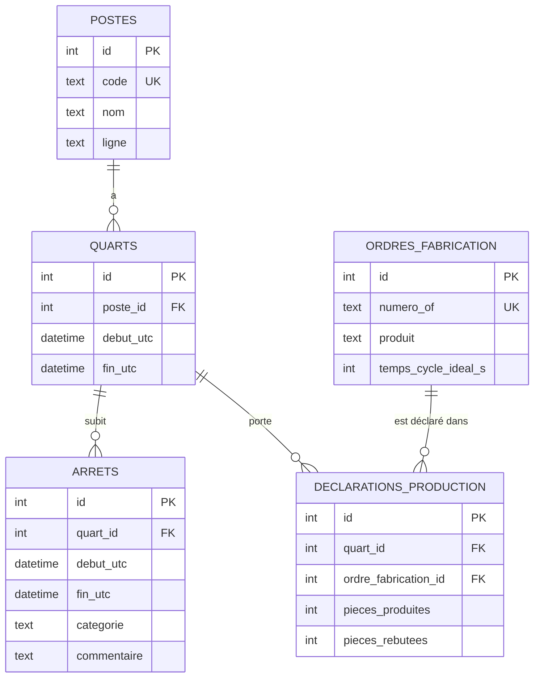

# Chapitre 4 · Les données : modéliser, migrer, prouver l'intégrité

*Séance 3 « Première user story, données et RGPD » · Master ITI, Nantes Université, 2026-2027. Chapitre à lire avant ou après la séance. Extraits de code, commandes et sorties exécutés le 26 novembre 2026 sous Linux, sur une copie du dépôt-modèle, avec Flutter 3.50.1, drift 2.35.4 et drift_dev 2.35.3 (les versions de `pubspec.lock`), git 2.53.0.*

Ce chapitre accompagne les blocs 8 et 9 de la séance : l'exposé sur les données, puis l'atelier où votre équipe dessine son modèle, crée ses premières tables, écrit sa première migration et prouve par un test que la base refuse une donnée incohérente. Il s'appuie sur le thème B (le TRS de la ligne 4) : un quart appartient à un poste, un arrêt appartient à un quart. Les équipes des thèmes A et C trouveront en section 9 leurs propres entités.

Tout ce qui est montré ici a été réellement fait sur une copie du dépôt-modèle : deux tables du thème B (`postes` et `quarts`) ajoutées avec leur migration vers la version 2, un test d'intégrité, puis deux branches qui préparent chacune une version 2, pour voir ce qui se passe vraiment. Les sorties citées sont celles obtenues.

## Ce que vous allez retenir

- **Les données survivent au code.** On réécrit un écran en une heure ; une base remplie, elle, doit être transformée sans rien perdre. C'est pour cela que toute modification de la base passe par une **migration** explicite, versionnée, testée.
- Un modèle de données se décrit avec quatre mots : **entités** (les choses dont on garde la trace), **relations** (comment elles se rattachent), **clés** (primaire : l'identité d'une ligne ; étrangère : le rattachement à une autre table) et **contraintes** (ce que la base refuse).
- **Le modèle se dessine sur papier d'abord**, se fait valider par l'enseignant, et seulement ensuite se confie à l'agent.
- **drift** en une phrase : on déclare les tables en Dart dans la couche `data`, et `build_runner` génère le code d'accès typé à la base SQLite.
- **Une migration, c'est quatre gestes** : `schemaVersion` + 1, `dart run drift_dev make-migrations`, une étape `fromNToM` dans `onUpgrade`, des tests verts. La CI vérifie qu'aucune table n'a changé sans nouvelle version.
- **Avec SQLite, les clés étrangères ne sont vérifiées que si on le demande** : le dépôt-modèle le fait à chaque ouverture, et un test le prouve en faisant échouer une insertion orpheline.
- **Une seule migration à la fois, coordonnée par le gardien des données.** Quand deux branches préparent chacune une version 2, celle qui fusionne en second devient la version 3 ; on ne réécrit jamais une version déjà fusionnée.

---

## 1. Pourquoi les données survivent au code

Imaginez que l'outil du thème B ait servi trois semaines dans un atelier : 6 postes, quelques centaines de quarts, des milliers d'arrêts enregistrés. Vous décidez ensuite d'ajouter une colonne aux arrêts. Le code, vous pouvez le jeter et le réécrire ; les arrêts déjà enregistrés, non. Il faut **transformer** la base existante, sur chaque poste où elle existe, sans perte.

Dans votre projet, ce n'est pas une hypothèse lointaine. L'application tourne dans le navigateur (`flutter run -d chrome`, puis la version publiée sur GitHub Pages en séance 4) et **chaque navigateur qui l'a ouverte garde sa propre base**. Vous ne pouvez pas aller la modifier à la main chez chacun. La seule chose qui voyage, c'est le code : il doit donc savoir, en ouvrant une base, dans quelle version elle est, et quelles étapes jouer pour l'amener à la version actuelle. C'est exactement ce qu'est une migration.

Deux conséquences pratiques, qui font l'objet de ce chapitre :

- on ne modifie **jamais** une base à la main (ni avec un outil graphique, ni en effaçant les données du navigateur pour « repartir propre ») pour faire passer un changement : ce geste ne serait fait que sur un poste, et toutes les autres bases resteraient dans l'ancien état ;
- on **prouve** par des tests que le schéma se crée, que les migrations se rejouent et que la base refuse les données incohérentes. C'est la definition of done de la séance.

> **À retenir.** Le code se remplace, les données se transforment. Une migration est la recette de cette transformation, écrite une fois et rejouée partout.

---

## 2. Entités, relations, clés et contraintes

Ces mots viennent des bases de données relationnelles (SQLite en est une). Vous en avez besoin pour dessiner votre modèle et pour relire ce que propose l'agent ; vous n'avez pas besoin de savoir écrire le code qui va avec.

### 2.1 Entités, tables, lignes, colonnes

Une **entité** est une chose dont l'outil garde la trace : pour le thème B, un poste, un quart, un ordre de fabrication (OF), une déclaration de production, un arrêt. Dans la base, chaque entité devient une **table** : un tableau dont chaque **ligne** est un exemplaire (le poste P01, le poste P02…) et chaque **colonne** une information (code, nom, ligne de production).

| `id` | `code` | `nom` | `ligne` |
|---|---|---|---|
| 1 | P01 | Sertissage | 4 |
| 2 | P02 | Contrôle visuel | 4 |

*Table `postes`, deux lignes d'exemple (données fictives).*

### 2.2 La clé primaire : l'identité d'une ligne

Chaque ligne a un identifiant qui ne change jamais et qui n'appartient qu'à elle : la **clé primaire**. Dans le projet, c'est toujours une colonne `id`, un nombre attribué automatiquement par la base (1, 2, 3…). On ne s'en sert pas pour afficher quoi que ce soit : elle sert à **désigner** la ligne depuis une autre table.

Pourquoi pas le code « P01 » ? Parce qu'un code d'atelier peut être renommé un jour, alors qu'une clé primaire ne doit jamais bouger : toutes les lignes qui la citent seraient sinon à corriger.

### 2.3 La relation et la clé étrangère : « un quart appartient à un poste »

Un quart (de 6 h à 14 h, un mardi) se déroule **sur un poste**. Pour noter ce rattachement, la table `quarts` a une colonne `poste_id` qui contient la clé primaire du poste concerné. Une telle colonne s'appelle une **clé étrangère** : elle pointe vers une ligne d'une autre table.

| `id` | `poste_id` | `debut_utc` | `fin_utc` |
|---|---|---|---|
| 1 | 1 | 2026-10-06 04:00 | 2026-10-06 12:00 |

*Le quart n° 1 appartient au poste n° 1 (P01). Les heures sont en UTC : 04:00 UTC est 06:00 à Paris, le 6 octobre 2026 (heure d'été).*

Une relation se lit dans les deux sens et se décrit par sa **cardinalité** : un quart appartient à **un et un seul** poste ; un poste a **zéro, un ou plusieurs** quarts. De même, un arrêt appartient à un et un seul quart, et un quart peut avoir plusieurs arrêts. La clé étrangère est toujours du côté « plusieurs » : c'est le quart qui porte `poste_id`, pas le poste qui porterait la liste de ses quarts.

### 2.4 Les contraintes : ce que la base refuse

Une **contrainte** est une règle que la base vérifie elle-même, à chaque écriture, quel que soit le code qui écrit. C'est le dernier filet : même si un écran, un import CSV ou un agent se trompent, la base dit non.

| Contrainte | Ce qu'elle impose | Exemple du thème B |
|---|---|---|
| Valeur obligatoire (`NOT NULL`) | La colonne ne peut pas rester vide | Un quart a toujours un début et une fin |
| Unicité (`UNIQUE`) | Deux lignes ne peuvent pas avoir la même valeur | Deux postes ne partagent pas le code « P01 » |
| Vérification (`CHECK`) | Une condition doit être vraie | Un quart finit après avoir commencé |
| Clé étrangère (`REFERENCES`) | La ligne pointée doit exister | Pas de quart rattaché au poste n° 99 s'il n'existe pas |

Une ligne dont la clé étrangère pointe vers une ligne inexistante s'appelle une **ligne orpheline** : un quart sans poste, un arrêt sans quart. Le test d'intégrité de la séance (section 6) prouve que la base refuse de les enregistrer.

### 2.5 Ce que le modèle refuse de contenir

Modéliser, c'est aussi décider de ce qu'on **ne stocke pas**. Pour le thème B, la mesure de conformité obligatoire est qu'aucun identifiant d'opérateur ne figure dans les données métier : il n'y a pas de colonne « opérateur » dans `quarts` ni dans `arrets`, et c'est un choix de modèle, pas un oubli. Le chapitre 3 (sections 6 et 7) explique pourquoi ; ici, retenez que cette décision se prend **sur le papier**, avant que l'agent ne propose un champ « nom de l'opérateur » qui paraît pratique.

> **À retenir.** Entité = table ; clé primaire = identité d'une ligne ; clé étrangère = rattachement à une autre ligne ; contrainte = ce que la base refuse, quel que soit le code qui écrit.

---

## 3. Le modèle sur papier d'abord

Le programme est explicite : d'abord un modèle sur papier, validé en passant par l'enseignant, puis seulement le travail avec l'agent. Un modèle se corrige en deux minutes avec une gomme ; une fois migré et fusionné, il se corrige par une nouvelle migration.

### 3.1 Ce qu'on dessine

Sur une feuille (ou au tableau, pris en photo pour la PR), le gardien des données et au moins un coéquipier dessinent :

1. **une boîte par entité**, avec ses colonnes et, pour chacune, son type (texte, nombre, date) et si elle est obligatoire ;
2. **la clé primaire** de chaque boîte (`id`) ;
3. **un trait par relation**, avec sa cardinalité aux deux bouts (« un » ou « plusieurs ») et la clé étrangère qui la porte ;
4. **les contraintes** en marge : unicité, conditions (`fin > début`, quantités positives), liste fermée de valeurs (les catégories d'arrêt) ;
5. **ce qu'on ne stocke pas**, et pourquoi (2.5).

Les entités et leurs colonnes ne s'inventent pas : elles sont dans l'énoncé de votre thème (`cours/projets/themes.md`, rubrique « Données manipulées ») et dans `PROJET.md`. Votre travail est de les relier et de poser les contraintes.

### 3.2 Le modèle du thème B

Voici le modèle du thème B tel qu'on le dessine en séance, à partir des cinq entités de l'énoncé (colonnes abrégées). Les tables `postes` et `quarts` sont celles qui ont été implémentées et testées pour ce chapitre ; les trois autres suivent la même méthode.



Comment le lire : `||--o{` se lit « un et un seul » du côté des deux barres, « zéro ou plusieurs » du côté du cercle et de la patte d'oie. `PK` marque la clé primaire, `FK` une clé étrangère, `UK` une colonne unique. Les colonnes `ticket_gmao` des arrêts et `quantite_lancee` des OF, prévues par l'énoncé, sont omises ici pour la lisibilité.

### 3.3 Les questions à se poser avant de faire valider

- Chaque colonne de l'énoncé a-t-elle sa place, et une seule ?
- Chaque clé étrangère est-elle du côté « plusieurs » ?
- Que se passe-t-il si l'on supprime un poste qui a des quarts ? (Dans l'exemple de ce chapitre, la base le refuse : c'est le comportement par défaut d'une clé étrangère, vérifié en section 6.)
- Les dates sont-elles en UTC (`debut_utc`, `fin_utc`) ? Le programme l'impose : stockées en UTC, affichées en heure de Paris.
- Quelles valeurs sont en liste fermée ? Pour le thème B, les catégories d'arrêt : `pause`, `maintenance_preventive`, `etalonnage` (planifiées) ; `panne`, `changement_serie`, `attente_matiere`, `micro_arret` (non planifiées).
- Y a-t-il une colonne qui permettrait de retrouver ou d'évaluer une personne ? (Chapitre 3.)

Une fois le dessin validé, il devient la consigne donnée à l'agent : « crée les tables drift de ce modèle, une par fichier, dans le dossier `data/` de la fonctionnalité, en suivant `docs/ARCHITECTURE.md`, section 7 ; écris d'abord les tests d'intégrité ». Une consigne vérifiable, parce que vous savez ce qui doit en sortir.

> **À retenir.** Le dessin est le contrat. Si l'agent propose une colonne ou une relation qui n'y est pas, c'est à discuter, pas à accepter.

---

## 4. SQLite et drift : une phrase, puis la pratique

### 4.1 En une phrase

**SQLite** est une base de données qui tient dans un seul fichier (dans le navigateur, dans un stockage local), sans serveur ; **drift** est la bibliothèque Dart qui permet de **déclarer les tables en Dart** dans la couche `data`, puis de faire **générer par `build_runner` le code d'accès typé** à ces tables. « Typé » veut dire que si vous écrivez un texte là où la table attend un nombre, l'erreur apparaît dans l'éditeur, avant même de lancer l'application.

### 4.2 Où sont les fichiers

Les couches et le principe « une fonctionnalité, un dossier » sont expliqués au chapitre 3 de la séance 2 (section 3) et le patron *repository* au chapitre 9 de la séance 1 (section 6.1) ; on ne regarde ici que ce qui touche à la base. Voici la copie du dépôt-modèle après l'ajout des tables `postes` et `quarts` (fichiers ajoutés ou modifiés marqués d'une étoile) :

```text
lib/
├── core/data/
│   ├── base_de_donnees.dart          * la base : liste des tables, version, migrations
│   ├── base_de_donnees.steps.dart    * étapes de migration (généré par make-migrations)
│   └── connexion.dart                  ouverture de la base, web et bureau
└── features/
    ├── jets/data/table_jets.dart       table de l'exemple (gardée ici)
    └── postes/data/
        ├── table_postes.dart         * une table par fichier
        └── table_quarts.dart         *
drift_schemas/base_de_donnees/
├── drift_schema_v1.json                instantané de la version 1 (fourni)
└── drift_schema_v2.json              * instantané de la version 2
test/core/data/
├── base_de_donnees_test.dart         * test d'intégrité, complété
└── migrations/base_de_donnees/       * tests de migration (générés par make-migrations)
    ├── migration_test.dart
    └── generated/ (schema.dart, schema_v1.dart, schema_v2.dart)
```

Le nom de la fonctionnalité (`postes`) est un choix fait pour ce chapitre : il correspond à la story « décrire les postes et créer les quarts » de `PROJET.md`. Votre équipe choisit les siens.

### 4.3 Déclarer une table

Voici `lib/features/postes/data/table_postes.dart`, tel qu'il a tourné :

```dart
// Définition drift de la table `postes` : un poste de travail de la ligne (thème B).
import 'package:drift/drift.dart';

/// Une ligne de la table `postes`.
@DataClassName('PosteLigne')
class Postes extends Table {
  @override
  String get tableName => 'postes';

  IntColumn get id => integer().autoIncrement()();

  /// Code court du poste, colonne `code`, unique (ex. : « P01 »).
  TextColumn get code => text().unique()();

  /// Nom lisible du poste, colonne `nom`.
  TextColumn get nom => text()();

  /// Ligne de production, colonne `ligne` (ex. : « 4 »).
  TextColumn get ligne => text()();
}
```

Comment le lire sans être développeur : chaque ligne `… get nom => …` déclare une colonne. `integer()` et `text()` donnent le type ; `autoIncrement()` fait de `id` la clé primaire numérotée automatiquement ; `unique()` pose la contrainte d'unicité. Une colonne est obligatoire par défaut (il faudrait écrire `nullable()` pour la rendre facultative). `@DataClassName('PosteLigne')` nomme la « ligne » générée, pour qu'elle ne se confonde pas avec une future entité `Poste` du domaine (`docs/ARCHITECTURE.md`, section 7).

Et `table_quarts.dart`, qui porte la clé étrangère et une contrainte entre deux colonnes :

```dart
// Définition drift de la table `quarts` : un quart appartient à un poste (clé étrangère).
import 'package:drift/drift.dart';

import 'table_postes.dart';

/// Une ligne de la table `quarts`.
@DataClassName('QuartLigne')
class Quarts extends Table {
  @override
  String get tableName => 'quarts';

  IntColumn get id => integer().autoIncrement()();

  /// Le poste du quart, colonne `poste_id` : clé étrangère vers `postes.id`.
  IntColumn get posteId => integer().references(Postes, #id)();

  /// Début du quart, colonne `debut_utc`, stocké en UTC.
  DateTimeColumn get debutUtc => dateTime()();

  /// Fin du quart, colonne `fin_utc`, stockée en UTC.
  DateTimeColumn get finUtc => dateTime()();

  /// Un quart finit après avoir commencé.
  @override
  List<String> get customConstraints => ['CHECK (fin_utc > debut_utc)'];
}
```

Trois choses à repérer : `references(Postes, #id)` déclare la clé étrangère ; le nom Dart `posteId` devient la colonne `poste_id` (drift convertit lui-même, et le test de la section 6 le vérifie) ; la contrainte « fin après début » touche deux colonnes, elle s'écrit donc au niveau de la table (`customConstraints`). L'énoncé nomme la colonne `poste` ; le suffixe `_id`, choisi ici, dit que la colonne contient un identifiant et non le poste lui-même. C'est le genre de détail que l'équipe tranche sur le papier.

### 4.4 Brancher la table et générer le code

Une table n'existe pour l'application que si elle figure dans la liste de `lib/core/data/base_de_donnees.dart` :

```dart
@DriftDatabase(tables: [Jets, Postes, Quarts])
class BaseDeDonnees extends _$BaseDeDonnees {
```

Puis on génère le code d'accès :

```bash
dart run build_runner build --delete-conflicting-outputs
```

```text
  Built with build_runner/aot in 11s; wrote 30 outputs.
```

Le fichier produit, `base_de_donnees.g.dart`, n'est pas versionné (chapitre 3 de la séance 2, section 7.1). C'est lui qui fournit, par exemple, `PostesCompanion.insert(...)`, que les tests utilisent pour insérer une ligne.

Mais ajouter une table, c'est **changer le schéma** : il faut une migration. La section suivante montre que l'ajout à la liste ne suffit pas.

> **À retenir.** Une table = un fichier dans le `data/` de sa fonctionnalité, ajoutée à la liste `@DriftDatabase`. Puis `build_runner`. Puis, toujours, une migration.

---

## 5. Les migrations versionnées

### 5.1 La version du schéma

Le **schéma** est la description de la base : quelles tables, quelles colonnes, quelles contraintes. Chaque état du schéma porte un numéro, `schemaVersion`. SQLite garde dans chaque base le numéro de la version avec laquelle elle a été créée ou migrée en dernier ; à l'ouverture, drift compare ce numéro à celui du code et, s'ils diffèrent, joue les étapes qui manquent.

Voici ce que fournit le dépôt-modèle, en version 1 (extrait de `lib/core/data/base_de_donnees.dart`) :

```dart
  /// À augmenter de 1 à chaque changement du schéma (voir docs/ARCHITECTURE.md, section 7).
  @override
  int get schemaVersion => 1;

  @override
  MigrationStrategy get migration => MigrationStrategy(
    onCreate: (m) => m.createAll(),
    onUpgrade: (m, from, to) async {
      // Version 1 : première version, aucune étape à jouer.
      // …
    },
    beforeOpen: (details) async {
      // SQLite n'applique les clés étrangères que si on le lui demande, à chaque ouverture.
      await customStatement('PRAGMA foreign_keys = ON');
    },
  );
```

`MigrationStrategy` regroupe trois moments de la vie d'une base :

| Moment | Quand | Ce que fait le dépôt-modèle |
|---|---|---|
| `onCreate` | La base n'existe pas encore (premier lancement, base en mémoire d'un test) | Crée toutes les tables de la version actuelle (`createAll`) |
| `onUpgrade` | La base existe dans une version plus ancienne que le code | En version 1 : rien. À partir de la version 2 : les étapes `stepByStep`, une par version |
| `beforeOpen` | À chaque ouverture, après les deux précédents | Active les clés étrangères (section 6) |

Le programme demandait de vérifier cette stratégie « sur la version de drift utilisée » : c'est fait. Avec drift 2.35.4 et drift_dev 2.35.3, `MigrationStrategy`, `onCreate`, `onUpgrade` et `beforeOpen` s'écrivent comme ci-dessus, et `onUpgrade` reçoit en version 2 la fonction `stepByStep` produite par `make-migrations` (5.3).

### 5.2 Pourquoi on ne modifie jamais une base à la main

Parce que la modification ne serait faite **que là où vous l'avez faite**. Votre base de développement serait à jour ; celle de vos coéquipiers, celle de la CI, celle de chaque visiteur de la version publiée, non. Pire : votre base afficherait une version qui ne correspond plus à son contenu, et la prochaine migration partirait d'un état faux.

Le dépôt-modèle prévoit un seul geste manuel, et il n'est pas une migration : si votre base de développement est incohérente, on l'efface dans Chrome (outils de développement, onglet « Application », « Clear site data »). Cela vide **votre** base et elle seule ; les autres navigateurs gardent la leur (`docs/ARCHITECTURE.md`, section 7, « Dépannage »).

La règle du dépôt-modèle, dans `CLAUDE.md` : « Toute modification d'une table drift = `schemaVersion` + 1 et la procédure de `docs/ARCHITECTURE.md` (section 7, migrations) ». Et dans les interdits : « Ne jamais modifier à la main `drift_schemas/` ni les fichiers `*.steps.dart` ».

### 5.3 La procédure, telle qu'elle a été jouée

La procédure complète est dans `docs/ARCHITECTURE.md`, section 7 (« Passer en version 2 »). La voici appliquée aux tables `postes` et `quarts`, en gardant la fonctionnalité d'exemple `jets` (si votre équipe la retire, l'étape 1 de cette section du fichier d'architecture dit quoi supprimer, et l'étape de migration ajoute `await m.deleteTable('jets');`).

**Étape 1. Écrire les tests d'abord.** Les tests d'intégrité des nouvelles tables (section 6) sont ajoutés à `test/core/data/base_de_donnees_test.dart` et commités : ils ne compilent pas encore, c'est le rouge du TDD.

```text
test/core/data/base_de_donnees_test.dart:87:13: Error: Undefined name 'PostesCompanion'.
test/core/data/base_de_donnees_test.dart:93:13: Error: Undefined name 'QuartsCompanion'.
```

**Étape 2. Déclarer les tables et passer à la version 2.** Les deux fichiers de la section 4.3, la liste `@DriftDatabase(tables: [Jets, Postes, Quarts])`, et `schemaVersion => 2`. On ne touche pas encore à `onUpgrade`.

**Étape 3. Générer.** Deux commandes, dans cet ordre :

```bash
dart run build_runner build --delete-conflicting-outputs
dart run drift_dev make-migrations
```

`make-migrations` est l'outil officiel de drift pour les migrations (réglé dans `build.yaml`). Il compare le schéma déclaré dans le code aux instantanés de `drift_schemas/`, écrit celui de la nouvelle version et prépare les fichiers de migration. Sa sortie se termine ainsi (extrait) :

```text
INFO: base_de_donnees: Generated test in test/core/data/migrations/base_de_donnees/migration_test.dart.
Run this test to validate that your migrations are written correctly. flutter test test/core/data/migrations/base_de_donnees/migration_test.dart
```

Juste avant, elle affiche un exemple de `stepByStep` à recopier. Après la commande, `git status` montre quatre lignes, toutes à versionner : le fichier de la base, modifié à l'étape 2, et trois nouveautés.

```text
 M lib/core/data/base_de_donnees.dart
?? drift_schemas/base_de_donnees/drift_schema_v2.json
?? lib/core/data/base_de_donnees.steps.dart
?? test/core/data/migrations/
```

**Ce qui se passe si l'on s'arrête là.** Le test de migration généré échoue, et il dit pourquoi :

```text
00:00 +0 -1: simple database migrations from 1 to 2 [E]
  Schema does not match
  comparing postes:
   The actual schema does not contain anything with this name.
  comparing quarts:
   The actual schema does not contain anything with this name.
```

Une base déjà en version 1 (celle d'un navigateur qui a ouvert l'application la semaine passée) passerait en version 2 sans que les tables soient créées. Le test a vu le défaut avant qu'il n'arrive chez quelqu'un.

**Étape 4. Écrire l'étape de migration.** Dans `base_de_donnees.dart`, on ajoute `import 'base_de_donnees.steps.dart';` avec les autres imports, et l'on remplace toute la fonction `onUpgrade` :

```dart
    onUpgrade: stepByStep(
      // Version 2 : tables du thème B, les postes et leurs quarts.
      from1To2: (m, schema) async {
        await m.createTable(schema.postes);
        await m.createTable(schema.quarts);
      },
    ),
```

`from1To2` se lit « pour passer de la version 1 à la version 2 ». On écrit `schema.postes` (la table telle qu'elle est **en version 2**) et non `postes` : si la table change en version 3, cette étape reste juste.

**Étape 5. Nettoyer le test généré.** `migration_test.dart` contient deux parties : la première (« simple database migrations ») vérifie le schéma après chaque migration, on la garde ; la seconde est un modèle à remplir, avec des listes vides et des commentaires `TODO` en anglais, on la supprime quand la migration ne fait que créer des tables (`docs/ARCHITECTURE.md`, section 7, étape 5). Le test d'intégrité est complété (section 6).

**Étape 6. Commiter, puis vérifier comme la CI.** `dart format .`, un commit de tout ce qui précède, puis les commandes de vérification du `README.md` du dépôt, dans l'ordre (le `git status --porcelain` ci-dessous n'affiche rien parce que tout est commité et que `make-migrations` n'a rien changé) :

```text
$ dart run build_runner build --delete-conflicting-outputs
  Built with build_runner/aot in 6s; wrote 36 outputs.
$ dart run drift_dev make-migrations
$ git status --porcelain -- drift_schemas lib/core/data test/core/data/migrations
$ dart format --output=none --set-exit-if-changed .
Formatted 51 files (0 changed) in 0.11 seconds.
$ flutter analyze
No issues found! (ran in 1.3s)
$ flutter test
00:02 +39: All tests passed!
```

Le dépôt-modèle comptait 32 tests ; il y en a 39 : six tests d'intégrité ajoutés (section 6) et un test de migration (de 1 à 2). Relancer `make-migrations` n'a rien changé, ce qui est le signe que tout est commité dans un état cohérent.

### 5.4 Les instantanés et le contrôle de la CI

Le dossier `drift_schemas/base_de_donnees/` contient un **instantané** par version : un fichier JSON qui décrit le schéma exact de cette version (`drift_schema_v1.json`, fourni par le dépôt-modèle, puis `drift_schema_v2.json`). Ce sont ces instantanés qui permettent à drift de générer les tests de migration : pour vérifier qu'une base v1 migrée ressemble bien à une base v2, il faut savoir à quoi ressemblaient l'une et l'autre.

Un instantané déjà fusionné est une **archive** : il décrit des bases qui existent quelque part. On ne le modifie pas, on ne le supprime pas, même si `drift_schema_v1.json` décrit une table `jets` que votre équipe a retirée (sans lui, l'étape `from1To2` n'est pas générée).

**Le contrôle de la CI.** Le workflow du dépôt (`.github/workflows/ci.yml`) relance `make-migrations` à chaque PR et échoue si quelque chose change. Ce contrôle a été provoqué : une colonne `commentaire` a été ajoutée à `postes` **sans** passer à la version 3. La commande s'arrête (code de sortie 255) :

```text
Fatal error: A schema for version 2 of the base_de_donnees database already exists and differs from the current schema. Either delete the existing schema file (…/drift_schemas/base_de_donnees/drift_schema_v2.json) or update the schema version in the database file.
```

Le message propose deux sorties. **Une seule est bonne** : « update the schema version », c'est-à-dire passer à la version suivante. Supprimer l'instantané existant revient à réécrire une version déjà publiée ; la section 7.2 montre pourquoi c'est dangereux, pourquoi les six commandes de vérification ne le voient pas, et le second contrôle que la CI fait pour le refuser.

> **À retenir.** Toute modification d'une table : `schemaVersion` + 1, `build_runner`, `make-migrations`, une étape `fromNToM` sans toucher aux précédentes, des tests verts. Les instantanés de `drift_schemas/` ne se modifient ni ne se suppriment jamais.

---

## 6. Prouver l'intégrité sur une base en mémoire

### 6.1 Une base en mémoire

Les tests n'utilisent jamais la vraie base : ils ouvrent une **base en mémoire**, créée vide au début de chaque test et effacée à la fin. Elle est rapide, elle ne laisse aucune trace et elle part toujours du même état. Dans le dépôt-modèle :

```dart
  setUp(() => base = BaseDeDonnees(NativeDatabase.memory()));
  tearDown(() => base.close());
```

Comme la base est neuve, c'est `onCreate` qui crée les tables, puis `beforeOpen` qui active les clés étrangères : exactement le chemin d'un premier lancement.

### 6.2 Les clés étrangères doivent être activées explicitement

Le programme demandait de le vérifier avec drift. Trois constats, faits sur la copie du dépôt-modèle :

1. **SQLite, sans réglage, ne vérifie pas les clés étrangères.** Une connexion SQLite brute, ouverte dans un test, répond `foreign_keys = 0` (bibliothèque SQLite 3.54.1, celle que le paquet `sqlite3` a fournie au test sous Linux).
2. **Sans activation, une ligne orpheline est acceptée sans un mot.** Avec la base du projet, après avoir désactivé le réglage (`PRAGMA foreign_keys = OFF`), l'insertion d'un quart rattaché au poste n° 99, qui n'existe pas, a réussi : la table contenait un quart. Seule une vérification après coup (`PRAGMA foreign_key_check`) signalait le problème : `{table: quarts, rowid: 1, parent: postes, fkid: 0}`.
3. **Avec l'activation du dépôt-modèle, la même insertion est refusée**, avec le message `FOREIGN KEY constraint failed` (code SQLite 787).

L'activation se trouve dans `lib/core/data/base_de_donnees.dart`, dans `beforeOpen`, donc **à chaque ouverture** de la base (le réglage ne se garde pas d'une connexion à l'autre) :

```dart
    beforeOpen: (details) async {
      // SQLite n'applique les clés étrangères que si on le lui demande, à chaque ouverture.
      await customStatement('PRAGMA foreign_keys = ON');
    },
```

`docs/ARCHITECTURE.md` le dit en une ligne : « ne le retirez pas ». Un **PRAGMA** est une commande de réglage propre à SQLite ; celle-ci dit « vérifie les clés étrangères ».

### 6.3 Le test d'intégrité

Le dépôt-modèle fournit `test/core/data/base_de_donnees_test.dart`, qui vérifie déjà que chaque table déclarée existe, que les clés étrangères sont activées, que SQLite ne signale aucun défaut d'intégrité et qu'une contrainte de la table `jets` est respectée. `docs/ARCHITECTURE.md` demande de le compléter à chaque nouvelle table. Voici le test central de la séance, celui de la definition of done (« un test prouve qu'une insertion orpheline est rejetée ») :

```dart
  group('un quart appartient à un poste', () {
    final debut = DateTime.utc(2026, 10, 6, 4);
    final fin = DateTime.utc(2026, 10, 6, 12);

    // …

    test('la base refuse un quart orphelin (poste inexistant)', () async {
      final insertion = base
          .into(base.quarts)
          .insert(
            QuartsCompanion.insert(posteId: 99, debutUtc: debut, finUtc: fin),
          );

      await expectLater(insertion, throwsA(isA<SqliteException>()));
      expect(await base.select(base.quarts).get(), isEmpty);
    });
```

Lisez-le comme une phrase : sur une base vide, on tente d'insérer un quart rattaché au poste n° 99 ; on attend que la base lève une erreur SQLite (`throwsA(isA<SqliteException>())`) ; puis on vérifie que la table des quarts est toujours vide. La seconde vérification compte : elle prouve que rien n'a été écrit, pas seulement qu'une erreur est apparue.

Les autres tests ajoutés pour ce chapitre, tous verts :

| Test | Ce qu'il prouve |
|---|---|
| la table quarts a les colonnes attendues | `id`, `poste_id`, `debut_utc`, `fin_utc`, dans cet ordre, en ASCII snake_case |
| la base accepte un quart rattaché à un poste existant | Le cas normal fonctionne (sans lui, un test de refus pourrait passer pour une mauvaise raison) |
| la base refuse un quart orphelin | La clé étrangère est vérifiée à l'insertion |
| la base refuse de supprimer un poste qui a des quarts | La clé étrangère est vérifiée aussi à la suppression : on ne crée pas d'orphelins après coup |
| la base refuse un quart qui finit avant de commencer | La contrainte `CHECK (fin_utc > debut_utc)` |
| la base refuse deux postes de même code | La contrainte d'unicité |

### 6.4 Ces tests gardent aussi le réglage

Dernière expérience : la ligne `PRAGMA foreign_keys = ON` a été mise en commentaire, comme le ferait un agent qui « simplifie ». Trois tests passent au rouge :

```text
00:00 +1 -1: les clés étrangères sont activées [E]
  Expected: <1>
    Actual: <0>
00:00 +6 -2: un quart appartient à un poste la base refuse un quart orphelin (poste inexistant) [E]
  Expected: throws <Instance of 'SqliteException'>
    Actual: <Instance of 'Future<int>'>
00:00 +6 -3: un quart appartient à un poste la base refuse de supprimer un poste qui a des quarts [E]
```

C'est le rôle d'un test d'intégrité : un réglage invisible, qu'on peut retirer sans qu'aucun écran ne change, devient une exigence vérifiée à chaque `flutter test`.

> **À retenir.** Sur une base en mémoire : un cas accepté, une insertion orpheline refusée, et rien d'écrit. Avec SQLite, ce refus n'existe que parce que `beforeOpen` active les clés étrangères à chaque ouverture.

---

## 7. Deux pièges

### 7.1 L'agent qui « corrige » un test en modifiant les données

Le scénario est simple. Quelque chose a désactivé les clés étrangères (un `beforeOpen` réécrit, une ligne mise en commentaire). Le test « la base refuse un quart orphelin » passe au rouge. Vous demandez à l'agent de « faire passer les tests ». Une réponse possible, rejouée pour ce chapitre : il modifie le **test**, en créant d'abord un poste et en y rattachant le quart, puis en attendant que l'insertion réussisse (`completes`) au lieu d'échouer.

```text
00:00 +1: All tests passed!
```

Le test est vert, et il ne prouve plus rien : il n'y a plus d'orphelin dans le test, donc plus rien à refuser. Le défaut (les clés étrangères désactivées) est toujours là. La même tentation existe avec un jeu de données : changer les valeurs d'entrée d'un test de calcul jusqu'à ce que le résultat attendu « tombe juste ».

Comment le repérer en relecture, sans lire le code en détail :

- la liste des fichiers de la PR **contient un fichier de test** alors que la demande portait sur le code ; c'est la question 5 de la checklist de revue (chapitre 1, section 5) ;
- dans un test de refus, la donnée « interdite » a disparu (ici, le poste n° 99), ou l'attente est passée de « lève une erreur » à « réussit » ;
- le titre du test (« refuse un quart orphelin ») ne correspond plus à ce que fait son corps.

La règle est déjà dans `CLAUDE.md` : « Ne jamais modifier, désactiver ni supprimer un test pour le faire passer ». Le bon réflexe est de demander à l'agent **pourquoi** le test échoue avant de lui demander de le corriger. Si l'agent a proposé ce changement et que vous l'avez refusé, notez-le dans la rubrique « ce que j'ai refusé » de la PR : c'est un cas d'erreur de l'agent à documenter.

### 7.2 Deux branches, deux versions 2

**La situation.** Pendant l'atelier, une personne crée les tables `postes` et `quarts` sur sa branche ; une autre, en parallèle, la table `ordres_fabrication` sur la sienne. Chacune suit la procédure de la section 5.3 à la lettre : chacune passe `schemaVersion` à 2, lance `make-migrations`, écrit son `from1To2`. Les deux branches sont vertes, chacune de son côté. La première PR est fusionnée. Ce scénario a été joué dans deux branches git locales de la copie du dépôt-modèle.

**Ce qu'on voit.** La seconde personne met sa branche à jour (`git pull origin main`, chapitre 1, section 6). Git s'arrête sur quatre conflits :

```text
Auto-merging drift_schemas/base_de_donnees/drift_schema_v2.json
CONFLICT (add/add): Merge conflict in drift_schemas/base_de_donnees/drift_schema_v2.json
Auto-merging lib/core/data/base_de_donnees.dart
CONFLICT (content): Merge conflict in lib/core/data/base_de_donnees.dart
Auto-merging lib/core/data/base_de_donnees.steps.dart
CONFLICT (add/add): Merge conflict in lib/core/data/base_de_donnees.steps.dart
Auto-merging test/core/data/migrations/base_de_donnees/generated/schema_v2.dart
CONFLICT (add/add): Merge conflict in test/core/data/migrations/base_de_donnees/generated/schema_v2.dart
Automatic merge failed; fix conflicts and then commit the result.
```

(Avec git en français : `CONFLIT (ajout/ajout) : Conflit de fusion dans …` et `La fusion automatique a échoué ; réglez les conflits et validez le résultat.`)

Deux observations. « add/add » signifie que les deux branches ont **créé** le même fichier avec des contenus différents : deux versions 2 qui ne décrivent pas le même schéma. Et la ligne `schemaVersion => 2` n'est **pas** en conflit : les deux branches y ont écrit la même chose, git la garde sans rien dire. Le conflit est visible dans la liste des tables et dans `from1To2` :

```text
++<<<<<<< HEAD
 +@DriftDatabase(tables: [Jets, OrdresFabrication])
++=======
+ @DriftDatabase(tables: [Jets, Postes, Quarts])
++>>>>>>> main
```

(Cette sortie a été obtenue avec une fusion locale de `main`. Après `git pull origin main`, la dernière ligne porte un identifiant de commit à la place de `main` : voir le chapitre 1, section 6.4.)

**Comment on s'en sort.** Principe : la version 2 est celle qui est déjà sur `main` ; la branche qui arrive en second devient la **version 3**. Concrètement, sur la branche en conflit, avec le gardien des données à côté :

1. **Reprendre la version de `main` pour les quatre fichiers en conflit.** Les fichiers générés ne se fusionnent pas à la main (interdit de `CLAUDE.md`) ; on prend ceux de `main`, puis on regénère.

   ```bash
   git checkout origin/main -- drift_schemas/base_de_donnees/drift_schema_v2.json lib/core/data/base_de_donnees.steps.dart test/core/data/migrations/base_de_donnees/generated/schema_v2.dart lib/core/data/base_de_donnees.dart
   ```

   `git status` ne montre plus de conflit. Le fichier de votre table (`table_ordres_fabrication.dart`) n'a pas bougé : il n'était pas en conflit.

2. **Rajouter sa table dans `base_de_donnees.dart` et passer à la version 3.** L'import de sa table, son nom dans la liste (`[Jets, Postes, Quarts, OrdresFabrication]`), `schemaVersion => 3`. On **ne touche pas** à `from1To2` : c'est celle de `main`, elle décrit le passage à la version 2 déjà fusionnée.

3. **Régénérer.** `dart run build_runner build --delete-conflicting-outputs`, puis `dart run drift_dev make-migrations`, qui annonce :

   ```text
   INFO: base_de_donnees: Creating schema file for version 3
   ```

   Il crée `drift_schema_v3.json` et `schema_v3.dart`, et met à jour `base_de_donnees.steps.dart`. À ce moment, `flutter analyze` signale ce qui manque :

   ```text
   error • The named parameter 'from2To3' is required, but there's no corresponding argument. Try adding the required argument • lib/core/data/base_de_donnees.dart:26:16 • missing_required_argument
   ```

4. **Écrire l'étape `from2To3`**, à la suite de `from1To2` :

   ```dart
         // Version 3 : table des ordres de fabrication.
         from2To3: (m, schema) async {
           await m.createTable(schema.ordresFabrication);
         },
   ```

5. **Vérifier et commiter la fusion.** `dart format .`, `flutter analyze` (`No issues found!`), `flutter test` (`+41: All tests passed!`) : les tests de migration couvrent maintenant les passages de 1 à 2, de 1 à 3 et de 2 à 3. `git add -A`, `git commit`, puis `make-migrations` relancé ne change plus rien. On pousse, la PR se met à jour.

Le résultat a été contrôlé sur une base enregistrée dans un fichier : créée avec le code de `main` (version 2 : `jets`, `postes`, `quarts`), puis ouverte avec le code de la branche résolue, elle est passée en version 3 et a reçu la table `ordres_fabrication`.

**La mauvaise sortie, et pourquoi les six commandes ne la voient pas.** La tentation, pendant le conflit, est de « tout garder en version 2 » : réunir les trois tables dans `from1To2`, supprimer `drift_schema_v2.json` (comme le suggère le message d'erreur de la section 5.4) et le régénérer. Cette résolution a été essayée : `flutter analyze` sans remarque, `flutter test` vert (39 tests), et **le contrôle de la section 5.4 passe** (`make-migrations` ne change rien), puisque l'instantané régénéré est cohérent avec le code. Pourtant, une base déjà en version 2 (créée avec le code de `main`, comme celle d'un navigateur qui a ouvert la version publiée) a été ouverte avec ce code : elle est restée en version 2, **sans** la table `ordres_fabrication`. drift n'a rien à migrer, puisque la version n'a pas changé. Aucune des six commandes ne le signale ; l'erreur n'apparaîtra qu'à la première écriture dans cette table, chez quelqu'un d'autre.

**Le second contrôle de la CI.** C'est pour cette faute que la CI du dépôt fait un contrôle de plus, avant les six commandes : l'étape « Refuser la modification d'un instantané déjà fusionné » compare la PR à `main` et passe au rouge si un fichier de `drift_schemas/` déjà présent sur `main` est modifié, supprimé ou renommé. Seul l'ajout d'un instantané passe ; un instantané créé dans la PR en cours, pas encore fusionné, peut encore être régénéré. Pour le rejouer sur votre poste avant d'ouvrir la PR, commitez votre travail, lancez `git fetch origin`, puis cette commande, qui ne doit rien afficher :

```bash
git diff --no-renames --diff-filter=MDT --name-only origin/main...HEAD -- drift_schemas
```

Ce contrôle ne dispense pas de la relecture : jusqu'à la séance 4, une pastille rouge se regarde mais n'empêche pas la fusion.

D'où la règle : **un instantané déjà fusionné dans `main` ne se supprime ni ne se regénère**. En relecture, une PR dont la liste des fichiers montre un `drift_schema_vN.json` existant modifié ou supprimé (et pas seulement un nouveau ajouté) est à refuser (ligne 9 de la checklist de revue, chapitre 1, section 5).

**Encore mieux : ne pas en arriver là.** Quand le gardien des données sait qu'une migration est en cours, la seconde personne attend que la première PR soit fusionnée, met sa branche à jour, et fait directement la version 3. Le conflit n'a pas lieu.

### 7.3 La règle à ajouter à `CLAUDE.md`

Le programme demande d'ajouter cette règle à `CLAUDE.md`, au bilan de la séance (bloc 11), par une PR du gardien du harnais. Le texte ci-dessous est une **proposition des supports** ; votre équipe peut le reformuler, à condition de garder les trois idées. À placer dans la section « Règles » :

```markdown
- Une seule migration à la fois, coordonnée par le gardien des données : avant de
  modifier une table drift ou `schemaVersion`, le prévenir ; tant qu'une PR de
  migration est ouverte, aucune autre branche ne prépare de migration.
- Si deux branches préparent la même version : celle qui fusionne en second
  reprend les fichiers de migration de `main` et passe à la version suivante
  (chapitre 4 de la séance 3, section 7.2).
```

Et dans la section « Interdits » :

```markdown
- Ne jamais supprimer ni régénérer un instantané `drift_schemas/` déjà présent sur
  `main`, même si `make-migrations` le propose.
```

Pourquoi l'écrire pour l'agent : c'est lui qui, devant le message « Either delete the existing schema file or update the schema version », pourrait choisir la première sortie. La règle lui dit laquelle prendre ; la relecture vérifie qu'il l'a prise.

> **À retenir.** Deux versions 2 concurrentes : celle de `main` reste, l'autre devient la version 3. On reprend les fichiers de migration de `main`, on regénère, on écrit `from2To3`. Mieux encore : une migration à la fois, annoncée au gardien des données.

---

## 8. Les données dans la fiche de conformité

Le chapitre 3 explique les rubriques 1 à 5 de `docs/fiche_conformite.md` ; on ne le redit pas ici. Le bloc 9 ajoute un geste précis : **noter en commentaire, dans la fiche, les rubriques que touche le modèle de données**, pour que la fiche change en même temps que les tables. Un commentaire Markdown (`<!-- … -->`) n'apparaît pas quand on affiche la fiche sur GitHub ; il se lit en ouvrant le fichier.

Exemple pour le thème B, **rédigé pour ce chapitre**, placé sous la rubrique 2 :

```markdown
<!-- Modèle de données (séance 3), à revoir à chaque migration :
     - rubrique 2 : tables postes, quarts (v2) ; arrets, ordres_fabrication,
       declarations_production à venir ; aucune colonne d'opérateur ;
     - rubrique 5 : la base vit dans le navigateur de chaque visiteur ;
     - rubrique 6 : stockage local drift/SQLite non chiffré ;
     - rubrique 11 : commentaire d'arrêt libre, consigne « aucun nom » à afficher. -->
```

Les rubriques citées sont celles du gabarit fourni : 2 (données traitées), 5 (conservation), 6 (hébergement, qui mentionne déjà le stockage local drift/SQLite non chiffré) et 11 (mesures). Le contenu de chaque rubrique, lui, relève du chapitre 3, sections 7 et 8.

---

## 9. Pour les thèmes A et C

La méthode ne change pas : modèle sur papier, tables dans le `data/` de chaque fonctionnalité, première migration, test d'intégrité avec une insertion orpheline refusée. Seules les entités changent. Elles sont fixées par l'énoncé (`cours/projets/themes.md`, rubrique « Données manipulées » de chaque thème), qui donne aussi les colonnes : c'est votre point de départ, ce chapitre n'en propose pas d'autre.

| Thème | Entités (5) | Relations données par l'énoncé | Une insertion orpheline possible pour le test |
|---|---|---|---|
| **A** · Les Marches de Cendrelune | `voie`, `passeur`, `saison`, `route`, `traversee` | Une saison a plusieurs routes ; une traversée lie un passeur à une route ; un passeur suit une voie et appartient à un utilisateur (`proprietaire`) | Une route rattachée à une saison inexistante, une traversée d'un passeur inexistant |
| **C** · Vœux de projet | `enseignant`, `sujet`, `etudiant`, `voeu`, `affectation` | Un étudiant a 3 à 5 vœux ordonnés vers des sujets distincts ; un sujet a un enseignant ; une affectation lie un étudiant à un sujet ou porte un motif de non-affectation | Un vœu vers un sujet inexistant, un sujet d'un enseignant inexistant |

Deux points propres à ces thèmes, à trancher sur le papier :

- **Thème A.** `proprietaire` est l'identifiant de l'utilisateur (un pseudonyme, jamais un nom) ; l'énoncé précise que le souffle maximum **ne se stocke pas**, il se calcule à partir de la voie et du rang. C'est un exemple de donnée qu'on refuse de dupliquer pour éviter les incohérences.
- **Thème C.** Plusieurs règles de l'énoncé ressemblent à des contraintes (des sujets distincts pour un même étudiant, un `rang` unique, `parcours` limité à trois valeurs) : décidez lesquelles la base vérifie elle-même, et écrivez un test de refus pour chacune. Une affectation peut ne pas avoir de sujet (motif de non-affectation) : la clé étrangère correspondante est alors facultative, ce qui se dessine sur le modèle.

Pour la qualification RGPD de ces données (pseudonymes en A ; étudiants et décision d'affectation en C), voir le chapitre 3, section 7.

---

## 10. Ce qui n'est pas demandé aujourd'hui, et ce qui ne se sacrifie jamais

**Pas demandé en séance 3** (poids **Pratique**, ils glissent : les douze jours avant la séance 4 permettent de les terminer, sous forme d'une tâche facultative de 2 h au plus par étudiant, ou au début de la séance 4, ou pendant le sprint) :

- le **seed complet**, c'est-à-dire le jeu de démonstration à graine fixe (pour le thème B : 6 postes, 90 quarts par poste, environ 3 000 déclarations et arrêts) ;
- la **garde d'accès par rôle** `RequireRole` dans la couche `domain`, avec son test de refus.

Si la séance prend du retard, ce sont eux que l'équipe abandonne en premier (le seed, puis les rôles), d'après l'ordre de coupe du programme.

**Ne se sacrifie jamais** : le modèle de données avec **sa première migration** et **son test d'intégrité**. Même une équipe en retard repart avec au moins une table du thème, la version 2, un test de migration vert et un test qui refuse une insertion orpheline.

Le livrable de fin de séance, identique pour les trois thèmes, dit « modèle et migrations fusionnés » : la PR de données est relue par un coéquipier et fusionnée avant la fin de la séance.

---

## 11. Avez-vous fini ? La part « données » de la definition of done

- [ ] Le modèle a été dessiné sur papier et validé par l'enseignant ; la photo ou le schéma est joint à la PR.
- [ ] Les tables du thème sont déclarées dans le `data/` de leur fonctionnalité et ajoutées à `@DriftDatabase`.
- [ ] `schemaVersion` vaut 2 (ou 3 si vous êtes passés par la résolution de la section 7.2, avec alors `drift_schema_v3.json` en plus), et `drift_schema_v2.json`, `base_de_donnees.steps.dart` et `test/core/data/migrations/` sont commités.
- [ ] Sur une base en mémoire vide, le schéma se crée et la migration se rejoue sans erreur : `flutter test test/core/data/migrations` est vert.
- [ ] Un test prouve qu'une insertion orpheline est rejetée, et qu'elle n'a rien écrit.
- [ ] `dart run drift_dev make-migrations` relancé ne change rien (`git status` propre), `flutter analyze` ne dit rien, `flutter test` est vert.
- [ ] Une seule migration à la fois : la règle est ajoutée à `CLAUDE.md`.
- [ ] Les rubriques de la fiche de conformité touchées par le modèle sont notées en commentaire.
- [ ] Aucune donnée personnelle réelle dans les tests ni dans les tables.

---

## Glossaire

- **Cardinalité** : nombre de lignes d'une table qui peuvent être reliées à une ligne d'une autre (« un et un seul », « zéro ou plusieurs »).
- **Clé étrangère** : colonne qui contient la clé primaire d'une ligne d'une autre table ; elle matérialise une relation.
- **Clé primaire** : identifiant unique et stable d'une ligne (dans le projet, la colonne `id`).
- **Contrainte** : règle vérifiée par la base à chaque écriture (valeur obligatoire, unicité, condition, clé étrangère).
- **drift** : bibliothèque Dart qui déclare les tables en Dart et génère, avec `build_runner`, le code d'accès typé à SQLite.
- **`drift_dev make-migrations`** : outil de drift qui écrit l'instantané de chaque version du schéma, le fichier d'étapes et les tests de migration.
- **Entité** : chose dont l'outil garde la trace ; dans la base, une table.
- **Instantané (de schéma)** : fichier JSON de `drift_schemas/` qui décrit le schéma exact d'une version.
- **Ligne orpheline** : ligne dont la clé étrangère pointe vers une ligne qui n'existe pas.
- **Base en mémoire** : base SQLite créée vide pour un test et effacée à la fin, sans fichier.
- **Migration** : étape qui fait passer une base existante d'une version du schéma à la suivante, sans perdre ses données.
- **`MigrationStrategy`** : dans drift, l'ensemble des actions jouées à la création (`onCreate`), à la mise à niveau (`onUpgrade`) et à chaque ouverture (`beforeOpen`) de la base.
- **PRAGMA** : commande de réglage propre à SQLite (par exemple `PRAGMA foreign_keys = ON`).
- **Schéma** : description de la base (tables, colonnes, contraintes).
- **`schemaVersion`** : numéro de la version du schéma attendue par le code ; augmenté de 1 à chaque modification d'une table.
- **SQLite** : base de données relationnelle contenue dans un seul fichier, sans serveur.
- **`stepByStep`** : fonction générée par `make-migrations` qui reçoit une étape par version (`from1To2`, `from2To3`…).

---

## Pour aller plus loin

- `docs/ARCHITECTURE.md` de votre dépôt, section 7 : la procédure complète, y compris le retrait de la fonctionnalité `jets` et l'ajout d'une colonne en version 3.
- Supports de la séance 1 : chapitre 9, section 6.1 (le patron *repository*, qui sépare le domaine de la base) ; chapitre 4, section 9 (tester une application Flutter).
- Supports de la séance 2 : chapitre 3, section 3 (les couches) et section 2.3 (le gardien des données).
- Séance 3 : chapitre 1, section 6 (conflits dans le dépôt d'équipe) et section 5 (checklist de revue) ; chapitre 3, sections 7 et 8 (qualification des données, fiche de conformité) ; chapitre 2 (la première user story, qui utilise un repository fake en mémoire et non la base).
- Documentation de drift : « Migrations » (https://drift.simonbinder.eu/migrations/) et « Testing migrations » (https://drift.simonbinder.eu/migrations/tests/).
- Documentation de SQLite : « SQLite Foreign Key Support » (https://www.sqlite.org/foreignkeys.html).

---

## Points non vérifiés (à signaler honnêtement)

- **Vérifié sous Linux seulement**, sur une copie locale du dépôt-modèle (Flutter 3.50.1, drift 2.35.4, drift_dev 2.35.3, git 2.53.0), le 26 novembre 2026. Ni Windows, ni macOS, ni la CI en ligne avec le code de ce chapitre (la CI du dépôt-modèle seul a tourné en ligne le 27 novembre 2026, verte). Les durées et nombres de fichiers affichés par `build_runner` varient d'une exécution à l'autre.
- **Version 2 jouée en gardant `jets`.** Le retrait de la fonctionnalité d'exemple, décrit dans `docs/ARCHITECTURE.md`, n'a pas été rejoué pour ce chapitre ; l'ajout de `await m.deleteTable('jets');` est repris de ce fichier.
- **Tables `arrets`, `ordres_fabrication` complète et `declarations_production`** : dessinées dans le schéma de la section 3.2 d'après l'énoncé, non implémentées. Une table `ordres_fabrication` réduite (sans `quantite_lancee`) a servi à l'expérience des deux branches. La contrainte sur la liste des catégories d'arrêt n'a pas été écrite ni testée.
- **Schéma `mermaid`** (section 3.2) : syntaxe `erDiagram` relue, rendu non vérifié au moment de la rédaction.
- **Expériences sur les clés étrangères** (section 6.2) : faites dans des tests temporaires, retirés ensuite. La version de SQLite (3.54.1) est celle que le paquet `sqlite3` a fournie aux tests sous Linux ; la base web (`web/sqlite3.wasm`) n'a pas été testée sur ce point.
- **Second contrôle de la CI** (section 7.2, étape « Refuser la modification d'un instantané déjà fusionné ») : ajouté au dépôt-modèle après les essais de ce chapitre. Son script a été rejoué le 28 novembre 2026 sur un dépôt git d'essai local (instantané ajouté, modifié, supprimé, renommé, régénéré dans la même PR, envoi dans `main`) ; il n'a pas été observé sur GitHub, et la mauvaise résolution de la section 7.2 n'a pas été rejouée avec lui.
- **Base déjà en version 2 ouverte par le code résolu** (section 7.2) : simulée avec une base enregistrée dans un fichier, sur le bureau Linux, pas dans un navigateur.
- **Message de `git pull origin main`** : le conflit a été obtenu avec `git pull origin main` (réglage `pull.rebase false`) dans un clone, et avec `git merge` dans la copie ; la sortie anglaise citée vient de `git merge` avec `LC_ALL=C`. GitHub, qui signale le conflit sur la page de la PR, n'a pas été utilisé.
- **Le piège de l'agent** (section 7.1) : la modification du test a été écrite à la main pour reproduire ce que ferait un agent ; aucun agent n'a été lancé.
- **Commentaire de la fiche** (section 8) : proposition des supports, à valider par l'enseignant.
- **Le modèle est validé « en passant par l'enseignant »** : la forme de cette validation (photo, schéma dans la PR) est une suggestion du chapitre, pas une consigne du programme.

---

## Sources

Documents du cours :

- `cours/programme-detaille.md` : séance 3 (blocs 8, 9 et 11, ordre de coupe, livrable, definition of done) ; section 8 (pile, ligne « Données », contenu du dépôt-modèle, socle commun).
- `cours/projets/themes.md` : tableau chiffré de comparaison (entités des trois thèmes) ; thèmes A, B et C, rubrique « Données manipulées ».
- Supports de la séance 1 : chapitre 4 (`04-guide-flutter.md`), chapitre 9 (`09-design-patterns.md`, section 6). Supports de la séance 2 : chapitre 3 (`03-demarrer-le-projet-d-equipe.md`). Séance 3 : chapitres 1 et 3.
- Dépôt-modèle du projet (`depot-modele/`, relu le 26 novembre 2026) : `CLAUDE.md`, `README.md`, `docs/ARCHITECTURE.md` (sections 1, 2 et 7), `docs/fiche_conformite.md`, `build.yaml`, `pubspec.yaml`, `pubspec.lock`, `.github/workflows/ci.yml`, `.gitattributes`, `lib/core/data/base_de_donnees.dart`, `lib/core/data/connexion.dart`, `lib/features/jets/data/`, `drift_schemas/base_de_donnees/drift_schema_v1.json`, `test/core/data/base_de_donnees_test.dart`, `test/features/jets/data/`, `themes/PROJET-B.md`.

Documentation officielle (citée pour aller plus loin, non relue en ligne pour ce chapitre ; les comportements décrits ont été constatés par exécution) :

- drift, migrations et tests de migration : https://drift.simonbinder.eu/migrations/
- SQLite, clés étrangères : https://www.sqlite.org/foreignkeys.html

Vérifications locales (26 novembre 2026, Linux, Flutter 3.50.1) : sur une copie du dépôt-modèle, état de départ vert (32 tests, `flutter analyze` sans remarque) ; ajout des tables `postes` et `quarts`, migration vers la version 2 avec `dart run drift_dev make-migrations`, 39 tests verts, `flutter analyze` sans remarque, contrôle de la CI rejoué ; table modifiée sans nouvelle version (erreur de `make-migrations`) ; clés étrangères désactivées puis réactivées ; deux branches en version 2, fusion en conflit, résolution en version 3 (41 tests verts) et mauvaise résolution en version 2 régénérée (les six commandes de la CI passées, base v2 existante non migrée ; le second contrôle de la CI n'existait pas encore).
