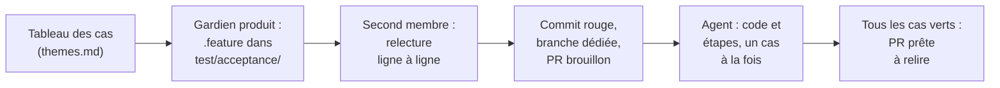

# Chapitre 1 · Le test d'acceptation indépendant

*Séance 4 « Qualité, CI/CD, sécurité, AI Act et validation RSSI » · Master ITI, Nantes Université, 2026-2027. Chapitre à lire avant ou après la séance. Les scénarios, commandes et sorties ont été écrits et exécutés le 27 novembre 2026 sous Linux, avec Flutter 3.50.1 (Dart 3.14.0), `bdd_widget_test` 3.1.0 (la version de `pubspec.lock`) et Claude Code 2.1.332, sur une copie du dépôt-modèle. Rien n'a été exécuté sur GitHub.*

Ce chapitre accompagne les quatre premiers blocs de la séance : le point d'équipe, la reprise de ce qui a glissé depuis la séance 3 (rôles et seed), l'exposé sur la qualité avec les agents, puis l'atelier central, où le gardien produit écrit les **cas d'acceptation du clou** avant que l'agent n'écrive le code qui les satisfait. Il suit l'exemple du thème B, la fonction `calculerTrs` : les huit cas du tableau de l'énoncé ont été réellement traduits en scénarios, générés, vus rouges, puis rendus verts dans une copie du dépôt-modèle. Les équipes des thèmes A et C trouveront en section 12 où sont leur tableau et leur fonction.

## Ce que vous allez retenir

- Quand le même agent écrit le code **et** les tests qui le jugent, il se note lui-même (*self-grading*, « Don't grade your own exam ») : des tests verts prouvent que le code est cohérent avec ses tests, pas qu'il est juste.
- Le **test d'acceptation indépendant** remplit trois conditions : il est écrit **avant** le code, par **une autre main** que celle qui code, avec des valeurs **recopiées de l'énoncé**, jamais calculées par l'agent.
- Les scénarios de `test/scenarios/` s'écrivent pendant le développement, souvent avec l'agent. Ceux de `test/acceptance/` s'écrivent **par un humain, avant le code**, et sont **protégés**.
- Le gardien produit traduit le tableau des cas d'acceptation de `cours/projets/themes.md` en un fichier `.feature`, un scénario par ligne du tableau ; un second membre relit les valeurs **ligne à ligne** ; le tout est commité **rouge** sur une branche dédiée, dans une **PR en brouillon** qui le restera jusqu'à ce que tous les cas soient verts.
- Trois verrous protègent `test/acceptance/` : la règle `deny` de `.claude/settings.json` (déjà présente dans le dépôt-modèle, et vérifiée : l'agent est refusé), la consigne de `CLAUDE.md`, et un fichier `CODEOWNERS`. Aucun ne protège les **étapes** de `test/steps/` : c'est la relecture qui s'en charge.
- Un relecteur qui ne lit pas le code vérifie que le test n'a pas été « arrangé » par quatre gestes : la **liste des fichiers touchés** (aucun fichier de `test/acceptance/` après le commit rouge), l'**historique du dossier**, les **valeurs comparées au tableau**, et la **valeur faussée** (un chiffre changé exprès doit faire rougir le cas).
- Avec `bdd_widget_test` 3.1.0, une étape nouvelle qui revient plusieurs fois avec des valeurs de longueurs différentes peut être générée **abîmée** ou mal mise en forme. Avant le commit rouge : réparer, puis `dart format test/steps` (section 7.2).

---

## 1. Pourquoi ce chapitre

Douze jours ont passé depuis la séance 3. Votre dépôt contient une première règle verte, un modèle de données et ses migrations, le début de la fiche de conformité. La séance 4 pose une autre question : **peut-on faire confiance à ce qu'on livre ?** Le programme y répond de trois façons complémentaires : des garde-fous automatiques (la CI, chapitre 2), un test d'acceptation écrit par un humain avant le code de l'agent (ce chapitre), et un passage devant le RSSI (chapitre 4).

Ce chapitre ne redit pas ce qui existe déjà. Le cycle rouge, vert, nettoyage et les cinq règles du « TDD sans triche » sont au chapitre 5 de la séance 1 (sections 3.3 et 12). L'écriture d'un scénario en français, les **valeurs entre accolades** et les **étapes qui n'ouvrent aucun écran** sont au chapitre 2 de la séance 3 (sections 4 et 7). Les signes de triche dans un diff sont au même chapitre, section 8. On applique ici le tout au clou du thème.



> **À retenir.** L'humain fixe les attendus, l'agent doit les satisfaire. Si l'agent touche aux attendus, il ne reste plus rien à vérifier.

---

## 2. Le point d'équipe (bloc 1)

### 2.1 Le bref contrôle

On ouvre la séance par le même contrôle qu'en séance 3 : `git pull`, `flutter pub get`, `build_runner`, `flutter test`, sur **chaque** poste. Les commandes, ce qu'on doit voir et quoi faire quand ça coince sont dans la fiche G de la séance 3 et au chapitre 1 de la séance 3, section 2. Une différence : après douze jours, `git pull` apporte en général beaucoup de choses (des PR fusionnées par vos coéquipiers, peut-être une table nouvelle), donc `dart run build_runner build --delete-conflicting-outputs` avant `flutter test` n'est pas facultatif.

### 2.2 Le tour de table

Quelques minutes, en équipe, à voix haute. Chaque question se vérifie sur un écran :

| Question | Où regarder | Ce qu'on doit voir |
|---|---|---|
| Quelles PR sont ouvertes ? | Onglet *Pull requests* du dépôt | Pour chacune : son auteur, son relecteur, ce qui la bloque |
| Qu'est-ce qui bloque ? | Les commentaires `[bloquant]` des PR ouvertes, la ligne « Reste à faire » de `JOURNAL.md` | Un nom en face de chaque blocage |
| La CI est-elle verte sur `main` ? | La pastille à côté du dernier commit de `main` | Une coche verte (la CI complète arrive au chapitre 2) |
| Où en est la fiche ? | `docs/fiche_conformite.md` sur `main` | Rubriques 1 à 5 remplies, relues par un coéquipier |
| Qu'a terminé la tâche facultative ? | Les PR fusionnées depuis le 4 décembre | Le seed, les rôles, les rubriques 6 et 7, ou rien : on le note |

La dernière ligne décide de la suite : une équipe qui n'a pas branché ses rôles commence par la section 3 ; une équipe à jour passe directement à la section 4. Le point d'équipe sert aussi à annoncer les appariements de l'audit croisé et les tables du passage devant le RSSI (chapitres 3 et 4).

> **À retenir.** On repart de l'état réel, pas de l'état espéré. Ce qui n'est pas visible sur un écran (une PR, une pastille, un fichier sur `main`) n'est pas fait.

---

## 3. Reprise de la séance 3 : rôles et seed (bloc 2)

Le programme fixe l'ordre : les **rôles** d'abord (**Indispensable** : l'audit croisé de cet après-midi les vérifie), puis un **seed reproductible fictif de taille réduite** (**Important**) ; le seed complet peut finir dans le sprint. Aucune équipe n'est censée avoir terminé le CRUD.

### 3.1 Ce que le dépôt-modèle fournit déjà

Vous n'écrivez pas la garde : elle est dans le dépôt depuis la séance 2.

- `lib/core/domain/roles/` : l'énumération `Role` (deux rôles de démonstration, `meneur` et `joueur`), l'utilisateur courant **simulé** (le rôle se choisit à l'écran ; ni compte ni mot de passe) et la garde `RequireRole`, qui lève `AccesRefuse` si le rôle n'est pas autorisé.
- `docs/ARCHITECTURE.md`, section 8 : la règle. Une action réservée se protège **dans le cas d'usage** (couche `domain`), pas dans l'écran ; chaque action protégée a son **test de refus**. L'exemple est `ViderHistorique`, dans la fonctionnalité `jets`.
- `test/core/domain/roles/require_role_test.dart` et `test/features/jets/domain/usecases/vider_historique_test.dart` : les tests de refus d'exemple.

Les tests de refus du dépôt commencent par le mot « refuse ». Pour les voir, sans lire de code :

```bash
flutter test --plain-name "refuse"
```

Sur la copie du dépôt-modèle :

```text
00:00 +0: test/features/jets/domain/usecases/vider_historique_test.dart: refuse au joueur de vider l’historique, sans rien effacer
00:00 +1: test/core/domain/roles/require_role_test.dart: refuse l’accès à un joueur
00:00 +2: test/core/data/base_de_donnees_test.dart: la base refuse un jet de valeur 0
00:00 +3: All tests passed!
```

L'option `--plain-name` ne lance que les tests dont le nom contient le texte donné. La troisième ligne n'est pas un test de rôle (c'est une contrainte de la base, chapitre 4 de la séance 3) : elle montre seulement que le filtre porte sur le nom.

### 3.2 Brancher les rôles de votre thème

Pour le thème B, `PROJET.md` (story S2) fixe les deux rôles et leurs droits : le `responsable` lit, importe, exporte et corrige ; l'`operateur` déclare uniquement sur les quarts de son poste. Le travail, confié à l'agent en mode plan (chapitre 2 de la séance 2, section 6), tient en trois points :

1. remplacer `meneur` et `joueur` par `responsable` et `operateur` dans `role.dart` (et le rôle par défaut de `utilisateur_courant.dart`) ;
2. dans chaque **cas d'usage sensible** déjà écrit, déclarer la garde et l'appeler avant d'agir, comme `ViderHistorique` ;
3. pour chaque cas d'usage protégé, un **test de refus** écrit et vu rouge **avant** la garde : le rôle non autorisé est refusé, et rien n'est modifié.

**Et la fonctionnalité `jets` ?** Tant qu'elle est dans le dépôt (la séance 3 autorisait à la garder), `ViderHistorique`, son test, le test du Cubit de `jets` et `require_role_test.dart` citent `meneur` et `joueur` : renommer les rôles les fait échouer à la compilation. Deux issues, à décider en équipe avant de lancer l'agent. Soit retirer `jets`, avec la procédure de `docs/ARCHITECTURE.md` (section 7, « Passer en version 2 », étape 1) ; si votre base est déjà en version 2 avec `jets`, ce retrait est une nouvelle migration, coordonnée par le gardien des données (une seule à la fois, chapitre 4 de la séance 3). Soit garder `jets` pour l'instant et, dans la même PR, adapter ces tests d'exemple aux nouveaux rôles, en le disant dans la description : c'est un renommage, les tests restent des tests de refus, aucune attente n'est assouplie. Aucune des deux issues n'a été jouée pour ce chapitre.

La liste des cas d'usage sensibles se fait **en équipe, avant de demander quoi que ce soit à l'agent**, à partir des droits de `PROJET.md`. Pour le thème B, elle ressemble à ceci. La garde se branche sur les cas d'usage **qui existent déjà** dans votre dépôt ; les autres la recevront quand ils seront écrits, pendant le sprint (l'import CSV, par exemple, vient pendant le sprint). Si aucun cas d'usage sensible n'existe encore chez vous, les rôles du thème remplacent les rôles de démonstration, le tableau est noté dans `PROJET.md`, et c'est tout pour aujourd'hui :

| Action | Rôle autorisé | Test de refus attendu |
|---|---|---|
| Importer des déclarations (CSV) | `responsable` | un `operateur` est refusé |
| Exporter les TRS (CSV) | `responsable` | un `operateur` est refusé |
| Corriger une déclaration ou un arrêt | `responsable` | un `operateur` est refusé |
| Déclarer sur un quart | `operateur` du poste du quart | un `operateur` d'un autre poste est refusé |

La dernière ligne demande plus qu'un rôle : il faut aussi vérifier que le quart appartient au poste de l'utilisateur. Elle n'a pas été écrite ni essayée pour ce chapitre.

**Ce que vous devez voir quand c'est fait.** La commande

```bash
git grep -n "RequireRole(" -- lib
```

liste les endroits du code où la garde est déclarée. Sur la copie du dépôt-modèle, elle affiche deux lignes : la définition de la garde, et le seul cas d'usage protégé de l'exemple.

```text
lib/core/domain/roles/require_role.dart:19:  const RequireRole(this.rolesAutorises);
lib/features/jets/domain/usecases/vider_historique.dart:10:  static const garde = RequireRole({Role.meneur});
```

Chez vous, vous devez y voir une ligne par cas d'usage sensible **existant** de votre tableau. Puis `flutter test --plain-name "refuse"` affiche un test de refus par cas d'usage protégé, et la sortie se termine par `All tests passed!`. Dans l'onglet des commits de la PR, chaque commit de test de refus précède le commit qui ajoute la garde (chapitre 2 de la séance 3, section 9.1). C'est ce que l'équipe qui vous audite regardera (checklist d'audit, point « Rôles », chapitre 3), sur les cas d'usage qui existent.

### 3.3 Le seed réduit

Le **seed** est le jeu de données de démonstration chargé dans une base vide ; le seed complet du thème B (6 postes, 90 quarts par poste, environ 3 000 déclarations et arrêts) est décrit au chapitre 4 de la séance 3, section 10. Le bloc 2 demande un seed **reproductible**, **fictif** et **de taille réduite** :

- **reproductible** : généré à graine fixe, il produit les mêmes données à chaque lancement ;
- **fictif** : produits, postes, opérateurs et tickets inventés, aucun nom de personne ;
- **réduit** : quelques postes et quelques quarts suffisent ; c'est le seed complet qui peut finir dans le sprint.

Ce que vous devez voir : un test qui génère le seed deux fois et vérifie que les deux résultats sont identiques, et l'application lancée (`flutter run -d chrome`) qui montre ces données dans une base vide. Le seed n'a pas été écrit pour ce chapitre.

### 3.4 Les équipes à jour

Elles avancent : relecture des PR ouvertes, début du CRUD de l'entité principale. Le gardien produit, lui, prépare déjà le tableau de la section 6.

> **À retenir.** La garde existe déjà ; votre travail est de la brancher sur **chaque** cas d'usage sensible, avec un test de refus vu rouge d'abord. La liste des cas sensibles se décide en équipe, à partir de `PROJET.md`.

---

## 4. Qualité avec les agents (bloc 3)

Cet exposé justifie l'atelier qui suit. Il reprend, en les reliant, des notions déjà vues en séance 1.

### 4.1 La revue humaine devient le goulot d'étranglement

Un agent produit du code plus vite qu'un humain ne le relit. Le facteur limitant n'est plus l'écriture, c'est la **relecture** : chapitre 3 de la séance 1, section 5.4, et chapitre 8 de la séance 1, sections 4.3, 7.3 et 11. La réponse du cours n'est pas de relire plus vite, mais de relire **mieux** : de petites PR, et des preuves qui ne demandent pas de lire le code.

### 4.2 Le self-grading

Si le même agent écrit le code et ses propres tests, il se **note lui-même**. Une erreur de compréhension passe alors dans les deux : le code calcule faux, le test attend le même faux, et tout est vert. Le chapitre 5 de la séance 1 (section 12.1) le documente, et le chapitre 3 de la séance 1 (section 5.1) montre le cas d'un test écrit après le code qui « protège » le bug. Les sources du cours rangent ce travers parmi les anti-patrons sous la formule « don't grade your own exam » (`cours/sources/agentic-engineering.md`).

### 4.3 Le test d'acceptation indépendant

La parade tient en trois conditions, qui viennent du programme :

| Condition | Ce qu'elle empêche | Ce qu'on vérifie |
|---|---|---|
| **Écrit avant** le code | Un test taillé sur le code existant | Dans l'historique, le commit du `.feature` précède les commits de code |
| **Par une autre main** que celle qui code | L'agent qui se note lui-même | Le `.feature` est écrit par le gardien produit ; l'agent ne peut pas le modifier (section 9) |
| **Valeurs recopiées de l'énoncé** | Des attendus « calculés » par l'agent, donc avec ses erreurs | Chaque valeur du `.feature` se retrouve, à l'identique, dans le tableau de `themes.md` |

Le format Gherkin en français s'y prête : il se lit sans savoir programmer, ce qui permet au second membre de le relire ligne à ligne (chapitre 3 de la séance 1, section 5.2).

### 4.4 Des repères chiffrés, avec leurs limites

Deux études déjà présentées au chapitre 3 de la séance 1 éclairent le sujet. Toutes deux viennent d'**éditeurs** d'outils d'analyse de code : elles sont à lire avec recul.

| Étude | Ce qu'elle dit | Limite |
|---|---|---|
| **GitClear**, édition 2025 (211 millions de lignes, 2020-2024) | La part de code « déplacé » (indice indirect du refactoring) passe d'environ 25 % des changements à moins de 10 % ; 2024 est la première année où le copier-coller dépasse le code déplacé | Éditeur ; résultats corrélationnels ; « lignes déplacées » mesure une façon d'éditer, pas directement la qualité |
| **GitClear**, édition 2026 (623 millions de changements, 2023-2026) | Selon la page de l'éditeur, le refactoring passe de 21 % des lignes modifiées en 2022 à 3,8 % en 2026 ; la duplication de blocs augmente de 81 % depuis 2023 | Seule la page de synthèse a été lue ; le « −70 % » repris ailleurs n'y figure pas : ne le citez pas |
| **CodeScene** (Borg, Tornhill et al., FORGE 2026, évalué par les pairs) | Sur du code peu sain, les modèles testés cassent plus souvent le comportement en refactorant ; le communiqué parle d'« au moins 30 % » de risque de défaut en plus | Un auteur fonde l'éditeur ; code de concours en Python ; effet non significatif pour les modèles les plus puissants ; le « +60 % » du livre blanc commercial ne vient pas de l'étude |

Ces chiffres ne prouvent pas que l'agent écrit du mauvais code. Ils indiquent que **la vérification ne suit pas toute seule** la vitesse de production, ce qui justifie des attendus fixés par un humain.

### 4.5 Un geste de relecture repris de la séance 1

Quand l'agent propose une structure (une classe de plus, une couche, une interface), posez-lui la question du chapitre 9 de la séance 1, section 8 : **« Quel patron as-tu utilisé, et quel problème ce patron résout-il ici ? »** Une réponse qui cite un besoin réel de votre projet (changer de stockage sans toucher à la règle, tester sans base) est un bon signe. Une réponse vague (« c'est une bonne pratique », « pour la maintenabilité ») signale un patron de trop : demandez la solution la plus simple qui passe les tests.

> **À retenir.** Des tests verts écrits par l'agent prouvent la cohérence, pas la justesse. La justesse vient d'attendus écrits avant, par un humain, recopiés de l'énoncé.

---

## 5. Deux sortes de scénarios

Votre dépôt contient déjà des scénarios `.feature` dans `test/scenarios/` (celui de `jets`, celui de votre première user story). Ceux de cette séance vont ailleurs, et ce n'est pas un détail de rangement.

| | `test/scenarios/` | `test/acceptance/` |
|---|---|---|
| **Quand** | Pendant le développement, story par story | **Avant** le code de la règle qu'ils vérifient |
| **Qui** | L'équipe, souvent avec l'agent (le scénario est relu avant d'être généré) | **Un humain** : le gardien produit, relu par un second membre |
| **D'où viennent les valeurs** | Des critères de `PROJET.md`, choisis par l'équipe | **Du tableau des cas d'acceptation** de `themes.md`, recopié |
| **Qui peut les modifier** | L'équipe, dans une PR relue | Personne sans relecture du gardien produit ; jamais l'agent |
| **Protection** | La relecture de la PR | Règle `deny`, consigne `CLAUDE.md`, `CODEOWNERS`, relecture |
| **Rôle** | Décrire et vérifier une story | **Juger** le clou, de l'extérieur |

Les deux ont la même écriture (`# language: fr`, valeurs entre accolades) et passent par le même `build_runner`. Leurs étapes vont au même endroit, `test/steps/` (le `README.md` de `test/acceptance/` le rappelle). Les tests générés à partir d'eux ne sont pas versionnés : le `.gitignore` exclut `/test/acceptance/**/*_test.dart` comme ceux des scénarios.

> **À retenir.** `test/scenarios/` : vos stories, écrites au fil de l'eau. `test/acceptance/` : le juge du clou, écrit avant, par un humain, et protégé.

---

## 6. Écrire les cas du clou : l'exemple du thème B (bloc 4)

### 6.1 Le tableau de l'énoncé

Le clou du thème B est la fonction pure `calculerTrs(quart, declarations, arrets)`. `cours/projets/themes.md`, thème B, rubrique « Cas de test d'acceptation », donne **huit cas** (valeurs affichées arrondies à 0,1 point). Les voici, recopiés :

| # | Entrée | Sortie attendue |
|---|---|---|
| 1 | quart de 480 min, aucun arrêt ; cycle 30 s ; 900 produites dont 9 rebutées | D 100,0 % ; P 93,8 % (93,75 arrondi vers le haut) ; Q 99,0 % ; OEE 92,8 % |
| 2 | quart de 480 min ; pause 30 min ; panne 45 min + changement de série 15 min ; cycle 60 s ; 330 produites dont 33 rebutées | temps requis 450, marche 390 ; D 86,7 % ; P 84,6 % ; Q 90,0 % ; OEE 66,0 % |
| 3 | quart du mardi 6 octobre 2026, 06:00 à 14:00 heure de Paris ; panne de 13:30 à 14:30 ; cycle 20 s ; 1 200 produites, 0 rebut | arrêt tronqué à 30 min ; D 93,8 % ; P 88,9 % ; Q 100,0 % ; OEE 83,3 % |
| 4 | quart de 480 min, aucun arrêt ; cycle 30 s ; 1 000 produites dont 50 rebutées | temps utile 500 min > 480 : P plafonnée à 100,0 %, `performance_plafonnee` vrai ; Q 95,0 % ; OEE 95,0 % |
| 5 | quart de 480 min ; attente matière 60 min ; OF 1 : cycle 30 s, 400 produites dont 4 rebutées ; OF 2 : cycle 45 s, 200 produites dont 20 rebutées | marche 420 ; D 87,5 % ; temps utile 350 min ; P 83,3 % ; Q 96,0 % ; OEE 70,0 % |
| 6 | quart de 480 min, dont 480 min d'arrêt planifié | « non calculable », sans exception |
| 7 | quart de 480 min ; panne de 480 min ; 0 pièce | D 0,0 % ; P 0,0 % ; Q 0,0 % ; OEE 0,0 % |
| 8 | nuit du 24 au 25 octobre 2026, de 22:00 (heure d'été) à 06:00 (heure d'hiver), soit 20:00Z à 05:00Z ; aucun arrêt ; cycle 30 s ; 1 000 produites dont 10 rebutées | durée 540 min ; D 100,0 % ; P 92,6 % ; Q 99,0 % ; OEE 91,7 % |

Les règles qui produisent ces valeurs (durée du quart, troncature, disponibilité, performance plafonnée, qualité, OEE et cas dégénérés) sont juste au-dessus du tableau, dans `themes.md`. Le gardien produit n'a **pas** à les appliquer : il recopie.

### 6.2 Du tableau au `.feature` : les choix faits

Le gardien produit écrit le fichier **lui-même**, dans VS Code, sans le demander à l'agent : c'est la condition « une autre main » de la section 4.3, et de toute façon l'agent n'a pas le droit d'écrire dans ce dossier (section 9.1). Les choix suivants ont été faits pour la copie de vérification ; ils valent pour toute équipe B.

- **Un scénario par ligne du tableau**, nommé « cas N · … » : un cas rouge se retrouve alors d'un coup d'œil dans le tableau.
- **Les phrases de la séance 3 sont reprises telles quelles** quand elles disent la même chose : « un quart de {480} minutes », « un arrêt planifié {'pause'} de {30} minutes », « la disponibilité affichée est {'86,7 %'} »… C'est la règle de réutilisation du chapitre 2 de la séance 3 (section 4.2). Conséquence dans votre dépôt : voir l'encadré de la section 7.1.
- **Les codes de l'énoncé, pas des libellés** : `'changement_serie'`, `'attente_matiere'`, comme dans la liste des catégories de l'énoncé.
- **Les heures des cas 3 et 8 sont écrites au format ISO 8601**, qui porte le décalage par rapport à UTC. **Cas 8** : le tableau donne lui-même les heures UTC, « soit 20:00Z à 05:00Z » ; elles sont recopiées telles quelles : `'2026-10-24T20:00:00Z'` et `'2026-10-25T05:00:00Z'` (le `Z` signifie UTC). **Cas 3** : le tableau dit « 06:00 à 14:00 heure de Paris » sans donner de décalage. Le scénario écrit `'2026-10-06T06:00:00+02:00'` (« 06:00, heure de Paris en été, UTC+2 ») : les heures sont celles du tableau, mais le décalage `+02:00` est un **ajout**, à signaler dans la PR, comme la catégorie du cas 6.
- **Cas 6** : le tableau dit « 480 min d'arrêt planifié » sans préciser la catégorie. Une catégorie est nécessaire pour l'étape ; `'pause'` a été choisie, et n'importe quelle catégorie planifiée donnerait le même résultat d'après la règle 3. Avec le décalage du cas 3, ce sont **les deux seuls ajouts** au tableau : signalez-les dans la description de la PR.
- **Cas 7** : « 0 pièce » est écrit « aucune pièce déclarée ». **Cas 6** : « sans exception » n'a pas d'étape propre ; si le calcul levait une exception, l'étape « Quand je calcule le TRS » échouerait et le cas serait rouge.

### 6.3 Le fichier

`test/acceptance/calculer_le_trs.feature`, tel qu'il a été généré et exécuté :

```gherkin
# language: fr
Fonctionnalité: Calcul du TRS d'un quart (cas d'acceptation du thème B)

  Scénario: cas 1 · quart sans arrêt, une déclaration
    Soit un quart de {480} minutes
    Et aucun arrêt
    Et une déclaration avec un cycle de {30} secondes, {900} pièces produites dont {9} rebutées
    Quand je calcule le TRS
    Alors la disponibilité affichée est {'100,0 %'}
    Et la performance affichée est {'93,8 %'}
    Et la qualité affichée est {'99,0 %'}
    Et le TRS affiché est {'92,8 %'}

  Scénario: cas 2 · un arrêt planifié et deux arrêts non planifiés
    Soit un quart de {480} minutes
    Et un arrêt planifié {'pause'} de {30} minutes
    Et un arrêt non planifié {'panne'} de {45} minutes
    Et un arrêt non planifié {'changement_serie'} de {15} minutes
    Et une déclaration avec un cycle de {60} secondes, {330} pièces produites dont {33} rebutées
    Quand je calcule le TRS
    Alors le temps requis est de {450} minutes
    Et le temps de marche est de {390} minutes
    Et la disponibilité affichée est {'86,7 %'}
    Et la performance affichée est {'84,6 %'}
    Et la qualité affichée est {'90,0 %'}
    Et le TRS affiché est {'66,0 %'}

  Scénario: cas 3 · une panne qui déborde du quart est tronquée
    Soit un quart du {'2026-10-06T06:00:00+02:00'} au {'2026-10-06T14:00:00+02:00'}
    Et un arrêt non planifié {'panne'} du {'2026-10-06T13:30:00+02:00'} au {'2026-10-06T14:30:00+02:00'}
    Et une déclaration avec un cycle de {20} secondes, {1200} pièces produites dont {0} rebutées
    Quand je calcule le TRS
    Alors l'arrêt est tronqué à {30} minutes
    Et la disponibilité affichée est {'93,8 %'}
    Et la performance affichée est {'88,9 %'}
    Et la qualité affichée est {'100,0 %'}
    Et le TRS affiché est {'83,3 %'}

  Scénario: cas 4 · la performance est plafonnée à 100 %
    Soit un quart de {480} minutes
    Et aucun arrêt
    Et une déclaration avec un cycle de {30} secondes, {1000} pièces produites dont {50} rebutées
    Quand je calcule le TRS
    Alors le temps utile est de {500} minutes
    Et la performance affichée est {'100,0 %'}
    Et la performance est plafonnée
    Et la qualité affichée est {'95,0 %'}
    Et le TRS affiché est {'95,0 %'}

  Scénario: cas 5 · deux ordres de fabrication
    Soit un quart de {480} minutes
    Et un arrêt non planifié {'attente_matiere'} de {60} minutes
    Et une déclaration avec un cycle de {30} secondes, {400} pièces produites dont {4} rebutées
    Et une déclaration avec un cycle de {45} secondes, {200} pièces produites dont {20} rebutées
    Quand je calcule le TRS
    Alors le temps de marche est de {420} minutes
    Et la disponibilité affichée est {'87,5 %'}
    Et le temps utile est de {350} minutes
    Et la performance affichée est {'83,3 %'}
    Et la qualité affichée est {'96,0 %'}
    Et le TRS affiché est {'70,0 %'}

  Scénario: cas 6 · tout le quart est un arrêt planifié
    Soit un quart de {480} minutes
    Et un arrêt planifié {'pause'} de {480} minutes
    Quand je calcule le TRS
    Alors le TRS affiché est {'non calculable'}

  Scénario: cas 7 · une panne sur tout le quart, aucune pièce
    Soit un quart de {480} minutes
    Et un arrêt non planifié {'panne'} de {480} minutes
    Et aucune pièce déclarée
    Quand je calcule le TRS
    Alors la disponibilité affichée est {'0,0 %'}
    Et la performance affichée est {'0,0 %'}
    Et la qualité affichée est {'0,0 %'}
    Et le TRS affiché est {'0,0 %'}

  Scénario: cas 8 · la nuit du changement d'heure dure 540 minutes
    Soit un quart du {'2026-10-24T20:00:00Z'} au {'2026-10-25T05:00:00Z'}
    Et aucun arrêt
    Et une déclaration avec un cycle de {30} secondes, {1000} pièces produites dont {10} rebutées
    Quand je calcule le TRS
    Alors le temps d'ouverture est de {540} minutes
    Et la disponibilité affichée est {'100,0 %'}
    Et la performance affichée est {'92,6 %'}
    Et la qualité affichée est {'99,0 %'}
    Et le TRS affiché est {'91,7 %'}
```

Le fichier est placé directement dans `test/acceptance/`. Un sous-dossier (`test/acceptance/trs/`) fonctionnerait aussi : la ligne du `.gitignore` couvre les sous-dossiers.

### 6.4 La relecture ligne à ligne, par un second membre

Le second membre n'a besoin ni de Dart ni de l'agent : il a le tableau de `themes.md` d'un côté, le `.feature` de l'autre. Pour **chaque** scénario :

1. le numéro du cas correspond à la même ligne du tableau ;
2. chaque nombre de la colonne « Entrée » se retrouve dans une ligne `Soit` ou `Et` du scénario, **à l'identique** (480, 30, 900, 9…), à une exception de forme près : l'espace des milliers disparaît (« 1 200 » devient `{1200}`, « 1 000 » devient `{1000}`) ;
3. chaque valeur de la colonne « Sortie attendue » se retrouve dans une ligne `Alors` ou `Et`, **au caractère près**, virgule décimale et espace avant `%` compris (`'92,8 %'`, pas `'92.8%'`) ;
4. aucune valeur du scénario n'est absente du tableau, sauf les deux ajouts signalés (la catégorie `'pause'` du cas 6, le décalage `+02:00` du cas 3) ;
5. aucune ligne du tableau n'a été oubliée : huit lignes, huit scénarios.

Le relecteur coche, ou écrit un commentaire `[bloquant]` sur la ligne fautive (chapitre 1 de la séance 3, section 4.2). C'est **lui** qui approuve la PR du `.feature`, pas son auteur.

> **À retenir.** Un scénario par ligne du tableau, les valeurs recopiées au caractère près, les phrases de la séance 3 reprises. Tout ajout au tableau est signalé dans la PR.

---

## 7. Générer, et constater le rouge

### 7.1 La génération

```bash
dart run build_runner build --delete-conflicting-outputs
```

Sur la copie, la commande a produit le test `test/acceptance/calculer_le_trs_test.dart` (non versionné) et **dix-neuf étapes** nouvelles dans `test/steps/`, une par phrase distincte, par exemple :

```text
test/steps/un_quart_de_minutes.dart
test/steps/un_quart_du_au.dart
test/steps/un_arret_planifie_de_minutes.dart
test/steps/une_declaration_avec_un_cycle_de_secondes_pieces_produites_dont_rebutees.dart
test/steps/je_calcule_le_trs.dart
test/steps/le_trs_affiche_est.dart
...
```

Chacune est un squelette qui échoue volontairement (`throw UnimplementedError();`), comme en séance 3 (chapitre 2, section 4.3). La virgule de « {30} secondes, {900} pièces » ne gêne pas : les trois valeurs deviennent trois paramètres.

> **Dans votre dépôt, certaines étapes existent déjà.** La copie de vérification partait du dépôt-modèle, sans la story de la séance 3 : toutes les étapes ont donc été créées. Chez vous, les phrases reprises de la séance 3 (« un quart de {480} minutes », « la disponibilité affichée est {…} », « le temps requis est de {…} minutes »…) ont déjà leur étape, et `build_runner` ne la recrée pas. Or ces étapes ont été écrites pour la disponibilité : par exemple, « la disponibilité affichée est » lit le résultat de « je calcule la disponibilité », pas celui de « je calcule le TRS ». C'est **l'étape** qu'il faudra adapter, dans `test/steps/`, en gardant le scénario de la séance 3 vert ; **jamais le `.feature`**. Ce cas n'a pas été essayé pour ce chapitre.

### 7.2 Le piège des squelettes abîmés

Sur la copie, le premier `flutter test` après la génération n'a même pas pu charger le fichier :

```text
test/steps/un_arret_non_planifie_de_minutes.dart:9:6: Error: Expected a function body or '=>'.
Try adding {}.
ror();
     ^
test/steps/un_arret_non_planifie_de_minutes.dart:10:1: Error: Expected a declaration, but got '}'.
```

Le squelette avait deux lignes de trop à la fin (`ror();` et `}`) : des restes d'un autre squelette. L'étape « un arrêt non planifié {…} de {…} minutes » apparaît quatre fois dans le fichier, avec des valeurs de longueurs différentes, et `bdd_widget_test` 3.1.0 a écrit le même fichier plusieurs fois, la version la plus courte par-dessus la plus longue, sans effacer la fin. L'essai a été refait quatre fois en supprimant les étapes générées : à chaque fois, au moins un fichier était abîmé, pas toujours le même (`la_disponibilite_affichee_est.dart`, `le_trs_affiche_est.dart`…). Parfois, il ne reste qu'une ligne vide en trop. Ce n'est pas sans conséquence : la CI vérifie la mise en forme avant les tests (étape « Vérifier la mise en forme », `dart format --output=none --set-exit-if-changed .`), et des squelettes générés échouent à cette vérification. Sur une nouvelle génération, faite après réparation du fichier abîmé, elle a répondu :

```text
Changed test/steps/la_performance_affichee_est.dart
Changed test/steps/le_trs_affiche_est.dart
Formatted 64 files (2 changed) in 0.08 seconds.
```

(deux fichiers cette fois-ci, trois lors d'une autre relecture : le nombre varie). D'où une commande de plus avant le commit rouge, qui remet les étapes en forme sans rien changer à leur sens :

```bash
dart format test/steps
```

Après elle, la même vérification répond `Formatted 64 files (0 changed)`.

**Comment le reconnaître** : `flutter test` ou `flutter analyze` signalent une erreur dans un fichier de `test/steps/` qui vient d'être créé, avec `Expected a declaration` ou `A function body must be provided`.

**Comment le réparer** : ouvrez le fichier signalé ; un squelette se termine par la première ligne qui ne contient que `}`. Supprimez tout ce qui suit, enregistrez, relancez `flutter test`. Ce sont des fichiers d'étapes, pas des fichiers de `test/acceptance/` : l'agent peut aussi le faire si vous le lui demandez (« répare les squelettes abîmés de `test/steps/` signalés par `flutter analyze`, sans rien toucher d'autre »).

**Ce qui ne marche pas** : supprimer le fichier abîmé et relancer `build_runner`. Tant que le `.feature` n'a pas changé, la génération est considérée à jour (`wrote 0 outputs`) et l'étape n'est pas recréée.

### 7.3 Le rouge attendu

Squelettes réparés, `flutter test test/acceptance` donne, pour chaque cas :

```text
00:00 +0: Calcul du TRS d'un quart (cas d'acceptation du thème B) cas 1 · quart sans arrêt, une déclaration
══╡ EXCEPTION CAUGHT BY FLUTTER TEST FRAMEWORK ╞════════════════════════════════════════════════════
The following UnimplementedError was thrown running a test:
UnimplementedError

When the exception was thrown, this was the stack:
#0      unQuartDeMinutes (file://test/steps/un_quart_de_minutes.dart:6:3)
...
00:00 +0 -1: Calcul du TRS d'un quart (cas d'acceptation du thème B) cas 1 · quart sans arrêt, une déclaration [E]
```

et se termine par :

```text
00:00 +0 -8: Some tests failed.
```

Huit cas, huit échecs (`-8`), chacun sur `UnimplementedError` : une étape au moins de chaque scénario n'est qu'un squelette. Lancé sur tout le dépôt, `flutter test` affiche `00:02 +32 -8: Some tests failed.` : les 32 tests du squelette passent, les huit cas échouent. **Ce rouge est le livrable** : il prouve que les cas sont exécutés et qu'aucun code ne les satisfait encore.

### 7.4 Le commit rouge, la branche, la PR en brouillon

Sur une **branche dédiée**, après avoir réparé les squelettes abîmés et remis les étapes en forme (section 7.2), le gardien produit commite le `.feature` et les squelettes d'étapes, seuls :

```bash
git switch -c acceptance/trs
dart format test/steps
git add test/acceptance/calculer_le_trs.feature test/steps/
git commit -m "test(acceptance): cas d'acceptation du TRS (rouge)"
```

Sur la copie, `git show --stat` sur ce commit liste le `.feature` (88 lignes) et les dix-neuf étapes, rien d'autre : `20 files changed, 230 insertions(+)`.

Puis il pousse la branche et ouvre la PR **en brouillon** (*draft*) :

```bash
git push -u origin acceptance/trs
gh pr create --draft
```

L'option `--draft` existe dans `gh` (vérifié dans son aide, `gh pr create --help`) ; jamais `--fill`, qui saute le modèle de PR (chapitre 3 de la séance 2, section 9.2). `gh pr create --web` ouvre la création dans le navigateur, où le brouillon se choisit dans le menu du bouton de création (libellé non vérifié). Une PR en brouillon ne peut pas être fusionnée tant qu'on ne l'a pas déclarée prête (*Ready for review*). Elle **reste en brouillon jusqu'à ce que les huit cas soient verts**. Dans sa description : le tableau d'origine (`themes.md`, thème B), les ajouts signalés (catégorie du cas 6, décalage du cas 3), et la mention du second membre qui a relu les valeurs (son rôle, pas son nom).

La CI de cette PR sera **rouge** : c'est normal et voulu. Le rouge attendu est celui de l'étape « Tester et mesurer la couverture » du contrôle `analyse-et-tests` ; si c'est l'étape « Vérifier la mise en forme » qui échoue, c'est un `dart format test/steps` oublié, à corriger. On ne « répare » pas le rouge des tests en touchant au test.

> **À retenir.** Rouge, sur une branche à part, dans une PR en brouillon : c'est l'état attendu à la fin de la séance. Un squelette abîmé n'est pas un rouge : on le répare avant de commiter.

---

## 8. Du rouge au vert : ce qui change dans la sortie

### 8.1 Un cas passe au vert

La suite du clou est le travail de l'agent, sur la même branche, pendant le sprint : écrire la règle dans `domain` (tests unitaires d'abord, comme en séance 3), puis compléter les étapes. Une demande possible, **rédigée pour ce chapitre** et non essayée avec l'agent :

```text
Sur la branche acceptance/trs, fais passer les cas d'acceptation de
test/acceptance/calculer_le_trs.feature, un cas à la fois, dans l'ordre.
Tu ne modifies rien dans test/acceptance/. Tu peux compléter les étapes
de test/steps/ ; chaque étape « Alors » compare une valeur avec expect.
Règle pure calculerTrs dans domain, tests unitaires d'abord, aucun double,
conversion des secondes dans lib/core/unites.dart. Après chaque cas,
montre la sortie de flutter test test/acceptance.
```

Pour montrer la différence observable, la copie de vérification a été avancée **à la main** (pas par un agent) du strict nécessaire pour un cas : une règle `calculerTrs` dans `lib/features/trs/domain/`, la constante des secondes par minute dans `lib/core/unites.dart`, et les huit étapes utilisées par le cas 1. Une étape complétée ressemble à ceci ; la ligne à reconnaître est `expect`, qui compare la valeur calculée à la valeur du `.feature` :

```dart
/// Usage: le TRS affiché est {'92,8 %'}
Future<void> leTrsAfficheEst(WidgetTester tester, String attendu) async {
  expect(resultatDuCas.oeeAffiche, attendu);
}
```

La sortie de `flutter test test/acceptance` devient :

```text
00:00 +0: cas 1 · quart sans arrêt, une déclaration
00:00 +1: cas 2 · un arrêt planifié et deux arrêts non planifiés
00:00 +1 -1: cas 2 · un arrêt planifié et deux arrêts non planifiés [E]
...
00:00 +1 -7: cas 8 · la nuit du changement d'heure dure 540 minutes [E]
00:00 +1 -7: Some tests failed.
```

(Le préfixe « Calcul du TRS d'un quart (cas d'acceptation du thème B) » de chaque ligne a été retiré ici pour la lisibilité.) Comment lire le compteur : `+1` est le nombre de cas verts, `-7` le nombre de cas rouges. Le cas 1 n'apparaît plus dans la liste `Failing tests:` de la fin. Sur tout le dépôt : `00:02 +33 -7: Some tests failed.`

Les sept autres restent rouges parce que leurs étapes propres (« un arrêt planifié… », « le temps utile est de… », « un quart du … au … ») ne sont pas encore écrites. Quand tous les cas sont verts, la sortie se termine par `+8: All tests passed!` : la PR peut alors passer en *Ready for review*.

### 8.2 Les huit cas sont cohérents

Pour s'assurer que le tableau de l'énoncé ne contient pas d'erreur, la copie de vérification a ensuite été complétée : les dix-neuf étapes, et une règle qui applique les six règles du niveau 1 sur des valeurs exactes (entiers, pas de `double`), l'arrondi étant fait à l'affichage seulement. Résultat :

```text
00:00 +8: All tests passed!
```

et `flutter test` sur tout le dépôt : `00:03 +40: All tests passed!` (résultat identique avec le `.feature` définitif, où le cas 8 est écrit en heures UTC) ; `flutter analyze` : `No issues found!`. Les huit cas du tableau sont donc atteignables ensemble, avec les valeurs recopiées. Ce code n'est pas fourni : c'est le travail de votre équipe et de son agent.

### 8.3 La valeur faussée : prouver qu'une étape vérifie vraiment

Un cas vert ne dit pas, à lui seul, que son étape compare quelque chose. Deux essais faits sur la copie le montrent.

**Une valeur faussée fait rougir le cas.** Dans le `.feature`, `{'92,8 %'}` (cas 1) est remplacé par `{'92,9 %'}`, puis on relance `build_runner` et `flutter test test/acceptance --plain-name "cas 1"` :

```text
The following TestFailure was thrown running a test:
Expected: '92,9 %'
  Actual: '92,8 %'
...
00:00 +0 -1: Some tests failed.
```

**Une étape vidée laisse passer n'importe quoi.** On met en commentaire la ligne `expect` de l'étape « le TRS affiché est », et on remplace `{'92,8 %'}` par `{'12,3 %'}` dans le `.feature`. Résultat :

```text
00:00 +1: All tests passed!
```

Un TRS de 12,3 % au lieu de 92,8 %, et le cas est vert. Les étapes sont dans `test/steps/`, que ni la règle `deny` ni `CODEOWNERS` ne protègent (section 9.4) : un agent pressé peut affaiblir une étape sans toucher au `.feature`. D'où le geste du relecteur (section 10) : **fausser une valeur sur son poste, constater le rouge, annuler**. Annuler demande trois commandes, pas une : `git restore test/` remet le `.feature`, mais le test généré, ignoré par git, garde la valeur faussée. Sur la copie, après `git restore test/` seul, `flutter test test/acceptance` affichait encore `Expected: '92,9 %'`. Il faut donc :

```bash
git restore test/
dart run build_runner build --delete-conflicting-outputs
flutter test test/acceptance
```

et le cas redevient vert (`+8: All tests passed!` sur la copie complétée). Les deux essais ont été annulés de cette façon.

> **À retenir.** Le compteur `+N -M` dit combien de cas sont verts. Un cas vert prouve quelque chose seulement si une valeur faussée le fait rougir.

---

## 9. Protéger `test/acceptance/` : trois verrous

Le programme demande trois extraits « à copier et à fusionner » : une règle `deny` d'édition sur `test/acceptance/**`, la consigne `CLAUDE.md` « un test qui échoue n'est jamais corrigé en modifiant le test », et un fichier `CODEOWNERS` pour ce dossier. Le dépôt-modèle en contient déjà une partie : **vérifiez leur présence avant de copier quoi que ce soit**, pour ne pas créer de doublon. Ces modifications vont dans une **PR à part**, courte, fusionnée **avant** que la PR du `.feature` ne soit déclarée prête.

### 9.1 La règle `deny` : déjà là

Ouvrez `.claude/settings.json`. Dans la liste `deny`, le dépôt-modèle contient déjà :

```json
      "Edit(/test/acceptance/**)",
```

Si la ligne y est, **ne la recopiez pas**. Si votre équipe l'a retirée (une PR de la séance 2 ou 3 a pu toucher ce fichier), remettez-la par une PR relue (chapitre 2 de la séance 2, section 5).

**On ne croit pas une règle, on l'essaie** (chapitre 2 de la séance 2, section 5.4). Sur la copie, Claude Code 2.1.332, lancé dans le dossier du dépôt en mode par défaut, a reçu deux demandes. La première : ajouter une ligne à la fin du `.feature` avec son outil d'édition. La seconde : créer un fichier `test/acceptance/essai.feature` avec son outil de création de fichiers. Les deux ont été refusées, avec le même message :

```text
File is in a directory that is denied by your permission settings.
```

et `git status` n'a montré aucune modification. La règle `Edit(…)` couvre donc aussi la création de fichier. Faites le même essai dans votre dépôt, une fois : lancez `claude` à la racine du dépôt et tapez, par exemple,

```text
Avec ton outil d'édition de fichiers, ajoute la ligne « # essai » à la fin
du fichier .feature de test/acceptance/. N'utilise pas le terminal.
Rapporte mot pour mot le message obtenu si l'outil refuse.
```

Vous devez voir un refus, puis `git status` sans modification. Notez le message obtenu dans la description de la PR des verrous.

Ce que la règle **n'arrête pas** est écrit dans `test/acceptance/README.md` : elle bloque les outils d'écriture de fichiers de l'agent et les redirections du terminal qu'il reconnaît, mais pas toute commande du terminal (`mv`, `rm`, un script). Ces cas n'ont pas été essayés pour ce chapitre. Le vrai garde-fou reste la relecture de la PR.

### 9.2 La consigne de `CLAUDE.md` : le sens est là, pas les mots

Ouvrez `CLAUDE.md`, rubrique « Interdits ». Le dépôt-modèle contient déjà :

```text
- Ne jamais modifier, désactiver ni supprimer un test pour le faire passer.
- Ne jamais modifier `test/acceptance/`.
```

La phrase du programme, « un test qui échoue n'est jamais corrigé en modifiant le test », n'y figure pas mot pour mot. Le sens est couvert par la première ligne. Si votre équipe veut la formulation exacte du programme, ajoutez-la sous ces deux lignes :

```text
- Un test qui échoue n'est jamais corrigé en modifiant le test.
```

Rappel du chapitre 2 de la séance 2 : une consigne de `CLAUDE.md` est une **demande** faite au modèle ; la règle `deny` est une **contrainte** appliquée par le programme. Les deux se complètent.

### 9.3 Le fichier `CODEOWNERS` : à créer

Le dépôt-modèle n'a pas de fichier `CODEOWNERS` actif, mais il en fournit un modèle : `docs/seance-4/CODEOWNERS.modele`. Un fichier `CODEOWNERS` désigne, chemin par chemin, les **propriétaires** dont GitHub demande la relecture quand une PR touche ces fichiers. Pour `test/acceptance/`, une seule ligne utile suffit. Exemple pour le thème B, avec des identifiants **fictifs** à remplacer par les identifiants GitHub de votre équipe (tableau des rôles de `PROJET.md`) :

```text
# Cas d'acceptation : toute modification est relue par le gardien produit
# ou par le second membre qui a relu les valeurs.
/test/acceptance/ @gardien-produit-b04 @relecteur-valeurs-b04
```

Partez du modèle du dépôt, qui contient la même ligne avec deux identifiants à remplacer, et copiez-le, dans la PR des verrous :

```bash
cp docs/seance-4/CODEOWNERS.modele .github/CODEOWNERS
```

puis remplacez les deux identifiants par ceux du gardien produit et du second membre. Un identifiant mal écrit, ou celui d'un compte sans droit d'écriture sur le dépôt, rend la ligne **sans effet**, sans message d'erreur visible dans la PR.

Deux propriétaires plutôt qu'un : l'auteur d'une PR ne peut pas approuver sa propre PR (chapitre 1 de la séance 2), c'est un coéquipier qui approuve (chapitre 1 de la séance 3, section 7.4), et le gardien produit est justement l'auteur de la PR du `.feature`.

Le fichier seul **demande** la relecture des propriétaires ; c'est **l'enseignant** qui la rend obligatoire, dans la protection de `main` (vous n'avez pas les droits d'administration du dépôt) ; il repère aussi les dépôts dont le fichier `.github/CODEOWNERS` manque ou contient un identifiant sans effet. Ce que vous vérifiez, vous : le fichier est sur `main`, les deux identifiants sont exacts, et sur la PR du `.feature`, GitHub affiche bien les propriétaires parmi les relecteurs demandés.

### 9.4 Ce que les trois verrous ne couvrent pas : les étapes

Les étapes des cas d'acceptation sont dans `test/steps/`, avec toutes les autres. Ni la règle `deny`, ni la consigne « Ne jamais modifier `test/acceptance/` », ni le `CODEOWNERS` proposé ne les visent. C'est voulu (l'agent doit pouvoir les écrire), mais c'est là qu'un test peut être affaibli sans que le `.feature` change (section 8.3). La protection des étapes, c'est la relecture de la section suivante.

> **À retenir.** Vérifiez avant de copier : la règle `deny` et deux interdits sont déjà dans le dépôt-modèle ; le `CODEOWNERS` est à activer à partir de `docs/seance-4/CODEOWNERS.modele`, avec deux identifiants exacts. Les étapes ne sont protégées que par la relecture.

---

## 10. Relire sans lire le code : le test n'a-t-il pas été arrangé ?

Quand l'agent annonce « les huit cas sont verts », la PR passe en *Ready for review*. Le relecteur n'a pas à juger le code de `calculerTrs`. Il vérifie que **le juge n'a pas bougé**, avec quatre gestes.

**1. La liste des fichiers touchés depuis le commit rouge.** Sur GitHub, onglet *Files changed* de la PR, en choisissant les commits postérieurs au commit rouge ; ou, en local, avec l'empreinte du commit rouge (visible dans `git log --oneline`) :

```bash
git diff --stat <commit rouge> HEAD -- test/acceptance/
```

Sur la copie, après les commits de code, cette commande n'affiche **rien** : aucun fichier de `test/acceptance/` n'a changé. La liste complète des fichiers touchés depuis le commit rouge, elle, contenait les fichiers de la règle dans `lib/`, un fichier d'aide dans `test/helpers/` et les dix-neuf étapes de `test/steps/`. Une ligne `test/acceptance/…` dans cette liste est une question bloquante à poser à l'auteur.

**2. L'historique du dossier.**

```bash
git log --oneline -- test/acceptance/
```

Sur la copie, il montre le commit rouge (`test(acceptance): cas d'acceptation du TRS (rouge)`) et le commit de départ du dépôt, rien d'autre. Le dernier commit qui touche ce dossier doit être celui du gardien produit, relu par le second membre.

**3. Les valeurs, comparées au tableau.** Ouvrez le `.feature` tel qu'il est dans la PR et refaites, cas par cas, la relecture de la section 6.4. C'est du français et des nombres.

**4. La valeur faussée.** Sur votre poste, placez-vous sur la branche de la PR : `gh pr checkout <numéro>` (ou `git fetch`, puis `git switch <branche>`). Puis : changez une valeur attendue du `.feature` (par exemple `'92,8 %'` en `'92,9 %'`), relancez `build_runner` puis `flutter test test/acceptance` ; le cas correspondant doit devenir **rouge**, avec `Expected` et `Actual`. Annulez avec `git restore test/`, puis `build_runner` et `flutter test test/acceptance` : le cas redevient vert (section 8.3). Faites-le pour un cas au moins ; si un cas reste vert avec une valeur faussée, son étape ne vérifie rien (section 8.3) : commentaire `[bloquant]`.

Les signes de triche de la séance 3 (`skip:`, le `~` dans la sortie de `flutter test`, un test supprimé) restent valables : chapitre 2 de la séance 3, section 8.2.

> **À retenir.** Le relecteur vérifie que le juge n'a pas bougé : aucun fichier de `test/acceptance/` après le commit rouge, les valeurs identiques au tableau, et une valeur faussée qui fait rougir le cas.

---

## 11. En séance, et dans le sprint

| En séance (bloc 4, **Indispensable**) | Dans le sprint |
|---|---|
| Les cas du tableau traduits en `.feature` dans `test/acceptance/`, relus ligne à ligne par un second membre | La suite du clou : la règle, ses tests unitaires et les étapes, un cas à la fois (environ 3 h de travail d'équipe, d'après le programme) |
| `build_runner`, squelettes réparés si besoin, rouge constaté | Les cas d'acceptation pas encore verts à la fin de la séance |
| Commit rouge sur une branche dédiée, PR en brouillon | La PR passe en *Ready for review* quand tous les cas sont verts, puis relecture (section 10) |
| PR des verrous (règle `deny` vérifiée, consigne `CLAUDE.md`, `CODEOWNERS`) fusionnée | |
| Rôles en place : garde `RequireRole` et tests de refus (bloc 2) | Le seed complet |

L'ordre de coupe du programme ne touche pas ce chapitre, sauf le bloc 3 qui peut se condenser ; le seed complet est le troisième élément coupé. **Ne se sacrifient jamais** : « le test d'acceptation en rouge » et « les rôles (garde `RequireRole`, avec le seed s'il a glissé) ». Le programme laisse ici une ambiguïté sur le seed **réduit** : l'ordre de coupe permet d'abandonner le seed complet (« et garde un seed réduit s'il existe »), tandis que la liste de ce qui ne se sacrifie jamais associe le seed aux rôles « s'il a glissé ». Ce chapitre ne la tranche pas : en cas de doute, demandez à l'enseignant si votre seed réduit peut glisser au sprint.

> **À retenir.** En séance, on fixe le juge et on le voit rouge ; dans le sprint, l'agent le fait passer au vert.

---

## 12. Et pour les thèmes A et C

La démarche est la même ; seuls le tableau, la fonction et quelques écritures changent. Chaque tableau est dans `cours/projets/themes.md`, rubrique « Cas de test d'acceptation » de votre thème, juste après les règles du niveau 1.

| | Thème A · Le registre du comptoir des Passeurs | Thème C · Vœux de projet |
|---|---|---|
| **Fonction clou** | `jugerTraversee(passeur, route, eclat)`, sans accès à l'aléa ni à la base | `repartir(sujets, etudiants, voeux)` |
| **Nombre de cas** | 7 | 7 |
| **Ce que décrivent les entrées** | Un passeur (voie, rang, renom, souffle), une route (nature, péril, usure, renom promis), un éclat de lune | Des sujets (capacités, parcours requis), des étudiants `etu_NNN` (rang, parcours), leurs vœux dans l'ordre |
| **Ce que vérifient les sorties** | Le total, l'issue (`tenue`, `rompue`, `tenue_pleine_lune`, `rompue_lune_noire`), le souffle perdu, le renom, le rang et le souffle « après le jugement » ; l'erreur `passeur_epuise` | L'affectation de chaque étudiant et le rang du vœu obtenu, les motifs de non-affectation, le statut `confirme` ou `sous_effectif` de chaque sujet ; l'erreur `rang_en_double` |
| **Ce qui change pour écrire** | Les codes de l'énoncé (`bete`, `veneur`…) sont des valeurs entre accolades ; le cas 6 décrit « n'importe quelle route » et « par exemple le pisteur du cas 5 » : choisissez une route de l'énoncé et **signalez ce choix** dans la PR, comme la catégorie du cas 6 du thème B | Le cas 1 s'appuie sur un **jeu de référence** (deux petits tableaux de sujets et d'étudiants) : il se recopie ligne par ligne en étapes `Soit`/`Et`. Pseudonymes `etu_NNN` uniquement |
| **Données à compléter** | Le cas 6 seulement (route, passeur) ; « aucune traversée enregistrée, aucune modification » se vérifie sur l'état du passeur après l'erreur. Les cas 1 à 5 et 7 donnent toutes leurs valeurs | **Cas 2 à 7 : complétez les données non fixées par le tableau, chaque choix signalé dans la PR.** Par exemple : au cas 2, J5 et J6 ne sont que deux vœux, alors qu'un étudiant doit en avoir au moins 3 (sinon `voeux_insuffisants`) ; au cas 4, les vœux eux-mêmes ne sont pas donnés ; aux cas 3, 5, 6 et 7, les rangs, parcours, capacités ou autres étudiants manquent en partie. Seul le cas 1 (jeu de référence) est entièrement fixé |

Un détail propre au thème A : `themes.md` précise que les cas s'écrivent « avant le code de l'agent sur les sous-règles restantes (celle de S3 est déjà couverte par ses propres tests) ». Le cas 1 reprend les valeurs de votre scénario de la séance 3 (veneur de rang 1, route `bete`, péril 17, éclat 11) : réutilisez ses phrases.

Les tableaux A et C n'ont pas été traduits en `.feature` ni exécutés pour ce chapitre ; le piège des squelettes abîmés (section 7.2) peut s'y produire de la même façon, puisque des phrases reviennent d'un cas à l'autre avec des valeurs de longueurs différentes.

> **À retenir.** Thème A : `jugerTraversee`, 7 cas. Thème C : `repartir`, 7 cas. Même méthode, même protection ; tout choix qui n'est pas dans le tableau est signalé dans la PR.

---

## 13. Avez-vous fini ?

La part de ce chapitre dans le livrable et la definition of done de la séance :

- [ ] Chaque membre a passé le bref contrôle (fiche G de la séance 3) ; le point d'équipe a été fait.
- [ ] Les rôles du thème remplacent les rôles de démonstration ; chaque cas d'usage sensible existant passe par la garde `RequireRole` ; `flutter test --plain-name "refuse"` montre un test de refus par action protégée, vert.
- [ ] Un seed reproductible fictif de taille réduite existe (ou son report au sprint est noté dans `JOURNAL.md`).
- [ ] Le test d'acceptation du clou (fichiers `.feature`) est dans `test/acceptance/`, commence par `# language: fr`, reprend **toutes** les lignes du tableau de `themes.md` avec les valeurs recopiées, et a été **relu ligne à ligne par un second membre**.
- [ ] Il a été écrit **avant** le code qu'il vérifie, commité **rouge** sur une branche dédiée, dans une **PR en brouillon** ; la sortie rouge (`-N` cas en échec) est collée dans la PR.
- [ ] La règle `deny` sur `test/acceptance/**` est présente dans `.claude/settings.json` et a été essayée (refus constaté) ; la consigne de `CLAUDE.md` est en place ; un `CODEOWNERS` couvre `test/acceptance/` ; ces trois éléments sont fusionnés dans `main`.
- [ ] Aucune PR n'a été fusionnée sans relecture par quelqu'un d'autre que son auteur.

---

## Glossaire

- **Cas d'acceptation** : ligne du tableau de l'énoncé qui fixe une entrée et la sortie attendue du clou.
- **Clou** : la règle métier centrale de chaque thème, une fonction pure de la couche `domain` (`jugerTraversee`, `calculerTrs`, `repartir`).
- **`CODEOWNERS`** : fichier d'un dépôt GitHub qui désigne les propriétaires de certains chemins ; GitHub demande leur relecture quand une PR touche ces chemins.
- **Gardien produit** : membre de l'équipe qui tient `PROJET.md`, les cas d'acceptation et la fiche de conformité.
- **Goulot d'étranglement** : étape la plus lente d'une chaîne, qui fixe le rythme de toute la chaîne ; ici, la relecture humaine.
- **ISO 8601** : format normalisé d'écriture des dates et heures, par exemple `2026-10-06T06:00:00+02:00` (date, heure, décalage par rapport à UTC).
- **PR en brouillon (*draft*)** : PR ouverte pour être vue, mais qui ne peut pas être fusionnée tant qu'elle n'est pas déclarée prête (*Ready for review*).
- **Seed** : jeu de données de démonstration chargé dans une base vide ; **reproductible** s'il est généré à graine fixe.
- **Self-grading** (auto-notation) : situation où le même agent écrit le code et les tests qui le jugent.
- **Squelette d'étape** : fichier d'étape créé par `build_runner`, qui échoue volontairement (`UnimplementedError`) tant qu'il n'est pas complété.
- **Test d'acceptation indépendant** : test écrit avant le code, par une autre main que celle qui code, avec des valeurs recopiées de l'énoncé.
- **Test de refus** : test qui vérifie qu'un rôle non autorisé est refusé par la garde `RequireRole`, et que rien n'est modifié.
- **Valeur faussée** : valeur attendue changée exprès, sur son poste, pour vérifier qu'un test la contrôle vraiment ; on annule ensuite.

---

## Pour aller plus loin

- Séance 1 : chapitre 3, sections 3.6, 3.7, 5.1, 5.2 et 5.4 (les études, le TDD garde-fou, les tests d'acceptation, la revue goulot) ; chapitre 5, section 12 (TDD sans triche) ; chapitre 8, sections 7.2, 7.3 et 11 (la protection de branche, la revue avec un agent, l'agent et la CI) ; chapitre 9, section 8 (patrons et agents).
- Séance 2 : chapitre 2, sections 5 et 6 (permissions, essai d'une règle `deny`, mode plan).
- Séance 3 : chapitre 1, sections 2 et 4 (contrôle d'ouverture, relire une PR) ; chapitre 2, sections 4, 7, 8 et 9 (scénario, étapes sans écran, triche, commits) ; chapitre 4, section 10 (seed et rôles).
- Dans votre dépôt : `docs/ARCHITECTURE.md`, sections 5 et 8 ; `test/acceptance/README.md` ; `.claude/settings.json` ; `CLAUDE.md`.
- Ce support : chapitre 2 pour la CI et la protection de `main` ; chapitre 3 pour l'audit croisé (point « Rôles ») ; chapitre 5, fiches O (point d'équipe et reprise) et P (test d'acceptation du clou) pour la version courte à suivre au clavier.

---

## Points non vérifiés (à signaler honnêtement)

- **Vérification sous Linux seulement**, sur une copie locale du dépôt-modèle (Flutter 3.50.1, Dart 3.14.0, `bdd_widget_test` 3.1.0), le 27 novembre 2026. Ni Windows, ni macOS. Les compteurs (`+32 -8`, `+33 -7`, `+40`) valent pour cette copie, sans la story ni le modèle de la séance 3 ; ils seront différents dans votre dépôt.
- **Rien n'a été fait sur GitHub** : ni branche poussée, ni PR en brouillon, ni bouton *Create draft pull request* ou *Ready for review*, ni onglet *Files changed* filtré par commits, ni CI rouge sur la PR. Ces écrans sont décrits d'après les chapitres précédents et le programme.
- **`CODEOWNERS`** : rien n'a été essayé. À vérifier dans la documentation GitHub : l'emplacement du fichier (`.github/`, racine ou `docs/`), la syntaxe d'un chemin de dossier (`/test/acceptance/`), l'obligation pour les propriétaires d'avoir un droit d'écriture sur le dépôt, le réglage de la protection de branche qui rend leur relecture obligatoire, l'affichage des propriétaires parmi les relecteurs demandés d'une PR. Le modèle `docs/seance-4/CODEOWNERS.modele` a été lu, pas activé ; le réglage de la protection par l'enseignant n'a pas été vu depuis un compte étudiant.
- **Rôles et seed** (section 3) : ni les rôles du thème B, ni les tests de refus, ni le seed réduit n'ont été écrits pour ce chapitre. Seuls les tests de refus du dépôt-modèle ont été lancés. La liste des cas d'usage sensibles est déduite de la story S2 de `PROJET-B.md` ; le contrôle « opérateur du poste du quart » n'a pas été essayé.
- **Réutilisation des étapes de la séance 3** (encadré de la section 7.1) : non essayée ; la copie ne contenait pas la story de la séance 3.
- **Squelettes abîmés** (section 7.2) : observés six fois sur six générations avec `bdd_widget_test` 3.1.0 ; l'explication (écritures successives du même fichier) est une interprétation de ce qu'on voit dans les fichiers, pas une lecture du code de la bibliothèque. Une version plus récente de la bibliothèque n'a pas été essayée.
- **Code de la règle** (section 8) : écrit à la main pour la vérification, pas par un agent ; la demande à l'agent est rédigée pour ce chapitre et n'a pas été essayée. Le niveau 2 (bonus) n'est pas couvert.
- **Règle `deny`** : essayée avec Claude Code 2.1.332 en mode non interactif (`claude -p`), mode de permission par défaut, pour l'outil d'édition et l'outil de création de fichiers. Les commandes du terminal (`sed -i`, `mv`, un script) n'ont pas été essayées : ce que la règle n'arrête pas est repris de `test/acceptance/README.md`.
- **Thèmes A et C** : tableaux non traduits en `.feature`, rien d'exécuté.
- **Seed réduit** : le programme est ambigu (ordre de coupe contre « ne se sacrifient jamais ») ; non tranché ici (section 11).
- **Rôles et `jets`** (section 3.2) : ni le retrait de `jets` ni l'adaptation de ses tests aux nouveaux rôles n'ont été joués ; l'échec à la compilation après renommage est déduit des usages de `Role.meneur` et `Role.joueur` listés par `git grep`.
- **Chiffres GitClear et CodeScene** : repris du chapitre 3 de la séance 1, avec ses propres réserves (page de synthèse de l'éditeur seulement pour GitClear 2026, résumé automatique à recouper pour CodeScene).

---

## Sources

Documents du cours :

- `cours/programme-detaille.md`, séance 4 : pourquoi ce thème, objectifs 1 et 2, blocs 1 à 4, ordre de coupe, « ne se sacrifient jamais », « peut glisser dans le sprint », livrable, definition of done.
- `cours/projets/themes.md` : thème B (règle « clou », niveau 1, tableau des huit cas d'acceptation, harnais) ; thème A (`jugerTraversee`, sept cas) ; thème C (`repartir`, jeu de référence, sept cas).
- `cours/sources/agentic-engineering.md` (« don't grade your own exam »).
- Supports de la séance 1 : chapitre 3 (sections 3.6, 3.7, 5.1, 5.2, 5.4), chapitre 5 (section 12), chapitre 8 (sections 4.3, 7.2, 7.3 et 11), chapitre 9 (section 8). Supports de la séance 2 : chapitre 1, chapitre 2 (sections 5 et 6), chapitre 3 (section 9.2). Supports de la séance 3 : chapitre 1 (sections 2, 4 et 7), chapitre 2 (sections 4, 7, 8 et 9), chapitre 4 (section 10), chapitre 5 (fiche G).
- Dépôt-modèle (`depot-modele/`, relu le 27 novembre 2026) : `CLAUDE.md`, `.claude/settings.json`, `.gitignore`, `build.yaml`, `pubspec.lock`, `docs/ARCHITECTURE.md` (sections 5 et 8), `themes/PROJET-B.md` (story S2, rôles), `test/acceptance/README.md`, `lib/core/domain/roles/`, `test/core/domain/roles/require_role_test.dart`, `test/features/jets/domain/usecases/vider_historique_test.dart`, `test/scenarios/jets/lancer_un_de.feature`, `test/steps/`.

Vérifications locales (27 novembre 2026, Linux, Flutter 3.50.1, Dart 3.14.0, `bdd_widget_test` 3.1.0, Claude Code 2.1.332), sur une copie du dépôt-modèle :

- état de départ : `flutter pub get`, `build_runner`, `flutter test` (`+32: All tests passed!`) ; `flutter test --plain-name "refuse"` (`+3: All tests passed!`) ;
- `test/acceptance/calculer_le_trs.feature` (huit cas du thème B) : `build_runner`, dix-neuf étapes créées ; squelettes abîmés observés à six générations, réparés à la main ; `dart format --output=none --set-exit-if-changed .` : `Formatted 64 files (2 changed)`, puis `dart format test/steps` et `(0 changed)` ; `flutter analyze` : `No issues found!` ; `flutter test test/acceptance` : `+0 -8: Some tests failed.` sur `UnimplementedError` ; tout le dépôt : `+32 -8` ;
- commit rouge, rejoué avec le `.feature` définitif (cas 8 en heures UTC) : `20 files changed, 230 insertions(+)` ; `gh pr create --help` : l'option `-d, --draft` existe ;
- règle minimale et étapes du cas 1 : `+1 -7` (tout le dépôt : `+33 -7`) ; puis toutes les étapes et la règle niveau 1 : `+8: All tests passed!`, tout le dépôt `+40: All tests passed!`, `flutter analyze` : `No issues found!` ;
- `.feature` définitif sur la copie complétée : `+8: All tests passed!`, tout le dépôt `+40` ;
- valeur faussée (`'92,9 %'`) : `Expected: '92,9 %'`, `Actual: '92,8 %'`, `+0 -1` ; après `git restore test/` seul, la valeur faussée est toujours attendue ; après `build_runner`, `+8: All tests passed!` ; étape vidée et valeur faussée (`'12,3 %'`) : `+1: All tests passed!` ;
- `git grep -n "RequireRole(" -- lib` sur le dépôt-modèle (deux lignes) ;
- `git log --oneline -- test/acceptance/` et `git diff --stat <commit rouge> HEAD -- test/acceptance/` (sortie vide) après les commits de code ;
- règle `deny` : Claude Code lancé dans la copie, demande d'édition du `.feature` puis de création de `test/acceptance/essai.feature`, deux refus (`File is in a directory that is denied by your permission settings.`), `git status` sans modification.
