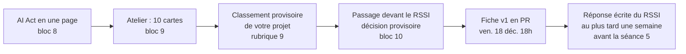
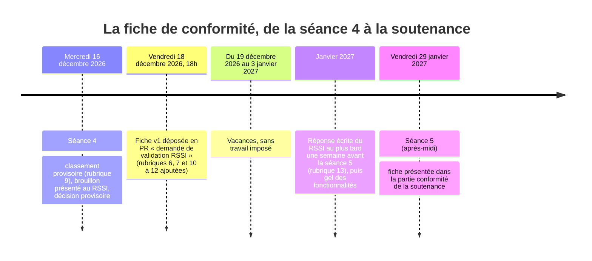

# Chapitre 4 · L'AI Act et le passage devant le RSSI

*Séance 4 « Qualité, CI/CD, sécurité, AI Act et validation RSSI » · Master ITI, Nantes Université, 2026-2027. Chapitre à lire avant ou après la séance. Faits juridiques repris du module de conformité du cours (`cours/conformite-ai-act-rgpd.md`), dont les sources ont été consultées le 1er octobre 2026 ; programme, gabarit de fiche et énoncés des thèmes relus dans le dépôt le 27 novembre 2026. Ce chapitre ne contient pas de code.*

Ce chapitre accompagne les trois blocs de conformité de la séance : l'AI Act en une page (bloc 8), l'atelier de classification (bloc 9) et le passage devant le RSSI en jeu de rôle (bloc 10). Il prend la suite du chapitre 3 de la séance 3, qui vous a fait remplir les rubriques 1 à 5 de `docs/fiche_conformite.md`. Comme lui, il ne redit pas le cours de droit : celui-ci est dans le **module de conformité** (`cours/conformite-ai-act-rgpd.md`), qui fait foi. Ce chapitre vous dit comment vous servir du module **sur votre projet** : classer votre outil pas à pas, écrire les rubriques 8 et 9 de la fiche, préparer les dix minutes devant le RSSI, puis transformer sa décision en tâches du sprint. L'exemple suivi est le thème B (le TRS de la ligne 4) ; les thèmes A et C ont leur section.

> **Sensibilisation, pas avis juridique.** Ce chapitre vous apprend à poser les bonnes questions et à écrire un classement argumenté. Il ne qualifie pas juridiquement votre outil. La décision revient au responsable de la sécurité des systèmes d'information (**RSSI**), avec le délégué à la protection des données (**DPO**) le cas échéant. Dans la formation, le RSSI est simulé par l'enseignant.

## Ce que vous allez retenir

- Avant de classer, on se demande **« est-ce un système d'IA ? »** (AI Act, art. 3, point 1). Un calcul fixe, comme un TRS par poste ou une affectation déterministe, peut être **hors champ** de l'AI Act ; le **RGPD**, lui, s'applique toujours dès qu'il y a des données personnelles.
- Ensuite seulement, on classe selon l'**usage** : interdit, haut risque, obligations de transparence (art. 50), minimal. C'est l'usage qui décide, ni la technologie, ni la durée de vie de l'outil.
- On nomme son **rôle** : **fournisseur** (on développe un système d'IA ou on le met sur le marché sous son nom) ou **déployeur** (on utilise un système sous sa propre autorité). Une équipe qui met un outil à disposition de tiers peut devenir fournisseur (à vérifier pour les cas d'usage).
- Le classement de votre projet va dans la **rubrique 9** de la fiche (rôle, une case, une justification qui commence par l'étape 0) ; la **rubrique 8** (décision automatisée, art. 22 du RGPD) se discute devant le RSSI.
- Devant le RSSI, on présente en quatre minutes, on répond à trois questions (« où partent les prompts ? », « qui peut contester ? », « que se passe-t-il à la fin de vie de l'outil ? ») et on reçoit une **décision provisoire** : go, go sous conditions, no-go.
- Une décision « go sous conditions » se transforme en **tâches datées** du sprint. La v1 de la fiche part en PR le **vendredi 18 décembre 2026 à 18h** ; le RSSI répond par écrit **au plus tard une semaine avant la séance 5**. Sans réponse, c'est **no-go** par défaut.

---

## 1. Pourquoi ce chapitre

En séance 3, vous avez répondu à la question « quelles données mon outil traiterait-il, et sont-elles personnelles ? ». La séance 4 en pose deux autres : **mon outil relève-t-il de l'AI Act, et à quel niveau ?** puis **peut-il être mis en usage ?** La première question se travaille sur des cas qui ne sont pas les vôtres (l'atelier), puis sur votre projet ; la seconde se pose devant le RSSI.

Le module fixe le réflexe professionnel que la séance met en scène : **aucun applicatif ne touche des données réelles ni n'est mis à disposition d'autres personnes sans validation du RSSI** (et du DPO si des données personnelles sont en jeu) (module de conformité, section 1). Le passage de la séance 4 en est une répétition à taille réelle : même dossier, mêmes questions, décision possible dans les deux sens.



> **À retenir.** Ce chapitre est un mode d'emploi du module de conformité, sections 3, 6, 7 et 8. Quand une phrase vous paraît trop courte, la version complète est dans la section du module indiquée.

---

## 2. L'AI Act en une page, appliqué à votre dépôt (bloc 8)

L'**AI Act** est le règlement (UE) 2024/1689, le règlement européen sur l'intelligence artificielle. Il suit une **approche par les risques** : plus l'usage d'un système d'IA peut nuire aux personnes, plus les obligations sont lourdes (module de conformité, section 3). Six notions suffisent pour classer votre projet.

| Notion | Rappel en une phrase | Dans le module | Ce que cela veut dire pour votre projet |
|---|---|---|---|
| Système d'IA | Système qui, à partir des entrées reçues, **déduit** comment générer des sorties (prédictions, contenus, recommandations, décisions) (art. 3, point 1) | Section 3, « Étape 0 » | La première ligne de la justification de la rubrique 9 |
| Niveau de risque | Interdit, haut risque, obligations de transparence, minimal ; ou hors champ si ce n'est pas un système d'IA | Section 3, tableau | La case unique de la rubrique 9 |
| Fournisseur, déployeur | Celui qui développe ou met sur le marché un système sous son nom ; celui qui l'utilise sous sa propre autorité (art. 3) | Section 3, « Rôles » | Le rôle de la rubrique 9 |
| Maîtrise de l'IA | Mesures pour que les personnes qui utilisent des systèmes d'IA sachent s'en servir (art. 4) | Section 3, « Obligations » | La raison d'être de cette formation |
| Droit à l'explication | Une personne affectée par une décision fondée sur un système à haut risque peut obtenir des explications du déployeur (art. 86) | Section 3 et section 5 | La vue « mon résultat » du thème C |
| Calendrier | Une partie des obligations de haut risque est reportée par le règlement (UE) 2026/1744 | Section 0 | On raisonne dès maintenant comme si elles s'appliquaient |

### 2.1 Étape 0 : est-ce un système d'IA ?

C'est la question que le programme vous demande de **poser d'abord** (objectif 5 de la séance, et première ligne de la definition of done qui vous concerne). Le module donne la définition (art. 3, point 1) et trois exemples de ce qui **peut ne pas** être un système d'IA : un calcul de TRS par poste, une règle de jugement fixe, un algorithme d'affectation déterministe (module de conformité, section 3). Ce sont exactement les règles du clou de vos trois thèmes.

Pour vous aider à répondre sur votre projet, posez-vous ces questions, qui reprennent les exemples du module :

1. **D'où vient la règle qui produit le résultat ?** Si elle est écrite à l'avance, en toutes lettres, dans l'énoncé (« six règles du clou niveau 1 »), et que l'outil l'applique telle quelle, vous êtes du côté des exemples « hors champ » du module.
2. **Les mêmes entrées donnent-elles toujours la même sortie ?** C'est la promesse des trois `PROJET.md` : « la même formule pour tous » (B), « même lune, même jugement » (A), « mêmes vœux, même résultat » (C).
3. **L'outil contient-il, à l'exécution, un modèle qui génère, prédit ou recommande ?** Par exemple un appel à un service d'IA pour rédiger un texte ou noter quelque chose. Aucun des trois énoncés n'en prévoit dans le socle.

Si les réponses sont « dans l'énoncé », « oui » et « non », votre outil est **probablement** hors champ de l'AI Act. « Probablement » : la frontière exacte de la définition est l'objet de lignes directrices de la Commission, que le module signale **à vérifier** (section 3). C'est pourquoi la rubrique 9 donne une justification et non une simple case.

Deux pièges :

- **Hors champ de l'AI Act ne veut pas dire hors du droit.** Le RGPD s'applique toujours dès qu'il y a des données personnelles, et la confidentialité de l'entreprise aussi (module de conformité, section 3, tableau, ligne « Hors champ »). Tout ce que vous avez écrit en séance 3 reste vrai.
- **La question porte sur l'outil que vous livrez, pas sur les outils qui vous ont servi à le construire.** Vous développez avec un agent de code, qui est lui-même construit sur un modèle d'IA ; cela ne fait pas de votre calcul de TRS un système d'IA. L'agent intervient ailleurs dans la fiche : rubrique 6 (le fournisseur du modèle est un sous-traitant ou un destinataire) et rubrique 7 (ce qui part dans les prompts), comme l'a montré le chapitre 3 de la séance 3, section 3.

### 2.2 Les niveaux de risque, avec un exemple pris dans les cartes et dans les thèmes

Tableau condensé de la section 3 du module ; la colonne de droite dit où l'on rencontre chaque niveau dans la séance.

| Niveau | Ce que dit le module | Exemple dans les cartes de l'atelier | Exemple dans les thèmes |
|---|---|---|---|
| Hors champ (pas un système d'IA) | Pas d'AI Act ; RGPD et confidentialité restent applicables | Un tableau de TRS par poste | Le calcul du TRS (B), la règle de jugement (A), l'affectation déterministe (C), si l'étape 0 répond « non » |
| Interdit (art. 5) | Notation sociale, manipulation subliminale nuisible, reconnaissance des émotions au travail et à l'école (sauf raisons médicales ou de sécurité) (à vérifier pour le détail). Interdit depuis le 2 février 2025 (date à vérifier, module, section 0) | Une détection d'émotions des opérateurs par caméra | Aucun, et c'est une limite d'usage à écrire si l'on y pensait |
| Haut risque (art. 6, annexes I et III) | Usages listés : éducation et formation, emploi et gestion des travailleurs, accès aux services essentiels, biométrie… Exigences lourdes (gestion des risques, qualité des données, documentation, supervision humaine) | Un outil qui trie des CV ; un outil qui note les copies | Le thème C est « à discuter » (éducation) ; le thème B serait « à discuter » (emploi) s'il servait à suivre ou évaluer la performance individuelle, et pourrait devenir à haut risque si l'on y ajoutait une analyse **par IA** des performances individuelles (à vérifier) |
| Obligations de transparence (art. 50) | Agents conversationnels, contenus générés ou manipulés : informer qu'on parle à une IA, marquer les contenus générés, signaler les hypertrucages | Un chatbot qui répond sur la cantine ; un générateur d'images pour un flyer | Le thème A, si l'équipe ajoutait un texte généré par IA à l'exécution (extension) |
| Minimal | Pas d'obligation spécifique ; bonnes pratiques | Un filtre anti-spam | Le thème A, que le module classe « minimal ou hors champ » ; « minimal » suppose un système d'IA (le filtre anti-spam « est bien de l'IA ») |

Trois précisions du module, utiles pour votre propre classement :

- **Le haut risque se lit dans l'usage, pas dans la technique.** L'annexe III cite, pour l'éducation (point 3), l'accès, l'admission ou l'**affectation** aux établissements d'enseignement et de formation, l'évaluation des résultats d'apprentissage, l'évaluation du niveau d'enseignement approprié et la surveillance des comportements interdits pendant les examens ; pour l'emploi (point 4), le recrutement, les décisions sur les conditions de travail, la promotion, la rupture, l'**attribution de tâches** sur la base du comportement ou de traits personnels, et **le suivi et l'évaluation de la performance et du comportement** des personnes (formulations résumées, à vérifier ; module de conformité, section 3).
- **Une dérogation existe** (art. 6, par. 3) : un système de l'annexe III peut ne pas être à haut risque s'il ne présente pas de risque important (tâche procédurale étroite, amélioration d'un résultat humain déjà obtenu…), sauf profilage de personnes. Cette appréciation se documente et **ne se fait pas seul** (à vérifier). Ne la revendiquez pas dans votre fiche sans en parler au RSSI.
- **Le niveau ne dépend pas de la taille du code.** « Un petit script qui classe des candidats est un cas d'emploi sensible » (module de conformité, section 4).

### 2.3 Fournisseur ou déployeur

L'AI Act distingue plusieurs **rôles** (art. 3) ; deux vous concernent (module de conformité, section 3, « Rôles ») :

- le **fournisseur** développe un système d'IA, ou le met sur le marché sous son nom. Exemple : l'éditeur d'un outil de tri de CV ;
- le **déployeur** utilise un système d'IA sous sa propre autorité. Exemple : l'entreprise qui achète cet outil et l'emploie pour ses recrutements.

Le module ajoute deux mises en garde, marquées **à vérifier pour les cas d'usage** : une équipe qui construit un applicatif et **le met à disposition de tiers** peut devenir fournisseur ; un déployeur qui **modifie substantiellement** un système à haut risque peut aussi en devenir un (art. 25).

Pour votre projet, le raisonnement tient en deux temps. D'abord : votre équipe **développe** l'outil et le **publie** (dépôt public, build web sur GitHub Pages). Si l'outil était un système d'IA, c'est donc le rôle de fournisseur qui vous décrirait le mieux. Ensuite : si l'étape 0 a répondu « non », les rôles de l'AI Act ne s'appliquent pas à l'outil, puisqu'il est hors champ. La rubrique 9 doit pourtant nommer un rôle : écrivez les deux temps, et laissez le RSSI trancher (section 6.2).

### 2.4 La maîtrise de l'IA (art. 4)

Après l'omnibus, l'article 4 prévoit que **les fournisseurs et déployeurs prennent des mesures pour favoriser la maîtrise de l'IA de leurs personnels et des personnes qui utilisent des systèmes d'IA en leur nom** (formulation modifiée par l'omnibus, **à vérifier sur EUR-Lex** ; module de conformité, section 3). Le module en tire l'esprit à retenir : être capable de former et de se former à l'IA (section 0). C'est la justification de cette formation : vous apprenez à piloter un agent, à en vérifier le travail et à en connaître les limites. L'énoncé du thème A le dit aussi : l'équipe qui construit l'outil avec une IA est concernée par cette culture de l'IA (`cours/projets/themes.md`, thème A).

### 2.5 Le droit à l'explication (art. 86)

Toute personne affectée par une décision prise sur la base d'un système à haut risque de l'annexe III (sauf le point 2, infrastructures critiques), ayant des effets juridiques ou affectant de façon similaire sa santé, sa sécurité ou ses droits fondamentaux, peut obtenir **du déployeur** des explications claires sur le rôle du système et les principaux éléments de la décision (module de conformité, section 3 ; champ exact **à vérifier**, section 5). En séance 3, vous l'avez rencontré comme un de vos droits de citoyen (chapitre 3 de la séance 3, section 5.1). Ici, il devient une exigence de conception : c'est la vue « mon résultat » du thème C (section 5.2).

### 2.6 Le calendrier, et pourquoi il ne change pas votre raisonnement

Le module consigne un état au 1er octobre 2026 (section 0) : les pratiques interdites et la maîtrise de l'IA sont en application depuis le 2 février 2025 ; l'article 50 (transparence) est maintenu à partir du 2 août 2026, avec un report au 2 décembre 2026 pour certaines obligations de marquage ; les systèmes à haut risque de l'annexe III sont **reportés au 2 décembre 2027**, et ceux intégrés à des produits réglementés (annexe I) au 2 août 2028. L'acte modificatif est le **règlement (UE) 2026/1744**, publié au Journal officiel le 24 juillet 2026 et en vigueur le 27 juillet 2026. Toutes ces dates sont **à vérifier sur EUR-Lex** : le module le dit de son tableau entier, le texte officiel de l'omnibus n'ayant pas été relu.

Conséquence pratique, tirée du module : même si le haut risque n'est obligatoire qu'à partir de fin 2027, **on raisonne dès maintenant comme s'il était applicable**. C'est la bonne pratique de prudence, et le RSSI raisonne ainsi. N'écrivez donc jamais dans votre fiche « haut risque, mais pas avant 2027 ».

### 2.7 L'usage décide, pas la durée de vie de l'outil

Le programme le dit en une phrase (bloc 8) : **le fait que l'outil soit temporaire ne change pas la qualification : l'usage décide.** C'est le pendant AI Act de la phrase d'or de la séance 3 (« Temporaire ne veut pas dire hors la loi », module de conformité, section 8.4). Un outil de tri de CV utilisé pour une seule campagne de recrutement reste un outil de tri de CV. Pour votre TRS, la durée d'un trimestre ne change rien non plus. Un calcul fixe reste un calcul : s'il servait à évaluer des salariés, l'étape 0 répondrait toujours « non », mais le module juge alors la qualification « à discuter » (annexe III, point 4), et l'énoncé ne parle de haut risque possible que si l'on ajoutait une analyse **par IA** des performances individuelles (à vérifier). Dans tous les cas, le RGPD s'appliquerait.

> **À retenir.** Étape 0 d'abord (système d'IA ou non ?), puis l'usage (quel domaine, quel effet sur des personnes ?), puis le rôle. Hors champ de l'AI Act, le RGPD reste là. Et ni la taille, ni la durée, ni le report de 2027 ne changent le raisonnement.

---

## 3. L'atelier de classification (bloc 9)

### 3.1 Les dix cartes

Le module prévoit dix cartes de cas, d'une phrase chacune (module de conformité, section 8.1) :

| N° | Carte |
|---|---|
| 1 | Un chatbot qui répond sur la cantine |
| 2 | Un outil qui trie des CV |
| 3 | Un tableau de TRS par poste |
| 4 | Un outil qui note les copies |
| 5 | Un générateur d'images pour un flyer |
| 6 | Une application qui répartit des stagiaires |
| 7 | Une détection d'émotions des opérateurs par caméra |
| 8 | Un script qui résume des comptes rendus de réunion contenant des noms |
| 9 | Un filtre anti-spam |
| 10 | Une application de suivi du temps de pause des salariés |

Les cartes 6 (stagiaires) et 10 (pauses) sont **ambiguës** : elles sont réservées à la discussion de la mise en commun. Ne passez pas vos deux minutes à les trancher.

### 3.2 La démarche, carte par carte

Par équipe, **20 minutes**, soit environ **2 minutes par carte**. Pour chaque carte, notez cinq choses, dans cet ordre :

| Question | Ce qu'on note | Exemple, carte 3 (TRS par poste) |
|---|---|---|
| 1. Est-ce un système d'IA ? (étape 0) | Oui, non, ou « dépend de la façon dont c'est fait » | Non : c'est un calcul |
| 2. Quel usage, sur qui ? | Le domaine (emploi, éducation, information du public…) et les personnes touchées | Équipements d'une ligne ; des opérateurs en arrière-plan |
| 3. Quelle case ? | Hors champ, minimal, obligations de transparence (art. 50), haut risque, interdit | Hors champ |
| 4. Données personnelles en jeu ? | Oui ou non, lesquelles | Oui si des opérateurs sont nommés |
| 5. Ce qui ferait changer la case | Une phrase | À discuter s'il servait à évaluer des opérateurs |

La cinquième colonne n'est pas demandée par le module ; elle vous prépare au classement de votre propre projet, où elle devient la rubrique 12 (« n'utilisez pas cet outil pour… »).

### 3.3 Mise en commun et synthèse

- **Mise en commun, 12 minutes.** Les équipes comparent leurs classements ; les désaccords et les deux cartes ambiguës se discutent ici. Un désaccord est un bon signe : il montre où la règle demande un jugement.
- **Synthèse de l'enseignant, 8 minutes.** Elle sert à **corriger les cartes** : corrigez votre feuille au crayon d'une autre couleur, sans effacer votre première réponse. C'est l'écart entre les deux qui vous apprend quelque chose.

Total : 20 + 12 + 8 = 40 minutes (module de conformité, section 8.1).

### 3.4 Le corrigé indicatif (à lire après l'atelier)

Le module donne un corrigé **indicatif** (section 8.1), que la synthèse de l'enseignant peut nuancer :

| Carte | Corrigé indicatif du module |
|---|---|
| Chatbot de la cantine | Obligations de transparence (art. 50) |
| Tri de CV | Haut risque (emploi) |
| Tableau de TRS par poste | Hors champ (calcul, pas un système d'IA) ; RGPD si des opérateurs sont nommés |
| Notation des copies | Haut risque (éducation) |
| Générateur d'images pour un flyer | Obligations de transparence, selon le cas |
| Répartition de stagiaires | À discuter : hors champ si l'algorithme est déterministe, sinon éducation ou emploi selon le cas |
| Détection des émotions des opérateurs | Interdit (art. 5) (à vérifier pour les exceptions) |
| Résumé de réunions contenant des noms | Minimal pour l'AI Act, mais RGPD et confidentialité à traiter |
| Filtre anti-spam | Minimal (c'est bien de l'IA, sans obligation spécifique) |
| Suivi des pauses | À discuter, probable haut risque (suivi des travailleurs) |

Trois cartes parlent directement de vos thèmes : la carte 3 est le thème B, la carte 6 est un cousin du thème C, la carte 10 montre vers quoi glisserait le thème B s'il servait au suivi des personnes.

### 3.5 Reporter le classement de votre projet dans la rubrique 9

Le programme le précise : **chaque équipe reporte seule**, dans la rubrique 9 de sa fiche (rôle fournisseur ou déployeur et case de classement), un **classement provisoire** de son projet, **pendant l'observation du passage devant le RSSI**, et le RSSI le discute. La rubrique 8 (art. 22) est discutée devant le RSSI (programme, bloc 9 ; module de conformité, section 8.1).

Concrètement : pendant qu'une autre équipe de votre table présente, un membre de votre équipe (celui qui tient la fiche) ouvre `docs/fiche_conformite.md` et remplit la rubrique 9 en suivant la section 4 (thème B) ou la section 5 (thèmes A et C) de ce chapitre. Les autres observent avec la grille (section 8.3). Si votre équipe passe la première à sa table, elle n'a pas d'observation avant son tour : rédigez la rubrique 9 pendant la mise en commun de l'atelier de classification, ou présentez-la à l'oral et rédigez-la juste après votre passage. Le programme ne fixe pas l'ordre de passage dans une table : il est annoncé en séance.

> **À retenir.** L'atelier entraîne le raisonnement sur des cas qui ne sont pas les vôtres. La seule trace qui reste dans votre dépôt est la rubrique 9, provisoire, que le RSSI discutera.

---

## 4. Classer votre projet pas à pas : le thème B

Rappel du thème : un calcul du TRS par poste et par quart pour la ligne 4 d'un fabricant fictif, avec sa décomposition (disponibilité, performance, qualité), pendant une campagne de mesure ; l'outil n'évalue jamais une personne (`PROJET.md` du thème B, vision). Tout ce qui suit vient du module (section 7, thème B) et de l'énoncé (`cours/projets/themes.md`, thème B, rubrique « Conformité »).

**Pas 1. Que fait l'outil, et pour qui ?** Relisez la rubrique 1 de votre fiche (séance 3) : mesurer et améliorer le rendement des **équipements**, sans jamais évaluer individuellement un salarié. Le classement part de cette finalité : si elle est floue, le classement le sera aussi.

**Pas 2. Étape 0 : est-ce un système d'IA ?** Les trois questions de la section 2.1 :
- la règle vient de l'énoncé (les six règles du clou niveau 1 : la formule du TRS et ses composantes) ;
- les mêmes déclarations et arrêts donnent toujours le même TRS (« la même formule pour tous ») ;
- aucun modèle n'est appelé à l'exécution.

Réponse provisoire : **non**. Le module l'écrit pour ce thème : un calcul de TRS n'est pas forcément un système d'IA (section 7, thème B, renvoyant à l'étape 0 de la section 3).

**Pas 3. L'usage relève-t-il d'un domaine listé ?** Le domaine voisin est l'**emploi et la gestion des travailleurs** (annexe III, point 4), qui vise notamment le suivi et l'évaluation de la performance et du comportement des personnes. Par conception, votre outil calcule **par poste**, pas par personne : il n'entre pas dans cet usage. Mais l'énoncé signale le glissement possible : un TRS par quart peut, en pratique, évaluer indirectement une équipe ou un opérateur.

**Pas 4. Obligations de transparence ?** Pas d'agent conversationnel, pas de contenu généré : non.

**Pas 5. Quelle case ?** **Hors champ**, puisque l'étape 0 répond « non ». Le module donne « hors champ ou minimal » ; « minimal » suppose un système d'IA, ce que votre réponse à l'étape 0 écarte. Gardez la réserve : la définition est à vérifier sur les lignes directrices de la Commission.

**Pas 6. Quel rôle ?** Votre équipe développe l'outil et le publie : si c'était un système d'IA, vous en seriez le **fournisseur**. Hors champ, le rôle AI Act est sans objet pour l'outil (section 2.3). Écrivez les deux.

**Pas 7. Qu'est-ce qui ferait changer la case ?** Le module et l'énoncé répondent : si l'outil servait à **suivre ou évaluer la performance individuelle** d'opérateurs, la qualification serait **à discuter** (annexe III, point 4) ; si l'on ajoutait un jour une **analyse par IA des performances individuelles**, le système pourrait devenir **à haut risque** (à vérifier). Ces deux phrases deviennent une limite d'usage (rubrique 12) et une question à poser au RSSI.

**Pas 8. Ce qui reste vrai hors AI Act.** Le RGPD, en usage réel, dès qu'une donnée de poste identifie ou évalue un salarié (rubriques 2 et 3 de la séance 3). Et, dans un contexte réel, l'**information et la consultation des représentants du personnel** (CSE) peuvent s'imposer pour un outil de mesure de l'activité des salariés (Code du travail, notamment art. L. 2312-38, **à vérifier**) : l'énoncé demande de le mentionner dans la fiche comme un point à examiner avant toute mise en usage.

**Conclusion provisoire pour B** : hors champ de l'AI Act ; rôle de fournisseur si l'outil devenait un système d'IA ; vigilance sur le glissement vers l'évaluation d'individus ; RGPD et CSE à traiter en usage réel. Le RSSI a ici une question à trancher que le module lui laisse : la qualification « suivi de travailleurs » (section 7, thème B, « Pourquoi le RSSI »).

> **À retenir.** Pour B, la case est facile ; ce qui compte est la phrase qui dit ce qui la ferait changer. Le RSSI vous la demandera.

---

## 5. Pour les thèmes A et C

### 5.1 Thème A : le registre d'un comptoir de Passeurs

La fiche se rédige **hors de la fiction** : elle décrit l'outil réel et ses utilisateurs réels, pas le comptoir (module de conformité, section 7, thème A).

- **Étape 0.** Le jugement d'une traversée est une règle déterministe écrite dans l'énoncé (« même lune, même jugement ») ; le domaine ne tire jamais d'aléa et reçoit l'éclat de la lune en paramètre (`PROJET.md` du thème A). Réponse provisoire : non.
- **Usage.** Pas de décision sur des personnes : on juge les traversées de personnages fictifs. Aucun domaine de l'annexe III.
- **Case.** Le module et l'énoncé donnent **minimal ou hors champ** (« sans effet sur des droits ou des opportunités réels », à vérifier). Hors champ si l'étape 0 répond « non ».
- **Ce qui ferait changer la case.** Si l'équipe ajoutait un **texte généré par IA à l'exécution** vers les utilisateurs (extension), la transparence de l'art. 50 serait à examiner (à vérifier). Les textes du monde rédigés avec l'agent **pendant le développement** ne sont pas générés à l'exécution : ils sont relus et assumés par l'équipe (`cours/projets/themes.md`, thème A).
- **Rubrique 8.** Pas de décision automatisée sur une personne réelle. Le point qui intéressera le RSSI est ailleurs : l'effacement d'un utilisateur et la mention d'information (mesures obligatoires du thème), et le droit d'auteur sur les textes du monde publiés dans un dépôt public.

### 5.2 Thème C : la répartition de sujets entre étudiants

C'est le thème qui demande le plus de travail de conformité (module de conformité, section 7 ; programme, section 10). Trois questions s'y croisent : la classification AI Act, la décision automatisée (art. 22 du RGPD) et le droit à l'explication. Prenez-les dans cet ordre.

**Étape 0.** L'algorithme d'affectation est déterministe (« mêmes vœux, même résultat ») : il **peut** être hors champ de l'AI Act (module de conformité, section 3 et section 7, thème C). C'est précisément le point à discuter avec le RSSI (à vérifier).

**Usage.** L'annexe III, point 3 (éducation et formation) cite l'**affectation** aux établissements d'enseignement et de formation. Le module distingue : l'affectation visée par le texte concerne les établissements ; l'affectation à un sujet de projet interne est plus proche d'une organisation pédagogique. Mais un outil qui évalue des étudiants, ou dont la décision influence fortement leur parcours, ressemble à de l'éducation à haut risque (à vérifier avec le DPO et les lignes directrices de la Commission).

**La règle de prudence.** Le module conclut : **traiter l'outil comme s'il était à haut risque** dans la démarche (transparence, supervision humaine, journalisation, explication). C'est une **démarche de précaution pédagogique, pas une qualification juridique**. Concrètement, cela ne vous demande rien de plus que les mesures obligatoires de votre `PROJET.md` : elles sont exactement cette démarche.

**Quelle case cocher ?** La case est une qualification ; la démarche « comme si haut risque » n'en est pas une. Ne cochez donc pas « haut risque » par précaution : ce serait poser la qualification que le module et le programme excluent. Si l'étape 0 répond « non », cochez **hors champ** et écrivez à côté : « démarche menée comme si haut risque, pas une qualification juridique ». Puis posez la question au RSSI : c'est à lui de trancher, avec le DPO.

**Rubrique 8 : la décision automatisée (art. 22).** L'art. 22 du RGPD donne le droit de ne pas faire l'objet d'une décision fondée **exclusivement** sur un traitement automatisé produisant des effets juridiques ou affectant la personne de manière significative, avec des garanties : intervention humaine, possibilité d'exprimer son point de vue et de contester (module de conformité, section 2). Votre rubrique 8 doit dire :

- **Qui décide.** L'algorithme **propose** ; le **gestionnaire** (un rôle, pas un nom) **valide avant publication** et **peut déroger**. Le champ de statut `brouillon` / `publie` est la trace de cette validation.
- **Pourquoi cette validation n'est pas une formalité.** C'est la validation humaine **effective** qui peut écarter la qualification de décision exclusivement automatisée ; une intervention purement formelle ne suffit pas (à vérifier sur les lignes directrices du CEPD, et à faire discuter par le RSSI ou le DPO). Dites ce que le gestionnaire voit avant de publier et ce qu'il peut changer.
- **Qui peut contester, et comment.** L'étudiant, par la voie de contestation prévue dans les mesures (module de conformité, section 7, thème C). L'effet réel d'un sujet de projet sur un étudiant est lui-même à vérifier : la rubrique le dit.

**Le droit à l'explication.** Le module rassemble les textes : information sur la « logique sous-jacente » (RGPD, art. 13(2)(f), 14(2)(g) et 15(1)(h)), garanties de l'art. 22(3), explication individuelle (considérant 71), et AI Act art. 86 si haut risque. Il conclut : **la vue « mon résultat » avec explication est exactement la réponse**. Elle montre à chaque étudiant quel vœu il a obtenu, pourquoi les précédents ne l'ont pas été, quelle règle a été appliquée, et le motif de non-affectation est toujours affiché (`cours/projets/themes.md`, thème C). La **règle d'équité est publiée avant la collecte des vœux** (une page statique suffit).

**Rôle.** Votre équipe développe l'outil et le met à disposition : fournisseur, si c'était un système d'IA (section 2.3). Notez que le droit à l'explication de l'art. 86 s'exerce auprès du **déployeur**, c'est-à-dire, en usage réel, le département qui utiliserait l'outil : votre outil lui fournit le moyen de répondre.

**Présence du DPO.** L'énoncé prévoit que la fiche du thème C est présentée « au RSSI (et au DPO) ». Si aucun DPO n'est à votre table, écrivez dans la fiche que les questions de l'art. 22 restent à faire valider par le DPO.

**Squelette de la rubrique 8 pour le thème C.** Exemple **rédigé pour ce chapitre, à valider par l'enseignant**, tiré uniquement de l'énoncé du thème C (`cours/projets/themes.md`) et de la section 7 du module. Les chevrons sont à remplacer par ce que fait votre application. La rubrique se discute devant le RSSI et se rédige pour la v1 (section 6.1).

```text
8. Décision automatisée (art. 22) ? Humain dans la boucle (qui ?) :
   Qui propose : l'algorithme de répartition, déterministe, qui applique des
   règles publiées avant la collecte des vœux.
   Qui valide : le gestionnaire (rôle), avant toute publication ; le résultat
   reste au statut brouillon tant qu'il ne l'a pas passé à publie.
   Ce qu'il voit avant de publier : <affectations en brouillon, motifs de
   non-affectation, sujets trop peu choisis : ce que montre votre écran>.
   Ce qu'il peut changer : il peut déroger au résultat proposé ; <correction
   d'un vœu et nouvelle répartition, si l'extension est faite>.
   Voie de contestation : l'étudiant lit l'explication de la vue « mon
   résultat », puis conteste <comment, auprès de qui> jusqu'à la fin du
   délai de réclamation (par exemple 30 jours après publication).
   Réserves : la validation humaine effective du gestionnaire peut écarter la
   qualification de décision exclusivement automatisée (à vérifier) ; l'effet
   réel d'un sujet de projet au sens de l'art. 22 est à vérifier ; à faire
   valider par le DPO.
```

**Trois réponses préparées pour le thème C**, exemples **rédigés pour ce chapitre, à valider par l'enseignant** (les réponses du thème B sont en section 7.5) :

- **« Où partent les prompts ? »** Chez le fournisseur du modèle de l'agent de code. Tous les étudiants sont `etu_NNN` : jamais de vraie liste, même partielle, jamais de courriel ; la correspondance entre pseudonyme et identité resterait hors de l'application. Rien de réel n'est donc dans le dossier du projet, ni dans les prompts (rubrique 7, pour la v1).
- **« Qui peut contester ? »** L'étudiant. Il lit dans la vue « mon résultat » quel vœu il a obtenu, pourquoi les précédents ne l'ont pas été et quelle règle a été appliquée ; il conteste par la voie prévue ; le gestionnaire, qui a validé avant publication, peut déroger. Les garanties de l'art. 22(3) (intervention humaine, point de vue, contestation) sont à vérifier selon l'effet réel d'un sujet de projet.
- **« Que se passe-t-il à la fin de vie de l'outil ? »** Après la publication et la fin du délai de réclamation (par exemple 30 jours) : suppression des vœux et des rangs, conservation éventuelle de statistiques agrégées, archivage et arrêt du service (rubrique 5).

### 5.3 Les trois thèmes côte à côte

| | Thème A · Passeurs | Thème B · TRS de la ligne 4 | Thème C · Répartition des sujets |
|---|---|---|---|
| **Étape 0** (réponse provisoire) | Non : règle de jugement fixe | Non : calcul fixe | Non : affectation déterministe ; point à discuter avec le RSSI |
| **Domaine de l'annexe III voisin** | Aucun | Emploi (point 4), si suivi individuel | Éducation (point 3) |
| **Case probable** (module) | Minimal ou hors champ | Hors champ ou minimal | À discuter ; hors champ si l'étape 0 répond « non », avec la démarche « comme si haut risque », pas une qualification juridique |
| **Rôle si c'était un système d'IA** | Fournisseur | Fournisseur | Fournisseur |
| **Rubrique 8 (art. 22)** | Pas de décision sur des personnes réelles | Pas de décision sur des personnes ; le TRS aide à décider sur des équipements | L'algorithme propose, le gestionnaire valide (`brouillon` / `publie`) et peut déroger |
| **Ce qui ferait changer la case** | Un texte généré par IA à l'exécution (art. 50) | Une analyse par IA des performances individuelles (haut risque possible) | Un outil qui évalue des étudiants ou pèse fortement sur leur parcours |
| **Ce que le RSSI tranchera** (module, « Pourquoi le RSSI ») | Publication, stockage, effacement, droit d'auteur | Confidentialité industrielle, qualification « suivi de travailleurs », hébergement | Données d'étudiants, effet sur le parcours, décision automatisée |

Sources du tableau : module de conformité, sections 3 et 7 ; `cours/projets/themes.md`, rubrique « Conformité » de chaque thème ; `depot-modele/themes/PROJET-A.md`, `PROJET-B.md`, `PROJET-C.md`.

> **À retenir.** A et B se classent vite ; C demande trois raisonnements (AI Act, art. 22, explication) et un choix argumenté de case. Dans les trois cas, la justification commence par l'étape 0 et finit par ce qui ferait changer la case.

---

## 6. La fiche : ce que la séance 4 fait avancer

### 6.1 Où en est la fiche, rubrique par rubrique

| Rubriques | Quand | Ce que demande le programme |
|---|---|---|
| 1 à 5 | Séance 3 | Commitées et relues (chapitre 3 de la séance 3, section 8) |
| 9 | Séance 4, pendant l'observation | Rôle et case de classement **provisoires** |
| 8 | Séance 4, devant le RSSI | **Discutée** devant le RSSI ; rédigée ensuite pour la v1 |
| 6, 7, 10, 11, 12 | Sprint, avant la v1 du vendredi 18 décembre 2026 | Hébergement et sous-traitants, prompts, droits, mesures, risques résiduels |
| 13 | Réponse du RSSI, au plus tard une semaine avant la séance 5 | Date, décision, conditions |

Le livrable de fin de séance 4 est un **brouillon** de fiche : rubriques 1 à 5, classement et rôle AI Act provisoires à la rubrique 9, la rubrique 8 étant discutée devant le RSSI (programme, livrable de la séance 4).

### 6.2 Rubrique 9 · Rôle AI Act et classement

Le gabarit (module de conformité, section 6.1, qui fait foi) demande trois lignes :

```text
9. Rôle AI Act : fournisseur ou déployeur ? (justification) :
   Classement AI Act, une case : [ ] hors champ  [ ] minimal  [ ] obligations de transparence (art. 50)  [ ] haut risque  [ ] interdit
   Justification (commencer par : est-ce un système d'IA au sens de l'art. 3, point 1 ?) :
```

- **Ce qu'on y écrit** : le rôle avec sa justification ; **une seule** case cochée (remplacez `[ ]` par `[x]`) ; une justification qui suit l'ordre de la section 4 : étape 0, usage, case, ce qui la ferait changer, ce qui reste vrai hors AI Act.
- **Erreurs fréquentes** : cocher deux cases ; commencer la justification par le niveau de risque au lieu de l'étape 0 ; écrire « hors champ, donc rien à faire » (le RGPD reste) ; oublier les réserves « à vérifier » du module ; parler de l'agent de code au lieu de l'outil livré (section 2.1).

### 6.3 Rubrique 8 · Décision automatisée

```text
8. Décision automatisée (art. 22) ? Humain dans la boucle (qui ?) :
```

- **Ce qu'on y écrit** : si l'outil prend ou prépare une décision qui touche une personne ; si oui, qui la valide (un **rôle**, jamais un nom), ce que cette personne voit et peut changer, et comment la personne concernée conteste.
- **Erreurs fréquentes** : répondre « non » sans dire pourquoi ; nommer une personne réelle ; écrire « un humain valide » sans dire ce qu'il valide (une validation purement formelle ne suffit pas, à vérifier) ; confondre l'humain qui **développe** l'outil et celui qui **décide** avec.
- **Pourquoi elle se discute devant le RSSI** : c'est l'un des critères de no-go du module (« décision automatisée sans humain sur des personnes », section 6.2). Mieux vaut que la discussion ait lieu avant la v1.

### 6.4 Exemple pour le thème B, rubriques 8 et 9

Exemple **rédigé pour ce chapitre, à valider par l'enseignant**, dans la continuité de la fiche du thème B du chapitre 3 de la séance 3 (section 8.7). Les chevrons sont à remplacer par vos valeurs. La version passe à 0.2 : c'est le brouillon présenté au RSSI, avec la seule rubrique 9 ajoutée en séance ; la rubrique 8 est discutée devant le RSSI, puis rédigée pour la v1 (bloc 9 et livrable du programme).

```markdown
# Fiche de conformité : le TRS de la ligne 4
Équipe n° <X> (identifiants GitHub : <@identifiant-1>, <@identifiant-2>, <@identifiant-3>) · Thème : B · Version : 0.2 (brouillon présenté au RSSI, séance 4) · Date : 16/12/2026
(Dépôt public : aucun nom civil, aucune adresse de courriel dans cette fiche.)

1. Finalité (une phrase) : … (inchangée depuis la séance 3)
…
8. Décision automatisée (art. 22) ? Humain dans la boucle (qui ?) :
   (discutée devant le RSSI ; rédigée pour la v1)
9. Rôle AI Act : fournisseur ou déployeur ? (justification) :
   L'équipe développe l'outil et le publie (dépôt public, build web) : si
   l'outil était un système d'IA, elle en serait le fournisseur. L'outil étant
   hors champ (ci-dessous), aucun rôle AI Act ne s'applique à lui ; à faire
   confirmer par le RSSI.
   Classement AI Act, une case : [x] hors champ  [ ] minimal  [ ] obligations de transparence (art. 50)  [ ] haut risque  [ ] interdit
   Justification (commencer par : est-ce un système d'IA au sens de l'art. 3, point 1 ?) :
   Étape 0 : non. L'outil applique la formule du TRS écrite dans l'énoncé
   (mêmes déclarations et arrêts, même TRS) et n'appelle aucun modèle à
   l'exécution (définition à vérifier sur les lignes directrices de la
   Commission). Usage : calcul par poste et par quart, jamais par personne ;
   hors du suivi et de l'évaluation des travailleurs (annexe III, point 4).
   Ce qui changerait la case : un suivi de la performance individuelle
   d'opérateurs serait à discuter (annexe III, point 4) ; une analyse par IA
   des performances individuelles pourrait rendre le système à haut risque
   (à vérifier). Hors AI Act : en usage réel, RGPD dès qu'une donnée
   identifie ou évalue un salarié (rubriques 2 et 3), et information et
   consultation du CSE à examiner (Code du travail, art. L. 2312-38, à
   vérifier). Classement provisoire, discuté devant le RSSI le 16/12/2026.
…
```

Après la discussion devant le RSSI, la rubrique 8 du thème B peut s'écrire ainsi pour la v1 (même exemple rédigé pour ce chapitre, à valider par l'enseignant) :

```text
8. Décision automatisée (art. 22) ? Humain dans la boucle (qui ?) :
   Non. L'outil calcule un TRS par poste et par quart ; il ne prend ni ne
   prépare aucune décision sur une personne. Le TRS est un indicateur d'aide
   à la décision sur des équipements, pas une sanction automatique : les
   décisions restent prises par la responsable amélioration continue (rôle
   responsable). Vigilance : un TRS par quart peut évaluer indirectement une
   équipe ou un opérateur ; cet usage est exclu (rubrique 12). Discutée devant
   le RSSI le 16/12/2026.
```

Comme en séance 3 : n'écrivez pas de vrais identifiants GitHub dans un exemple ou une description de PR, car un `@identifiant` prévient la personne qui porte ce nom.

Pour le thème C, la structure est la même, avec les points de la section 5.2 : rubrique 8 selon le squelette donné là, case « hors champ » si l'étape 0 répond « non », et réserve « démarche menée comme si haut risque, pas une qualification juridique » écrite en toutes lettres. Pour le thème A, la rubrique 9 justifie « hors champ » ou « minimal » et dit ce qu'un texte généré à l'exécution changerait.

> **À retenir.** La rubrique 9 est un raisonnement en cinq temps, pas une case. La rubrique 8 dit qui décide, pas seulement si un humain existe.

---

## 7. Préparer le passage devant le RSSI

### 7.1 Ce que le RSSI regarde

Le module (section 6.2) fixe le dossier et les critères. Le RSSI regarde **la fiche, le dépôt (aucun secret, aucune donnée réelle), la CI verte, l'analyse des données**. Il décide avec deux listes de critères :

| Critères go | Critères no-go |
|---|---|
| Données fictives ou justifiées | Données réelles sans cadre |
| Finalité unique | Finalité floue |
| Durée et suppression définies | Secret dans le dépôt |
| Pas de donnée personnelle dans les prompts | Décision automatisée sans humain sur des personnes |
| Rôle AI Act et classement qualifiés et argumentés | Hébergement non identifié |
| Accès par rôle testé | |
| Limites d'usage écrites | |

Ces deux listes sont la **grille go/no-go** dont se servent les observateurs (section 8.3) et, à défaut d'intervenant, l'étudiant volontaire qui tient une table.

### 7.2 Ce qu'il faut pouvoir montrer, écran par écran

Préparez avant le bloc un ordinateur par équipe, avec ces onglets déjà ouverts, pour ne pas chercher pendant les quatre minutes :

| Critère | Ce que vous montrez | Où le trouver |
|---|---|---|
| Fiche | `docs/fiche_conformite.md`, rubriques 1 à 5 et 9 remplies : la rubrique 9 vient d'être rédigée et n'est pas encore sur `main` (protégée), donc ouverte dans l'éditeur, ou sur la branche de la PR de la fiche | L'éditeur, ou l'onglet « Pull requests » du dépôt |
| Aucun secret | Le contrôle `securite` de la CI, vert | Onglet « Actions » ; chapitre 2 (CI) et chapitre 3 (secrets) de cette séance |
| CI verte | La pastille verte du dernier commit de `main` | Onglet « Actions » ou page d'accueil du dépôt |
| Données fictives | Le seed à graine fixe et la liste des tables, sans colonne d'opérateur (B), avec `etu_NNN` (C) | Chapitre 1 de cette séance, section 3.3 (seed) ; chapitre 4 de la séance 3 (tables) |
| Accès par rôle testé | Les tests de refus de la garde `RequireRole`, verts : `flutter test --plain-name "refuse"` | Chapitre 1 de cette séance (reprise des rôles) |
| Limites d'usage | « Ce que l'outil ne fera pas » de `PROJET.md` (la rubrique 12 viendra au sprint) | `PROJET.md` |

Ces vérifications sont des **preuves observables** : une pastille, un test vert, un fichier affiché. Personne ne vous demandera de lire du code devant le RSSI.

Ce qui n'est pas encore rédigé n'a pas à l'être : les rubriques 6, 7 et 10 à 12 sont pour le sprint. Mais **vous devez pouvoir y répondre de vive voix**, parce que deux des trois questions du RSSI et un critère de no-go (hébergement non identifié) y renvoient.

### 7.3 Qui parle

Le programme ne fixe pas qui présente. Une répartition possible, proposée par ce chapitre :

- le **gardien conformité** (ou le gardien produit et conformité, dans une équipe de trois) présente la fiche : c'est lui que `PROJET.md` charge du contact avec le RSSI ;
- un **second membre** tient l'ordinateur et montre les preuves de la section 7.2 ;
- les **autres** répondent aux questions qui touchent leur rôle (le gardien des données sur les données et la fin de vie, le gardien du harnais et de la CI sur les secrets et la CI) et **notent** ce que dit le RSSI, mot pour mot si possible.

### 7.4 Les quatre minutes de présentation

Une trame proposée par ce chapitre, à adapter :

1. **Ce que fait l'outil, pour qui, combien de temps** (rubriques 1 et 5) : 30 secondes.
2. **Les données** : fictives ici, ce qu'elles seraient en usage réel, qui elles concerneraient (rubriques 2 à 4) : 1 minute.
3. **Le classement AI Act** : étape 0, case, rôle, ce qui ferait changer la case (rubrique 9) : 1 minute.
4. **La décision automatisée** : qui décide, qui valide, qui conteste (rubrique 8, à discuter) : 1 minute.
5. **Ce que vous n'avez pas tranché** et que vous demandez au RSSI : 30 secondes.

Le cinquième point est le plus utile : une équipe qui dit d'elle-même « nous hésitons entre deux cases, voici pourquoi » montre qu'elle a compris. Une équipe qui affirme une qualification juridique sans réserve montre le contraire.

### 7.5 Les trois questions du RSSI, préparées sur le thème B

Le programme et le module donnent trois questions (programme, bloc 10 ; module de conformité, section 8.2). Préparez une réponse de trois phrases à chacune ; voici celles du thème B, tirées de ce que votre fiche dit déjà ou dira.

**« Où partent les prompts ? »** Chez le fournisseur du modèle d'IA de l'agent de code, souvent hors de l'Union (chapitre 3 de la séance 3, section 3). Rien de réel dans le dossier du projet, donc rien de réel dans les prompts ; données fictives à graine fixe. Le fournisseur sera nommé en rubrique 6 et la confirmation écrite en rubrique 7, pour la v1.

**« Qui peut contester ? »** Pour B, l'outil ne décide rien sur une personne : il n'y a pas de décision à contester au sens de l'art. 22. En usage réel, une donnée inexacte (une déclaration, un arrêt) se corrige par le rôle `responsable`, qui « corrige » selon `PROJET.md` ; et un salarié dont le travail est mesuré garde ses droits d'accès et de rectification (rubrique 10, au sprint).

**« Que se passe-t-il à la fin de vie de l'outil ? »** À la fin de la campagne de mesure : export CSV des TRS, archivage du dépôt et arrêt du service ; données par quart supprimées ou agrégées par poste et par semaine (par exemple 3 mois maximum pour les données par quart, selon l'énoncé) (rubrique 5). Dans la formation, la date de fin du dépôt est celle que l'équipe a fixée avec l'enseignant.

Pour **A**, « qui peut contester ? » devient « comment un utilisateur fait-il supprimer ses données ? » : la suppression documentée et la mention d'information sont vos mesures obligatoires. Pour **C**, c'est la question centrale : l'étudiant, par la voie de contestation, après avoir lu l'explication de la vue « mon résultat », avant la fin du délai de réclamation.

Le RSSI peut en poser d'autres. Les critères de la section 7.1 vous disent lesquelles : chaque critère est une question possible (« où est votre test de refus ? », « où sont écrites vos limites d'usage ? »).

> **À retenir.** Préparez les preuves (des écrans, pas des promesses), une trame de quatre minutes, et trois réponses de trois phrases. Dites vous-même ce que vous n'avez pas tranché.

---

## 8. Le passage, en séance (bloc 10)

### 8.1 Le dispositif

**Trois tables en parallèle**, un RSSI par table : l'enseignant, le RSSI de l'établissement s'il est invité, un second intervenant ou une aide (à confirmer) ; à défaut, un étudiant volontaire muni de la grille go/no-go. Les équipes passent à tour de rôle devant leur table ; le jeu de rôle **est** le passage, ce n'est pas une activité en plus (programme, bloc 10 ; module de conformité, section 8.2).

| 8 équipes (3-3-2) | 7 équipes (3-2-2) |
|---|---|
| Table 1 : 01, 04, 07 | Table 1 : 01, 04, 06 |
| Table 2 : 02, 05, 08 | Table 2 : 02, 05 |
| Table 3 : 03, 06 | Table 3 : 03, 07 |

Les équipes étant numérotées par thème (8 équipes : A de 01 à 03, B de 04 à 06, C en 07 et 08 ; 7 équipes : A de 01 à 03, B en 04 et 05, C en 06 et 07 ; programme, section 9), chaque table mélange les thèmes : vous verrez passer au moins une équipe d'un autre thème que le vôtre.

### 8.2 Le déroulement d'un passage

**10 à 12 minutes par équipe** : environ **4 minutes** de présentation de la fiche, **5 minutes** de questions du RSSI, **2 minutes** de décision, retour des observateurs compris. Chaque table fait **au plus 3 passages** de 12 minutes au plus, soit 36 minutes, plus 4 minutes de rotation et de consignes : un bloc de **40 minutes** (module de conformité, sections 6.2 et 8.2).

La décision est **provisoire** : go, go sous conditions, ou no-go. **Le RSSI peut décider un no-go** ; l'équipe doit alors dire quoi corriger et sous quel délai (module de conformité, section 8.2).

### 8.3 Pendant que les autres passent

Quand votre équipe ne présente pas, elle fait l'une de ces choses (programme, blocs 9 et 10) :

- **observer au moins un autre passage avec la grille go/no-go** : pour chaque critère de la section 7.1, notez ce que vous avez vu (une preuve montrée, une réponse orale, rien) ; votre retour est donné dans les questions ou la décision ;
- **reporter seule le classement provisoire de votre projet** dans la rubrique 9 (section 3.5) ;
- **avancer l'audit croisé** (chapitre 3 de cette séance).

Ce qu'il est utile de regarder chez les autres, au-delà de la grille :

- **Comment l'équipe répond à l'étape 0.** Commence-t-elle par « est-ce un système d'IA ? », ou saute-t-elle directement à un niveau de risque ?
- **Ce que l'équipe montre ou se contente de dire.** Une pastille de CI affichée vaut mieux qu'un « la CI est verte ».
- **Les réponses aux trois questions.** Elles se préparent de la même façon d'un thème à l'autre : vous pouvez reprendre une bonne formulation pour votre propre fiche.
- **Ce qui déclenche une condition ou un no-go.** C'est ce que vous éviterez dans votre v1.

> **À retenir.** Observer n'est pas attendre : la grille à la main, vous préparez votre propre v1 en regardant celle des autres.

---

## 9. Lire la décision et en faire des tâches

### 9.1 Les trois décisions

| Décision | Ce qu'elle veut dire | Ce que fait l'équipe |
|---|---|---|
| **Go** | Rien ne s'oppose à la mise en usage **dans le périmètre pédagogique à données fictives** | Finaliser les rubriques restantes pour la v1 |
| **Go sous conditions** | Accord, à condition de réaliser des **actions datées** | Transformer chaque condition en tâche du sprint (section 9.2) |
| **No-go** | Refus en l'état | Dire quoi corriger et sous quel délai, puis corriger avant la v1 |

Deux règles du module encadrent toute décision (section 6.2) :

- **Portée d'un « go »** : il vaut uniquement pour le périmètre pédagogique à données fictives. Tout passage à des données réelles impose une nouvelle fiche et une nouvelle validation. Un « go » n'est donc jamais une autorisation de mettre de vraies données dans l'outil.
- **Sans réponse, la décision est no-go par défaut.** Si la réponse écrite n'arrive pas, l'équipe documente l'attente (programme, section 11) ; elle ne considère pas le silence comme un accord.

### 9.2 Faire d'un « go sous conditions » des tâches du sprint

Une condition du RSSI est une demande de correction. Elle se traite comme un constat d'audit : une tâche visible, datée, attribuée, fermée par une PR. La façon de faire ci-dessous est **proposée par ce chapitre** :

1. **Noter la décision provisoire dans `JOURNAL.md`** le jour même : date, décision, conditions telles que le RSSI les a dites, membre qui les a notées.
2. **Ouvrir une issue par condition**, avec la date demandée par le RSSI comme échéance, et l'attribuer à un membre. Rangez-la dans le backlog du sprint (bloc 12) parmi l'**essentiel** : une condition non levée peut transformer le go en no-go.
3. **Fermer chaque issue par une PR** qui modifie la fiche ou l'application, et qui cite l'issue. La relecture par un coéquipier vaut pour la fiche comme pour le code.
4. **Rappeler dans la PR de la v1** quelles conditions sont levées, et par quelles PR.

Exemple de conditions possibles pour le thème B, **inventé pour illustrer**, et ce qu'elles deviennent :

| Condition (exemple) | Tâche du sprint |
|---|---|
| « Afficher la consigne "aucun nom" dans le formulaire des arrêts avant la v1 » | Issue « Consigne aucun nom dans le commentaire d'arrêt », PR qui ajoute la consigne et son test |
| « Écrire en rubrique 12 que l'outil ne sert pas à évaluer un opérateur » | Issue « Rubrique 12 : limites d'usage », PR sur la fiche |
| « Nommer l'hébergement et le fournisseur du modèle en rubrique 6 » | Issue « Rubrique 6 : hébergement et sous-traitants », PR sur la fiche |

Ces conditions correspondent à des mesures déjà obligatoires du thème ou à des rubriques prévues au sprint : la charge reste dans les 15 à 20 heures du sprint, dont 3 à 5 heures pour la fiche, la documentation et la répétition (programme, section 5).

### 9.3 La rubrique 13

La rubrique 13 reçoit la **réponse écrite** du RSSI, pas la décision provisoire de la séance :

```text
13. Validation RSSI (rôle : enseignant simulant le RSSI, ou RSSI de l'établissement ; pas de nom) : date, décision (go / go sous conditions / no-go), conditions :
```

Le RSSI s'y désigne par son **rôle**, jamais par son nom. La trace de la validation est cette rubrique, datée, et le fichier versionné dans le dépôt, par une PR approuvée (module de conformité, section 6.2). En séance 5, la fiche complète doit contenir cette réponse datée : go, go sous conditions avec actions, ou no-go assumé avec les raisons (programme, séance 5, definition of done).

> **À retenir.** Une condition est une tâche : une issue, une date, un nom, une PR. Un « go » ne couvre que les données fictives. Pas de réponse, pas de go.

---

## 10. La suite : de la séance 4 à la séance 5

### 10.1 Le calendrier de la fiche



Points du programme à ne pas manquer (section 5, calendrier du sprint ; section 10) :

- **Vendredi 18 décembre 2026 à 18h** : la fiche v1 est déposée en PR, intitulée « demande de validation RSSI ». Le même jour, point d'étape asynchrone avant les vacances (une issue de cinq lignes). Deux jours séparent la séance de cette échéance : répartissez les rubriques 6, 7 et 10 à 12 entre les membres **avant de quitter la salle**, et levez d'abord les conditions qui portent sur la fiche.
- **Du samedi 19 décembre 2026 au dimanche 3 janvier 2027 inclus** : vacances, aucun travail imposé au-delà de ce que l'équipe choisit.
- **Au plus tard une semaine avant la séance 5** : réponse écrite et datée du RSSI dans la PR, et gel des fonctionnalités le soir même. Mettez la fiche à jour avant le gel si la réponse demande des corrections.
- **Séance 5, le vendredi 29 janvier 2027 après-midi** : la fiche est présentée dans la partie conformité de la soutenance et évaluée dans « Données et conformité ».

### 10.2 Le quiz de 8 questions (bloc 13)

Le module propose un quiz de contrôle de huit questions, avec leurs réponses (module de conformité, section 8.3) : RGPD d'un outil temporaire, pseudonyme, liste d'étudiants dans un prompt, délai de réponse à une demande d'accès, délai de notification d'une violation, autorité de réclamation, ce qui rend un système à haut risque dans l'éducation, qui valide la mise en usage. Il est classé **Moins utile** : c'est le premier bloc coupé si la séance prend du retard, et il **peut se faire pendant le sprint**. Faites-le seul, réponses cachées, en dix minutes : une erreur vous dit quelle section du module ou de ce chapitre relire.

---

## 11. Avez-vous fini ? La part AI Act et RSSI de la definition of done

Reprise de la definition of done et du livrable de la séance 4 (programme), pour la part qui concerne ce chapitre :

- [ ] Votre équipe est passée devant le RSSI.
- [ ] Elle a **posé la question « système d'IA ? »** (étape 0, art. 3, point 1) avant de classer.
- [ ] Elle a proposé un **classement AI Act** et un **rôle** (fournisseur ou déployeur), reportés à titre provisoire dans la rubrique 9 de la fiche.
- [ ] La rubrique 8 (art. 22) a été discutée devant le RSSI.
- [ ] Le brouillon de fiche présenté au RSSI contient les rubriques 1 à 5 et la rubrique 9 provisoire.
- [ ] L'équipe connaît la date de dépôt de la v1 : **vendredi 18 décembre 2026** (à 18h, en PR « demande de validation RSSI »).

Et, pour vous-même, ce que ce chapitre ajoute : la décision provisoire et ses conditions sont notées, chaque condition a son issue, et les rubriques 6, 7 et 10 à 12 ont chacune un responsable.

---

## Glossaire

- **AI Act** : règlement (UE) 2024/1689, règlement européen sur l'intelligence artificielle ; il classe les usages de l'IA par niveau de risque.
- **Annexe III** : liste des usages à haut risque de l'AI Act, dont l'éducation et la formation (point 3) et l'emploi et la gestion des travailleurs (point 4).
- **Déployeur** : celui qui utilise un système d'IA sous sa propre autorité (art. 3).
- **Décision automatisée** : décision fondée exclusivement sur un traitement automatisé, produisant des effets juridiques ou affectant une personne de manière significative ; encadrée par l'art. 22 du RGPD.
- **Décision provisoire** : décision du RSSI en séance 4 (go, go sous conditions, no-go), qui précède sa réponse écrite sur la v1 de la fiche.
- **Droit à l'explication** : droit d'une personne affectée par une décision fondée sur un système à haut risque d'obtenir des explications du déployeur (AI Act, art. 86).
- **Étape 0** : question préalable à tout classement : l'outil est-il un système d'IA au sens de l'art. 3, point 1 ?
- **Fournisseur** : celui qui développe un système d'IA ou le met sur le marché sous son nom (art. 3).
- **Go sous conditions** : accord du RSSI assorti d'actions datées à réaliser.
- **Grille go/no-go** : les critères go et no-go du module (section 6.2), avec lesquels le RSSI décide et les observateurs suivent un passage.
- **Haut risque** : niveau de l'AI Act pour les usages listés aux annexes I et III, soumis à des exigences lourdes (gestion des risques, qualité des données, documentation, supervision humaine).
- **Hors champ** : se dit d'un outil qui n'est pas un système d'IA ; l'AI Act ne s'applique pas, le RGPD si.
- **Maîtrise de l'IA** : obligation, pour les fournisseurs et déployeurs, de favoriser la capacité de leurs personnels à utiliser l'IA (art. 4).
- **No-go** : refus du RSSI ; c'est aussi la décision par défaut en l'absence de réponse.
- **Obligations de transparence** : obligations de l'art. 50 pour les agents conversationnels et les contenus générés : informer, marquer, signaler.
- **Omnibus numérique sur l'IA** : texte modificatif de l'AI Act, le règlement (UE) 2026/1744, qui a reporté une partie des obligations de haut risque.
- **Système d'IA** : système qui, à partir des entrées reçues, déduit comment générer des sorties telles que des prédictions, contenus, recommandations ou décisions (art. 3, point 1).

---

## Pour aller plus loin

- Module de conformité du cours, `cours/conformite-ai-act-rgpd.md` : section 0 (calendrier et réserves), section 3 (l'AI Act en une page), section 6 (gabarit et processus de validation), section 7 (les trois thèmes), section 8 (atelier, jeu de rôle, quiz, trois phrases d'or).
- L'énoncé de votre thème dans `cours/projets/themes.md`, rubrique « Conformité (RGPD et AI Act) », en particulier « Niveau de risque AI Act probable » et « Contenu attendu de la fiche de conformité » ; et le `PROJET.md` de votre dépôt, rubriques « Mesures de conformité obligatoires » et « Ce que l'outil ne fera pas ».
- Séance 3 : chapitre 3 (rubriques 1 à 5, test en quatre questions, prompts et fournisseur du modèle).
- Séance 4 : chapitre 1 (rôles et garde `RequireRole`), chapitre 2 (CI et publication), chapitre 3 (secrets et audit croisé), chapitre 5, fiches R (atelier de classification) et S (passage devant le RSSI).
- Commission européenne, page sur le cadre réglementaire de l'IA et son calendrier, et AI Act Service Desk (liens dans le module, section 9).

---

## Points non vérifiés (à signaler honnêtement)

- **Faits juridiques de seconde main.** Tous les articles, définitions, niveaux et dates de ce chapitre sont repris du module de conformité ou du programme, sans relecture directe de l'AI Act ni du RGPD sur EUR-Lex pour ce chapitre.
- **Calendrier de l'AI Act.** Les dates de la section 2.6 (2 février 2025, 2 août 2026, 2 décembre 2026, 2 décembre 2027, 2 août 2028) et celles du règlement (UE) 2026/1744 (publication le 24 juillet 2026, entrée en vigueur le 27 juillet 2026) sont toutes à vérifier sur EUR-Lex, comme le dit le module pour son tableau entier (section 0) ; l'état décrit est celui du 1er octobre 2026.
- **Article 4 après l'omnibus.** La formulation retenue (fournisseurs et déployeurs, personnels et personnes agissant en leur nom) est marquée « à vérifier sur EUR-Lex » dans le module et le programme.
- **Définition du système d'IA.** Le fait qu'un calcul fixe ou un algorithme déterministe soit hors champ dépend des lignes directrices de la Commission sur la définition, marquées « à vérifier » dans le module. Les trois questions de la section 2.1 sont une aide à la lecture tirée des exemples du module, pas un critère juridique.
- **Pratiques interdites, annexe III, dérogation de l'art. 6, par. 3, art. 50, art. 99.** Le détail des exceptions (émotions), les formulations de l'annexe III, la dérogation, la répartition des obligations de l'art. 50 et les sanctions sont marqués « à vérifier » dans le module.
- **Rôles.** La mise en garde « une équipe qui met un outil à disposition de tiers peut devenir fournisseur » et le cas de l'art. 25 sont marqués « à vérifier pour les cas d'usage ». Le traitement du rôle quand l'outil est hors champ (section 2.3, « rôle sans objet, à faire confirmer ») est une lecture de ce chapitre, pas une règle du module.
- **Droit à l'explication (art. 86).** Champ exact à vérifier (module, section 5).
- **Thème C.** La portée de l'annexe III, point 3, pour une affectation à un sujet interne ; l'insuffisance d'une validation humaine purement formelle (lignes directrices du CEPD) ; l'effet réel d'un sujet de projet au sens de l'art. 22 : tous marqués « à vérifier » dans le module ou l'énoncé. L'arrêt CJUE C-634/21 (SCHUFA), cité par le module « pour aller plus loin », n'a pas été relu.
- **Thème B, CSE.** L'information et la consultation des représentants du personnel (Code du travail, art. L. 2312-38) sont marquées « à vérifier » dans le module et l'énoncé.
- **Choix de la case pour le thème C.** Le module ne dit pas quelle case cocher quand l'outil est traité « comme si » haut risque. La consigne de la section 5.2 (cocher « hors champ » si l'étape 0 répond « non », avec la mention de la démarche de précaution) découle de ce que la démarche n'est « pas une qualification juridique » ; elle est à confirmer par l'enseignant.
- **Rubrique 8 : discutée ou remplie en séance 4 ?** Le programme se contredit : le bloc 9 et le livrable de la séance 4 disent que la rubrique 8 est « discutée devant le RSSI », alors que sa section 10 annonce « classement et rôle provisoires (rubriques 8 et 9) ». Ce chapitre suit le bloc 9 et le livrable : la rubrique 8 est rédigée pour la v1.
- **Exemples rédigés pour ce chapitre** : la fiche du thème B (rubrique 9 en version 0.2, rubrique 8 pour la v1), le squelette de la rubrique 8 et les trois réponses du thème C (section 5.2), la trame de quatre minutes, la répartition de la parole, les réponses préparées aux trois questions pour le thème B, la façon de transformer des conditions en issues et les exemples de conditions de la section 9.2. Ils sont à valider par l'enseignant.
- **Organisation de la séance.** Les intervenants des tables 2 et 3 sont « à confirmer » dans le programme ; l'ordre de passage dans une table n'est fixé par aucun document, d'où la consigne de la section 3.5 pour l'équipe qui passe la première (rubrique 9 rédigée pendant la mise en commun de l'atelier, ou présentée à l'oral et rédigée après le passage) ; la présence d'un DPO au passage du thème C n'est pas organisée par le programme.
- **Dates et calendrier** (16 et 18 décembre 2026, vacances, séance 5 le vendredi 29 janvier 2027 après-midi) : repris du programme, susceptibles d'ajustement par l'enseignant.

---

## Sources

Documents du cours :

- `cours/programme-detaille.md` : séance 4 (objectifs, matériel, blocs 8, 9, 10 et 13, ordre de coupe, « peut glisser », tables à 7 équipes, livrable, definition of done) ; section 5 (le sprint final, calendrier) ; section 9 (numérotation des équipes) ; section 10 (conformité : AI Act, RGPD et validation RSSI) ; section 11 (RSSI en retard) ; séance 5 (definition of done, fiche complète).
- `cours/conformite-ai-act-rgpd.md` (module de conformité) : sections 0, 1, 2 (décision automatisée), 3, 4, 5, 6.1, 6.2, 7, 8.1, 8.2, 8.3 et 8.4.
- `cours/projets/themes.md` : « Règle d'or et conformité (RGPD et AI Act) » et rubrique « Conformité (RGPD et AI Act) » des thèmes A, B et C.
- Dépôt-modèle du projet (`depot-modele/`, relu le 27 novembre 2026) : `docs/fiche_conformite.md` ; `themes/PROJET-A.md`, `themes/PROJET-B.md`, `themes/PROJET-C.md` (vision, rôles, mesures de conformité obligatoires, ce que l'outil ne fera pas).
- Supports de la séance 3 : chapitre 3 (`03-rgpd-applique-au-projet.md`), sections 3, 5 et 8.
- Supports de la séance 4 : chapitre 1 (`01-test-d-acceptation.md`), sections 3.2 et 3.3 (tests de refus, seed réduit) ; workflow fourni `depot-modele/docs/seance-4/ci.yml` pour le nom du contrôle `securite`.

Textes officiels cités par le module (non relus directement pour ce chapitre) :

- AI Act, règlement (UE) 2024/1689 : https://eur-lex.europa.eu/eli/reg/2024/1689/oj
- RGPD, règlement (UE) 2016/679 : https://eur-lex.europa.eu/eli/reg/2016/679/oj
- Commission européenne, cadre réglementaire de l'IA : https://digital-strategy.ec.europa.eu/en/policies/regulatory-framework-ai
